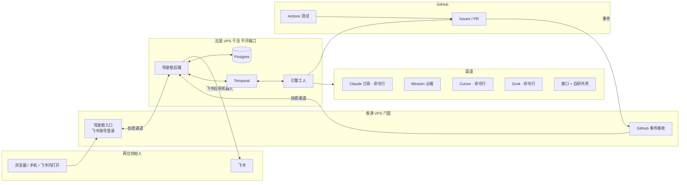
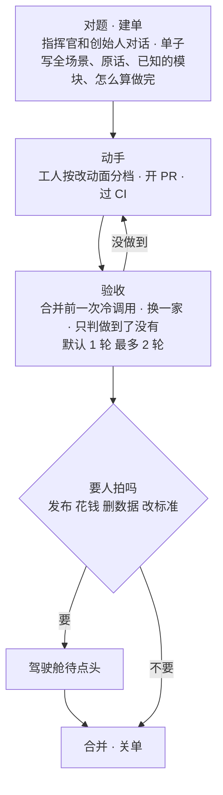

# fleet-dao 设计文档（讨论稿）

> 状态：现行流程是三段一条龙（对题 → 动手 → 验收，`docs/decisions/0010-three-segment-flow.md`，方案全文 `specs/509-需求梳理/流程重做方案.md`）；需求从驾驶舱「提需求」进，飞书只发手机通知（`docs/decisions/0090-intake-in-cockpit.md`、`specs/2047-提需求/方案.md`）。守哪些规矩看 `docs/goals.md`。本文档里 Fusion 的 0–7 步、库里认领、帅位座位等机制已被替代：正文凡写「已删」「已被替代」的以那句为准，不照旧做法实现。计划以 GitHub 为准（里程碑＝版本，没挂＝未排期），仓里不存副本（#654 删了 plan.md 快照），要看现在的计划跑 `pnpm plan`（现读 GitHub）。
> 起草：2026-09-25。参与：创始人 + Claude（Opus 5.5）。

## 一、一句话

创业团队的 AI 全流程：你们写任务，AI 从拆解、写码、测试、审查到合并全包；手上的多家 AI 订阅自由组合、互不闲置；驾驶舱里看得见、管得住。

## 二、为什么从零写

前身是 windsurf-dao（派工与规矩）和 ai-gateway-stack（渠道接线）两个仓。2026-09-24 的盘点结论：

| 现象 | 根因 |
|---|---|
| 没人盯就停 | 新任务要人亲手贴标签才开工；卡住的任务进收件箱，没有自动处理 |
| 订阅额度用不掉 | 派工从不走 Claude 订阅那条线；排序只会「用完就停」，没有「快清零的先用」 |
| 总断链 | 30 本账，一个月断 10 次：闸挂在没人跑的地方、写方漏分支而读方当没事、拿假样本验收 |
| 会话开太多 | 一单拆 4 个角色，审查不过就整轮重来，审查意见互相打转（windsurf-dao#1289、windsurf-dao#1338） |
| 并行撞车、落后主线 | 任务切得太碎、各开各的分支，做到最后才发现主线早就变了 |
| issue、PR 没人读 | 模板为流程和检查而写，又长又全，人不读，AI 也用不着那些套话；没有需求文档，历史无处可查 |
| 看不见进度 | 有的命令行会列任务清单，有的不会；做到哪一步只能猜 |
| 越修越重 | 代码 11.4 万行、测试 11.5 万行、99 项检查；近 30 天关掉的单约 90% 在修机制自己，开放单一半是机器给自己派的「这里该加检查」 |

所以不修补，从零写一个小而硬的核心。旧仓只当参考：好的做法搬过来，踩过的坑写成测试带过来。

## 三、已定（共识）

已定的事项一决定一文件，索引和现状在 `docs/decisions/README.md`；这里只留要常读的一条。

| # | 事项 | 结论 |
|---|---|---|
| 16 | 规则 | 一页原则（偏好 + 人闸 + 底线），其余写成代码和测试；创始人的全局规则与钩子同步精简。2026-09-25 创始人过目定稿：`AGENTS.md` 上半段是所有仓通用的一段，由同步脚本写进每台机器上各家 AI 的全局说明（只改受管的那一块），下半段只管本仓；别的仓的 `AGENTS.md` 由建仓或第一次进仓的 AI 起草，只写那个仓特有的（栏目固定，缺了由标准的补齐 PR 起草，15.7 第 9 条）；各仓都用得上的规矩提回这里改通用段，不横着抄（直接开 PR 改标准，15.7 第 12 条）。人闸就是第 4 条那四类；改通用段属于「改标准」，要创始人同意才合（第五节），日报列出改了哪几行。skill 走同一个同步脚本分发：方法类的 skill 放本仓 `agents/skills/`；旧仓的派工 skill、钩子、开会话自愈全部退役；GitHub 一律走 `gh`（创始人同日过目工具箱去留） |

## 四、架构



- **引擎工人（法国）**：执行 Temporal 派下来的每一步：起会话、跑测试、开 PR、合并、记账。不存状态，以后加机器就是加工人。
- **Temporal（法国）**：每个任务一条工作流。记下每一步的开始、排队、耗时、重试；接收驾驶舱的信号（暂停、叫停、换模型、批准）；接收驾驶舱的信号之外，旧系统约 30 个 systemd 定时器（额度探测、模型扫描、巡检、备份、续期互动限制）里留下的引擎定时任务不在 Temporal 里：是引擎进程里的普通定时器（#1072，`packages/engine/src/jobs/timers.ts`），只有任务工作流留在 Temporal（巡检那条长工作流随决定 0093 删了）。
- **Postgres（法国）**：驾驶舱要的一切都在这：路由配置（带版本）、用量与额度、战绩、进度、GitHub 镜像、通知、操作记录。有变化实时推到驾驶舱。
- **驾驶舱后端（法国）**：驾驶舱的所有读写都经过它——查数据、改调度台、叫停任务（给 Temporal 发信号）、开任务（经机器人写 GitHub）、实时推送、权限与操作记录，以及手机通知：把该推的提醒用飞书应用机器人推进团队群、记送达（`packages/api/src/feishu-push.ts`，运维说明在 docs/ops.md 每小时对账那一节后面；推不通由看门狗进「要你拍」）。推送分级：只有要你拍的（四类人闸和 AI 判定要创始人的）和每日简报马上推；卡住报警开满 120 分钟、主线红开满 60 分钟没自愈才推；其余不推，进引擎每天 08:30 的每日简报（推飞书、同时在置顶进度单 #1055 发评论，到没到只由看门狗判，决定 0096）。读数据只从 Postgres 读，不直接查 GitHub——快，也不撞 GitHub 的调用限额。唯一的例外是 /france 页的发版卡（`packages/api/src/release-card.ts`）：主线头、它的 CI 和最近合并的 PR 以 GitHub 为准、库里没有副本，所以只在打开那一页时现读一次，读不到照实说。
- **香港门面**：只当门卫和信使，不放业务逻辑——驾驶舱页面与飞书登录、收 GitHub 事件（飞书只剩登录和手机单向通知，通知由法国的驾驶舱后端用飞书应用机器人直接推，不再有香港上的飞书网关，决定 `docs/decisions/0090-intake-in-cockpit.md`）。和法国之间走加密通道。
- **为什么分两台**：实测调飞书接口香港 0.17 秒、法国 1.1 秒；Anthropic 对香港封区，Claude 等 AI 活只能在法国跑；`workers.dev` 在国内被 DNS 污染，不能当入口。
- **Cloudflare**：不再用。曾经设想过一个外部看门狗（定时 Worker，#292），一直没部署，#2369 删了：法国失联由香港探活（每分钟探法国 `/healthz`，ops 的「香港探法国」）看，香港由本机巡检看。备份去向见 ops 第十一节「备份与恢复」。

### 仓库结构

```
fleet-dao/
  packages/engine     引擎：Temporal 工作流与每一步的实现
  packages/adapters   渠道插头：Claude Code、codex、cursor-agent、Grok 命令行、接口外壳
  packages/api        驾驶舱后端
  packages/web        驾驶舱前端：看板 + 后台管理
  deploy/             一条命令装好整台机器
  specs/              需求文档（每个需求一个文件夹，见第七节）
  docs/               设计与决定
```

### 执行模式与容量

- **无头**：每个子任务在后台起一个命令行写码助手进程（Claude Code、codex、cursor-agent、Grok 命令行或自研外壳），不开窗口、没有界面会话；Mirasim 中转的路由也走它的程序接口。驾驶舱提供「直播」：实时滚动显示助手每一步在干什么。
- **Temporal 指挥，AI 干活**：派活、等待、重试都是确定性的工作流；AI 只在分诊、写方案、写码、审查和定时的 AI 指挥官出场。每个助手在自己的工作副本里干活，需要时在会话内部再起子代理。
- **插手**：「换模型」「暂停」让当前进程停在干净的点（做完的已提交），再按新设置接着干；临时追加的要求排进下一轮。暂停（含发版前的暂停）后点「继续」，动手那一段按会话号续上原会话（决定 0088，`packages/engine/src/workflows/task-session.ts`、`real/segment-resume.ts`）：同一棵工作树、同一个执行方式、同一个账号池、同一个会话用户，`runs` 里记着那一段的会话号，就用执行体的续会话起，提示词只补一句被打断的原因；续不上（没记下会话号、换了执行方式、池、会话用户或工作树、没查成）原分支原树开新会话，带上「树里有上一次留下的东西」，任务进度里写明为什么没续上。续起来没跑成的，下一次开新会话。发版重启引擎时，命令行那几家（claude-code、cursor-agent、grok）上的动手会话不暂停：会话脱开引擎接着跑，这一段交回 detached，工作流隔 20 秒带上 attach 再调同一段，新引擎从收发目录接回、等它收场（#2238，`real/session-handoff.ts`，ops 第九节「发布不碰会话」）；Mirasim 上的动手会话也一样（#2815）：服务端的会话不靠引擎的 ws 连接活着，放手只断开连接、不发 stop，新引擎按交接单里的会话号重新订阅；一家验的冷验收会话也一样（#2848）：coldVerify 交回 detached，工作流隔 20 秒带上 attach 再调同一次验收（`patched('cold-verify-attach')`），新引擎接回、结论照常贴照常认，结局记回原来那一行；两家都验的两个会话不脱开，发版叫停了、又没接回的不算验收没过，回 retry 重验一次（不算一轮，全程模式「冷验收被拒 2 次」也不数它）；整理这类短会话照旧暂停、续上。
- **会话断了接着干，不重来**：会话被额度、限流、进程被杀、引擎重启打断时，同一个账号池就按会话编号续上原会话，上下文都在；额度用满就挂起，到清零时间续同一个会话，不开新的（Claude 订阅池不干等到清零：引擎切号，切过去接着干，见本条末尾）。非换池不可时，引擎从库里拼一份接力任务书开新会话：原任务、步骤清单做到哪、最近的进度、工作副本里已提交的改动、还没处理的审查意见；已提交的不重做。法国只有一个会话用户，平时挂拼车组织；拼车用满时整个用户切到独享组织，手上的活先停下、切完接着干（三段的一次性会话在原分支上重跑那一段；见第九节）：同一台设备上切号，会让上面所有在跑的会话一起断（2026-09-25 构建期实咬：本机一次切号，总指挥和十几个子代理全断；把记录接回新会话后，各自从断点接着干完）。两种不再续这个号、改开新会话带接力任务书（#489）：这个号上一轮续起来没有第一帧（startup_timeout）；Grok 的号上一轮判了停滞、本来要同池 `-r` 的。
- **容量（6 核 12G）**：

| | 旧系统（实测） | 新系统（起步值，实测后调） |
|---|---|---|
| 同时在写码、验证 | 3 个任务（2026-09-22 负载 15 后封顶，windsurf-dao#1748） | 6 个会话（约 5 个子任务 + 1 个审查），压力低往 8–10 加 |
| 同时跑测试 | 全机 2 份 | 2–3 份（新测试秒级） |
| 一个任务占几个会话 | 2–4 个 × 返工轮 | 1 个主会话 + 需要时 1 个审查 |

- 旧系统那次负载 15，主要是机器在忙自己：5 个任务同时执行、一个工作副本里 13 个测试进程、一份 109 秒的全量检查、Mirasim 轮询 30 个工作副本、用量采集器每轮扫 1526 个文件。新系统这些都没有。
- **放行看三样**：内存与机器压力（不看整机 CPU 百分比）、账号池并发空位、额度够不够。真正的上限多半在订阅，不在机器。排队的任务在驾驶舱写明在等什么：等空位、等额度、等前一个子任务。
- 每个会话连同它跑的测试的内存上限，2026-09-26 按法国实测定（#164，原先按 1.2–1.6G 估，#160 在软 1.5G、硬 2G 里跑测试卡死），2026-09-28 按新一次断链改过推导（法国实测：单会话被自己那道窄墙——旧的三等分值——卡死，整机却还有 6.8G 空闲）：安全垫从「单会话」挪到父节点 fleet-agents.slice，总量上限 =（能分给会话的 11G − 平台常驻服务约 0.6G）≈ 10.4G，软上限低 512M；单会话硬上限放宽到「一次放得下 tsc -b 全仓 + 测试 2–3 个进程 + 代理本身」这种最坏组合，约 6G（约总量的一半），仍明显小于父节点总上限，多个会话同时冲高由父节点兜住；测试开几个进程按所在 cgroup 的上限算。算法在 `packages/engine/src/limits.ts`、`packages/conventions/src/test-run.ts`，单元文件在 `deploy/france/fleet-agents.slice`，运维见 ops 第五节。以后加机器就是加工人。

### 为什么用 Postgres

| | SQLite | MySQL | Postgres |
|---|---|---|---|
| 是什么 | 一个文件，嵌在程序里 | 数据库服务 | 数据库服务 |
| 多个程序同时写 | 容易「库被锁」（旧系统专门写了重试代码，windsurf-dao#1814） | 可以 | 可以 |
| 跨机器用 | 不行 | 可以 | 可以 |
| 数据一变就通知 | 没有 | 没有，要另加中间件 | 自带，驾驶舱实时刷新就靠它 |
| 存结构不固定的数据 | 弱 | 有 JSON 类型 | JSONB，能建索引，查得快 |
| Temporal 同库 | 只能单机开发模式 | 支持 | 官方支持 |
| 扩展 | 少 | 少 | 多：库内定时、向量搜索（以后按意思搜历史任务）等 |

引擎工人、驾驶舱后端、定时任务会同时写库，以后还要跨机器，所以 SQLite 不合适；MySQL 和 Postgres 都成熟免费，Postgres 多了实时通知、JSONB 和扩展这几样我们正好要用的。

## 五、一个任务怎么走完全程

> 本节写引擎里一张单怎么走完全程。现行流程有两种并存（决定 0105）：三段（对题 → 动手 → 验收，决定 0010，默认）和全程（动手会话一路带到合并，试点中）；需求从驾驶舱「提需求」进，飞书只发手机通知（决定 0090、`specs/2047-提需求/方案.md`）。下面凡标「已删」的是已被替代的旧做法，只作历史对照。



- **两种流程并存**（决定 0105；记账 `task_flow_assignments`、`tasks.flow_mode`、`task_rounds.flow_mode`，开关设置 `engine.flowMode`，名单和读法在 `packages/shared/src/flow-mode.ts`）：
  - **三段**是上图的样子，默认流程，也是对照组：动手、验收各是一个会话，CI 红或验收拒绝时由引擎另起一轮返工。
  - **全程**：同一个写码会话从动手带到合并。先出几行方案、自己跑改到的测试、提交；CI 红、和主线冲突、冷验收拒绝，引擎把失败的 job 名、日志尾巴或拒绝原因交回**同一个会话**接着修，不算新的一轮，整张单有推送次数和 token 的上限；等 CI 时会话不挂着，本轮先结束、有结果再续。上图里引擎做的那些事（推分支、开 PR、等 CI、合并）一样不少，只是失败后续的是原会话。
  - 两种的合并闸、冷验收、改标准人闸完全一样，写码用同一个模型。全程现在只在 fleet-dao、只走 Claude Sonnet 5.5 这一条路由；碰迁移、合并闸、凭据、权限、任务工作流、发布脚本、改标准路径的单、跨仓的单一律走三段。
  - 怎么分组（单上贴「全程」「三段」标签，没贴的按单号哈希并按档位分层对半分，分组一次定下不改）、成功怎么算、非劣效边界、样本量、三类止损各怎么算和谁来判，都在决定 0105；每日简报「流程健康」按模式分两栏对照（`flowModeHealth`），两组都不满 30 单只写「还不够判」。
  - 「低风险单免冷验收」不在这套里，另做独立试验。
- **合并前的验证（冷验收）怎么做**（#555；原来开 PR 前的验证零件 `workflows/verify.ts` 已随 Fusion 删除，见本节「合并闸」）：
  - 只派别家：写这张单的会话用过的族（库里按这张单起过的会话现查，验证、审查的不算）整族避开，点名的、续会话的路由也一样；渠道自己挑模型的（Cursor Auto 这类上游串是 auto 的）认不出这次是哪一家在答，也不派——验证要用钉住型号的路由。作者族认不出（cursor、目录里拆不出又按模型 id 也认不出的）两家都验；目录记成 unclassified 但模型 id 一看就知道是哪家的（`cursor:gpt-5.4-mini-high`）按那一家算（`packages/db` 的 `authorFamilyOf`；任务工作流交给验收的作者族也按它记，选路时算好随路由带回，决定 0093）。别家一条都派不出时用作者族起一次全新的冷会话兜底（同族兜底验，#1731），会话起不来换下一条路由、下一族再验，都试遍了才停下等人。
  - 喂给冷验收的材料（决定 0093）：需求原文、diff、PR 正文、引擎跑过的测试输出（有才给）。验收只判「怎么算做完」各条在材料里成不成立：建议类意见（含验收条原文写明「不挡」的）只进备注、不挡；要 diff 以外证据的条目（截图、现场、线上数据、审计结果）验收方标「不归我验」，不算没过、不回炉，引擎留言到单上转给人验。「怎么算做完」里只要求某某测试、检查、构建或类型检查通过的条目归合并闸的 CI：冷验收不核对、不因测试输出里没出现它（写了「没跑」「跳过」、没有这一条的输出也算）判不过，只有测试输出里明确写了失败才写成问题。读不到的文件 diff（GitHub 没给又补读不成、放不下的）跳过并在 diff 里注明，一个文件都看不到才算做不出来。
  - 判界面（碰页面代码的按界面类派，GPT 不验）、给验证方的「改了哪些文件」、PR 正文的「文档」一栏，都按推上去的头相对主线的净改动（推分支那一步并完最新主线后算的 `git diff 主线...头`，和 PR 在 GitHub 上看到的同一个口径），不按会话一轮轮交的累计。会话交活时「这一步改了什么」也扣掉它在树里并进来的主线（`packages/engine/src/real/user-git.ts` 的 `ownSpan`；只并了主线、自己没写东西的判没交付）：#293 那次按「起会话前的头..HEAD」算，把主线上别人改的健康页算成这张单改的，验证按界面类派，写它的两族之外只剩 GPT，干等了 47 分钟。
  - 验证会话检出送检的头、只读，结论写 `.fleet-out/verify.json`（core 的 `ReportSchema`）。
  - 结论只经 core 的 `decideVerdict` 判（本地活动 decide，进历史）：交回的认不出、审的不是送检的头、漏答、派成了同族，一律作废、记一笔、挂起等人，不当成过了；Lead 拿证据驳回也经它判，只认驳能挡的、带证据的。交回的「怎么算做完」和驳回的对象按 core 的 `criterionKey` 对：只抹反引号、加粗斜体、全角半角、中英文之间的空格这类不改意思的格式差别，对上了换回清单原文往下传；规范化后还对不上、两条撞成一条、漏答的照旧作废（#246 验收撞上的：模型抄的时候去掉了反引号，逐字比判成清单外、整轮重跑）。每一轮和驳回记进库 `verify_rounds`；结论写成 PR 正文「怎么验证的」「还欠什么」几行（core 的 `verificationLines`）。
  - 和 CI 同时起（决定 0093，`packages/engine/src/workflows/task.ts` 的 `deliver`）：推上 PR 之后等 CI 和冷验收一起跑，两样都过才挂自动合并。CI 不绿（红了、冲突、已合、仓切成不强制）就不认验收那一边的结果（不算一轮），当场取消那一次验收（Temporal 取消它自己那一层范围，只取消它、不碰动手会话；验收会话随之被杀，省一次验收会话的 token），按 CI 的返工走；验收已经跑完、结果交回了再取消不发命令，取消送到之前先跑完的结果照样回来、照样不认。CI 绿了再等验收的结果、认了才算一轮，没过照常返工。等 CI 时引擎自己并主线换了头，验的旧头不算，对新头再验一次；不是引擎换的头照旧停下等人看过。
  - 轮数照 core 的 `nextFlow`：默认 1 轮、挡了回第 4 步改完再验，最多 2 轮，还挡就停下等人（这张单头一回用尽先自动换路由续一次，见第十二节「停下之前先自动处理一次」）。验证结论不写成提交状态（合并闸只认 `cold-verify`，2026-10-06 起第二意见这一道没有了）。

- **需求拍板期**（创始人 2026-09-25 拍）：每张需求分诊后先进拍板期，默认 30 分钟（每个项目可调），这段时间 AI 不往下推。拍板期能在驾驶舱上延长、暂停、跳过。有人在讨论（驾驶舱「提需求」页里有新消息）就等讨论完；没人讨论，到点 AI 自己定方向往下做。到点时 AI 先把这张需求在「提需求」页的对话读一遍，和需求原话一起归纳成拍板方案（结论、还没定的问题、每条出自谁的原话），写进需求文档。归纳前先判「信息够不够下结论」（Jev 判断题：够不够、缺哪几条）：不够就在对话里列出缺的问题，拍板期自动顺延；够了再分重大、小方案。判为重大，或对话里的人意见有分歧，自动接进讨论环节（下面「讨论」，创始人 2026-09-26 拍）。（2026-10-13 起飞书不再收话，需求的讨论和拍板在驾驶舱「提需求」页，见 `docs/decisions/0090-intake-in-cockpit.md` 和 `specs/2047-提需求/方案.md`。）
- **重大方案人拍，小方案 AI 拍**：重大 = 碰四条人闸（对外发布、花钱、删数据、改标准），或和本文档已拍的规则冲突，或要新加外部服务、改架构、改阶段划分；其余都算小方案，AI 拍了直接往下做，理由写进需求文档，日报里列出。重大不重大由分诊判，判不准的按重大算。这条判据只管 VPS 上引擎自动派的模型；交互会话（指挥官、本机子代理、各家 CLI 会话）只为两件事问创始人——要掏新钱、要删找不回又没备份的，对外发布、改标准自己拍、事后报（`agents/shared-rules.md`，决定 0097）。**反过来同样算错**（创始人 2026-10-01 拍）：已经判明不碰要问的那几件（引擎是上面四条人闸，交互会话是那两件）、也不是和已拍规矩冲突、不新加外部服务、不改架构或阶段划分的，就是 AI 自己拍、接着做，只有事后报结果，不许写成选项来问——通用段「其余你自己定」里的「其余」是默认的那一边，不是兜底。判不准**是不是**碰那几件时按碰算（问）；判明不碰、却为了「省得创始人怪我没问」而问，同样是错：他只看得到每轮最后一条，一堆其实不用他定的选择题会把真正要定的那几件盖住。同类事问过一次、他也答过的，往后照那次办、只报不问。聊天记录本身不算拍板，引擎只认需求文档。
- **流程只为快，不当绊脚石**（创始人 2026-09-26 拍，照数据：机制少的头 8 小时合了 17 个真功能 PR；第二天加满关卡的 5 小时，30 个 PR 里 22 个在改流程本身，产品只有约 1700 行）。先上线，出了问题再改。量两个数看流程有没有变好：每天合进去的产品 PR 数、从开到合的中位时长。
  - **合并前只拦一样**：CI 绿（测试、类型、格式）。检查一律取主线上那份代码来跑，PR 改不了自己的检查（#74 合并闸）。卫生检查（真密钥）也在 CI 里跑，但改成只报不挡，不进 `check` 的必过名单：真正挡的是推之前——`.githooks/pre-push`、引擎推分支和写公开内容前的扫描，查出真密钥就不推、不写（账号、组织编号、邮箱、IP 这类标识不算泄漏，不拦，创始人 2026-09-28 傍晚拍，specs/169-Fusion形态/需求.md）。
  - **CI 一律全套**（`.github/workflows/ci.yml`，计划和汇总判法在 `packages/conventions/src/ci-plan.ts`，决定 0101）：PR、主线推送、每夜、手动都跑全部——`lint`（biome 整仓、tsc 整棵树、文档指针 `doc_pointers`、技能测试 `agents_test`、deps、release_smoke、卫生检查）、全部单元测试（按耗时装箱分台，并行）、web 打包、驾驶舱 e2e 全套（两种屏宽，切 2 台）、`deploy/test/run.sh` 全套（切 3 台）。原来按改动预测只跑一部分，漏的到主线才红（近 7 天 18 轮、234 分钟）；全套墙钟 3.4 分钟，只比选测多 1 分钟上下。只留两种「输入完全相同才跳过」：PR 上某一台测试的输入没变、上一轮全绿就复用（`packages/conventions/src/ci-cache.ts`）；主线提交和某次成功的 PR 检查是同一棵树就整轮复用，test、web、e2e、deploy 都跳过（`packages/conventions/src/main-reuse.ts`，树对不上就全套）。本机推前仍按改动选（`pnpm test:changed`，只改到包的面以外——`exports`、`bin` 顺着包内相对引用走不到的入口脚本、包内模块、测试——只测这个包自己，判法 `packages/conventions/src/package-surface.ts`），CI 全套兜底。`lint` 里几步并在一个 job（一个 PR 少占几个并发槽，免费档同时只能跑 20 个；装依赖只装一次，几步各自 continue-on-error、汇总步逐样核对都绿了，biome 先红不会吃掉 tsc，卫生检查红了只打警告；CI 里卫生检查只在 lint 的一步里跑，文件树和提交历史两遍都在这一步）；卫生检查执行的是目标分支上那份卫生检查代码、PR 的代码只当数据扫，防的是 PR 自己改宽规则当场就用上（PR 改规则、白名单要合进去才用上）；它除了扫 PR 最终的文件树，还按提交扫 base..head（先加后删的、提交说明）。驾驶舱 e2e（`packages/web/e2e`）既是合并闸也是发版闸：发版只认主线头 CI 全绿，所以它红了不发。它每个 Playwright worker 一整套环境（自己的库、后端、门面），worker 开到核数，全套切 2 台；首跑红重试一次，重试过了算偶发（flaky）不算红；近 10 轮偶发（重试才过）2 次的由 `e2e-flaky.yml` 自动开单（限期 7 天；重试也红的真红不算；一轮超过 5 条只开一张汇总单，一次扫描最多新开 3 张，#2735），跟单的人把它放进隔离集（`packages/web/e2e/quarantine.json`，照跑照报不挡；隔离集不在 ci 里跑，由 `e2e-quarantine.yml` 每天定时跑一次、可手动触发），修好了删掉（`packages/web/e2e/README.md`）。PR 上新的一轮挤掉旧的；main 推送按提交号分并发组，每个提交各跑各的、一个都不挤掉，合并再密每个主线提交都有自己的结论（发版只发自己的 CI 绿了的提交，#362，ops 第九节「发版」）。必过检查 `check` 是汇总 job：plan 必须是全套（或主线同树复用），该跑的必须绿、复用时该跳过的必须确实跳过（卫生检查例外：它每次都跑，但红不算进这条判定）；按改动选出来的 plan 交给它就红。测试读包外文件（`docs/ops.md`、`AGENTS.md`、别的包的源码）的清单也在 ci-plan.ts，`ci-plan.test.ts` 扫测试源码核对，漏记一条就红。
  - **PR 上的测试分片结果缓存**（`packages/conventions/src/ci-cache.ts`）：同一个 PR 重推时，test job 里某一台（engine 1/3、db、rest 2/3……）的输入没变、上一轮又全绿，就不再跑 vitest（job 照常绿，跳的只是那一步）。键盖住分片参数、被测单元和向下依赖闭包的整棵源码、`TEST_READS`、根配置、工作流、`deploy/`、`agents/`、夹具、被 vitest 收的测试文件、环境身份（node、vitest 版本、有没有真 Postgres、Temporal 版本、日期）；命中后不信键，清单里每个文件的哈希重算比对，对不上、清单坏了、不 complete、缓存读不到一律真跑，只在整台全绿后写清单。缓存按 ref 分作用域，只有这个 PR 自己的重跑读得到；**主线推送那一轮是自动发布的闸门，一个测试都不许跳，缓存每一步都认事件名、只在 pull_request 上动**。
  - **所有 PR 只看 CI，不再有第二意见这一道**（创始人 2026-10-06 14:25 拍：「B：全去掉，连删数据也只靠 CI，风险是迁移误删表。」，决定 0023，#1114；替掉决定 0016 那套先审后合 / 第二意见合并闸 / 合并后补审，起因是 #1113 只改了法国期望配置里一个巡检仓名字也被挡着等第二意见，一次审查要几分钟到几十分钟）：迁移里有删改语句、碰密钥鉴权、CI 工作流和卫生检查、对公网开口子的生产配置的 PR，和别的改动一样 CI 绿就合。改坏了：CI 的整套测试和部署测试大多拦得住；上线后才发现的，发布脚本健康检查不过会自动退回上一版，也能手动 `release.sh --rollback`。**已知风险：迁移误删表只靠 CI 兜**（没有人审那一眼）。要回头：git 历史里决定 0016 那套（`second-opinion.mjs`、`high-risk-paths.json`、合并闸里改到先审后合路径要 `second-opinion` 状态那一条）。
  - **CI 绿就合，合并后不补审**（0002 第 4 条，2026-09-27 定稿时落进本节；2026-10-06 起没有例外，见上一条）：别家把关挪到开 PR 前——引擎的单在合并前由换了家族的冷验收核「怎么算做完」；指挥官派的活：工人用 `pnpm pr:open` 开 PR、当场挂自动合并（CI 绿就合；改标准的正文贴创始人原话再挂，见下面「人闸第四类：改标准」），不盯 CI，红了才回来修（2026-10-05 创始人同意改；全仓审查量出 40 个 PR 里 9 个没挂自动合并、靠手动合，绿了闲着共 3993 秒）。
- **第二意见换厂商**（同日拍）：同一家的模型审自家写的，会偏向自己（[Panickssery 等，NeurIPS 2024](https://arxiv.org/abs/2404.13076)）。写码是 Claude 时，第二意见默认用 Mirasim 云端额度的 gpt-6-luna；界面类用 Gemini（GPT 不碰界面）。这是调度台里第二意见阶段的默认顺序，不是硬闸。
- **讨论**（创始人 2026-09-25 定，2026-09-26 收窄，同日拍成一张单流程里的一个环节；和审查是两回事：审查看代码，讨论定方案。原来的盲设计题就是讨论的第 0 轮，是同一种东西，不另算一样。做成什么样见 #69）：
  - **什么时候讨论**（创始人 2026-09-26 拍）：只在重大方案时触发，判据就是上面「重大方案人拍」那一条（碰人闸、和已拍规则冲突、新加外部服务、改架构或改阶段划分），VPS 引擎和本机总指挥用同一条；小方案 AI 直接定，不讨论。触发点有两处：拍板期到点归纳时判为重大或群里有分歧；规划阶段写方案时碰上重大方案。人随时可以主动叫一次：驾驶舱需求卡上的「发起讨论」按钮（飞书群里 @机器人 的叫法已取消，见 `docs/decisions/0090-intake-in-cockpit.md`）；总指挥会话用 `fleet discuss` 发起（第八节）。
  - **讨论是一条记录**：库里一张表；驾驶舱的「讨论」页（15.5）只是这个环节的视图。一条讨论记下：题面；第 0 轮各家独立答；之后每一轮挑错；每家的答案和耗时；谁没答上、为什么（超时、起不来、没输出）；各家一致的、还剩的分歧、总指挥推荐哪个，对方每条意见收没收、为什么；拍板结论和当时方案的版本。每条讨论挂在一张需求上，或一个 PR 上，或「规矩」这类没有需求的决定上（改 AGENTS.md、design 的）。
  - **状态**：讨论中 → 等你拍（重大的）→ 已拍板；人主动叫的小方案到拍板期按推荐做，走 讨论中 → 已定，理由写进需求文档、日报里列出；单子里问创始人的一句不走这几个状态，照下面「没人拍板」不挡路。一家都没答上算「没讨论成」：停在讨论中、提醒总指挥，不拿总指挥自己的方案冒充讨论结论；有几家没答上照样往下走，结论里写明哪几家没答上，不当成「同意」。
  - **怎么问**：先把问题本身（不带自己的方案）并行发几家各自独立答，再把自己的方案连同它们的答案发一家挑错；挑错前先推演：从创始人的角度把全程走一遍，按阶段列边界和最坏情况、每条写怎么收尾，写上对照的成熟案例，写成题面里的【推演】段，缺了本机工具不发；每轮不读仓、限字数、每家有硬超时（起步 400 字、30 秒，第九节「讨论」阶段的配置）。材料里附上相关规则原文和证据（对方看不到仓）。交给人拍的：先结论和推荐，再各家一致的、还剩的分歧，推演出的边界表附在后面，最后写还拿不准、要人补的。
  - **能接着聊**（2026-09-27 定稿，0003 第 14 条；替掉原来「AI 自动挑错最多 2 轮、人回复后最多 3 轮、到数就停」）：同一场讨论各方保留自己的会话（codex `exec resume`、cursor-agent `--resume`），随时拉起接着聊；停在三种时候——收敛、分歧定型（主张没变、证据没新增）、到轮数和额度上限；重新拉起要写明能改变结论的新证据。本机会话的讨论规矩在 AGENTS 通用段，随改标准的 PR 改（0003 第 19 条）。
  - **结果怎么给人看**（创始人 2026-09-26 拍；2026-10-13 起不再有讨论群和结果卡，见 `docs/decisions/0090-intake-in-cockpit.md`）：结果只在驾驶舱里：一致的、分歧、推荐，每个选项一个按钮，推荐的放第一个。同一条讨论只有一份，状态变了原地更新。飞书只发一条手机通知，带驾驶舱链接。人可以点按钮拍板，也可以在「提需求」页回复；只有带了新材料的回复才再跑一轮挑错（Jev 判断题判「是不是新材料」），不是新材料的回复只记下、不重跑。
  - **拍板怎么走**：创始人在驾驶舱里点了哪个，引擎把结论写进这张需求的需求或方案文档，并写明拍的是方案的哪一版（方案文档当时的提交号：方案后来又改了，结论不自动算到新版上）；挂「规矩」的写进 AGENTS.md 或 design，由引擎开 PR。讨论变「已拍板」，需求卡上显示结论链接。聊天记录不算拍板，引擎只认仓里的文档。
  - **没人拍板**（创始人 2026-09-26 拍；2026-10-07 #939 改：不设追问）：他多半不在场，问他不许卡住活。重大方案到拍板期还没人点，停在「等你拍」、不自动执行，引擎照常做别的需求；小方案到点按推荐做。动手会话没有「向创始人提问」的命令（`fleet ask`、`/agent/v1/ask`、驾驶舱「回答追问」都删了）：碰到要人拍板的，报 `fleet blocked`，任务停下（`task-runtime.ts` 的 `park()`），人在驾驶舱点「继续」或「放弃」，只有这一个收信处。只有他本人才有的东西（账号、权限、登录）报 `--needs access`，这一块等他，这张单其余部分照做；碰人闸四类（对外发布、花钱、删数据、改标准）的只挡合并那一步。对题阶段的追问是指挥官当面问创始人，问清了才开单（`docs/goals.md`）。库里的 `asks` 表留着、没有读写代码，确认没有读者后可以直接删（决定 0097）。
  - **飞书不可用时**：通知发不出去（飞书接口报错、超时、额度用完），这条讨论照样进驾驶舱提醒中心的「要人拍」（15.3）等人，驾驶舱上写明「飞书没发出去」和原因；飞书恢复后补发那一条。平时等你拍的讨论也同时在「要人拍」里，两边点哪边都算。
  - **渠道**（创始人 2026-09-26）：讨论提速暂时搁置，现在以 Cursor（cursor-agent 无头、只读）和 Mirasim 云端为主；OpenRouter 这类直连接口排在 P3，做成什么样算完见 #118。参与哪几家、每家走哪条渠道、超时和并发都是调度台「讨论」阶段的配置（第九节）。引擎接活之前，本机的实现是 `agents/skills/discuss/scripts/ask.mjs`（随 `discuss` 技能由 agents-sync 装到每台机器，记录在 `~/.local/share/second-opinion/runs/`）：默认只问 GPT，要多家时经 cursor-agent 并行、30 秒上限，2026-09-26 实测 GLM 21 秒、Kimi 25 秒、GPT 27 秒，Grok 常超时；这台机器没装、没登录 cursor-agent 就直说，不当成讨论过了。
  - **依据**：2026-08-14 第一次三臂盲设计，两个守住盲的臂独立得出同一个答案，证明「各自独立答」能给出收敛信号，但每臂起完整会话、读仓外中性目录，一轮要几十分钟；2026-09-25 创始人把总指挥的分析手贴给网页 GPT，20 秒拿回把框架推进一步的反驳，于是改成一问一答（同日实测 medium、限 400 字 12–20 秒一轮，#69 的讨论稿就这样出的）；2026-09-26 创始人指出方案没推演就交、漏洞全靠他挑（「你好像把思考也当成做事情了……没有想着去验证一下这个思路」，例子是统领单「开单时自动挂上」会让母单永远关不掉），于是挑错前先推演、工具拦缺【推演】的题面；2026-09-26 本机五家齐跑、工人又把进程数顶满，宿主崩过，所以同时最多几家要限（起步 3，第九节）。
- **发现问题当场修**（创始人 2026-09-26 拍，替掉 #87 的「合并后的问题开单攒着」；2026-09-27 定稿第 19 条改成分急缓：急的当场修，其余开小单、按版本修，0003 第 19 条）：
  1. 急的谁发现谁在同一轮里修——坏了的（主线红、生产坏、数据、泄露、安全）、挡住当前版本的、正在做的那张母单范围里的、创始人说「现在修」的：改、推 PR、挂自动合并，不开单、不派工人、不先请示。PR 本身就是记录，修不完的也先开 PR 挂上。只有要掏新钱、要删找不回又没备份的先问（决定 0097）。其余开小单（`pnpm issue:new`，写清怎么算做完），进未排期或当前版本，按版本修；引擎只有带证据的急修能自己开单（0003 第 8 条）。
  2. 流程、规矩上的漏洞（该拦的没拦住、该有的没做到）同样分急缓；修都修在动作必经的那一步（脚本、检查、钩子）；修的是闸门或检查（拦东西的那一步）的，配一条故意造出失败的测试证明堵上了，普通读取路径只要返回明确的失败；只在文档里加一句不算修。本机的脚本、钩子改完当场验证。
  3. 已上线的真问题先回退再修；主线坏了（必过检查红）立刻修，修不简单先回退，修复 PR 写清是哪次合并弄坏的。
  4. 修复正好在某个开着的 PR 的范围里才修进那个 PR，不相干的另开。
  5. 必过检查分两种说准（创始人 2026-09-27 晚拍，#299；原来笼统写「必过检查必须确定」）：CI 里跑的检查（汇总 job `check`；本机的 `pnpm check` 是同一套判法的子集：格式 + 类型 + 改到的测试 + 卫生检查，默认只跑改到的、全量加 `--all`，决定 0093）必须确定——只看检出来的文件，同一份代码什么时候跑结果都一样；依赖外部状态（单子开没开、时间、别的仓）的检查放进定时任务，只留言，不挡 PR。反例：#83 把「推后的话挂的单号要开着」接进了 `pnpm check`，#67 一关，所有 PR 跟着红。合并闸 `merge-gate` 是另一种：它本来就汇总 PR 此刻的状态，只看各项检查的结果（引擎任务 PR 的冷验收 cold-verify 也算一项；第二意见 2026-10-06 起不再是，决定 0023）。#299 起曾多认一样引擎机器人贴的「认领对得上」（判的是库里随时间变化的认领记录）、#325 起曾多判一样 PR 自己的内容（正文写了关单词、或「这个 PR 做完就关单」填了「是」的，要带那张单的 结果.md，见第七节「关单要有证据」）；2026-09-28 下午拍（#444）把这两样都挪出了合并闸：它们拦的都不是改不回来的事，#431 就被这两样连红 3 次、原因说不清停下等人；缺认领、缺结果都改成每天的关单对账事后发现、留言，不再挡 PR（#654 又把 结果.md 和关单对账整个删了）。往合并闸的判法里加别的（单子开关、时间……）会被 `packages/conventions/test/merge-gate-inputs.test.ts` 拦下，要加得先改这一条。
- **人闸第四类：改标准**（创始人 2026-09-26 拍；原来三类是对外发布、花钱、删数据）：改 fleet-dao 里推给各仓、各机器的那份标准里的规矩。现在这是挡 VPS 上引擎自动模型的护栏：引擎开的 PR 没有创始人原话，碰了就合不进；交互会话自己拍，开 PR 时正文贴创始人原话（他这次说的，或他授权指挥官拍板的那句），事后报（决定 0097）。范围按路径列在 `packages/conventions/standard-paths.json`（每条写为什么）：AGENTS.md 通用段、技能说明（`agents/**/*.md`）、钉住规矩的测试（`agents/test/rules/`）、同步工具的目标清单、这份清单本身。技能脚本、同步工具的其余代码修 bug 不算，CI 绿就合（创始人 2026-09-27 收窄：「以后技能里的脚本修 bug 我自己拍，只有规矩文字给你看」选项 1）。
  - 规矩不能藏进脚本绕过去（GPT 2026-09-27 挑错）：脚本里的判断一旦改了规矩（比如别的机器在做也去碰），`agents/test/rules/` 里钉住它的测试会红；要改那条测试，就是改标准。技能说明只写做法；描述脚本自己怎么动的事实写在脚本头注释里，不进说明。
  - 碰没碰按改动路径自动判，不看 PR 自己怎么写；判中了自动贴 `人闸` 标签，只作显示（第七节「标签与里程碑」）。
  - 进驾驶舱「要人拍」（15.3）和飞书；1 天、3 天还没点，各再提醒一次。
  - 合并闸按路径判（决定 0093，`packages/conventions/src/merge-gate.ts`）：PR 改到的文件（改名的新旧名字都算）落进清单，正文里就要有创始人同意的记录——一行 `**创始人原话**：「<原话>」（<时间>）`，原话、时间都不能空（`pnpm pr:open --founder-quote "<原话>" --at "<时间>"` 写的就是它；认法只有 `pr-columns.ts` 的 `founderQuote` 一处，开 PR 那一步的 `--founder-approved` 用同一个）。缺了 `merge-gate` 判红，点名碰了哪些路径、写明缺创始人原话；文件列表读不到、超过 GitHub 给的 3000 个读不全判「没查成」。清单用主线上那份（闸检出主线），PR 改不了自己的门槛；PR 正文改了（补上原话）闸也重算。
  - 交互会话正文贴原话和时间直接挂自动合并，不等他（决定 0097）。不认 GitHub 账号的批准：本机 gh 登的是创始人的账号，只认账号批准会被 AI 冒名。
- **流程冻结**（同日拍）：不再为「可能出事」加关卡。只有真出了事（主线坏、数据、泄露、安全，或同一个坑踩第二次）才改流程；改的时候当场做、一个小 PR，PR 正文写明是哪次出的事。规矩只写在 AGENTS.md 和这一节，别处只放指针。
- **关卡的时间预算**（创始人 2026-09-25 定）：该砍的是人工串行，不是质量——检查尽量并行、自动、只管自己那一块。派活 1 分钟内，会话 2 分钟内起来，测试并行跑，所有 PR 只看 CI（不再有第二意见），合并和 issue 状态自动更新。要加关卡先答三问：挡什么风险、多出多少延迟、能不能自动化；答不上来就不加。
- **引擎接活之前，本机照这一节走**：开单、需求文档、方案、PR、验证、合并，步骤和叫法都一样，只是由本机会话来推；PR 的第二意见这一道 2026-10-06 去掉了（决定 0023），只看 CI。切换点（创始人 2026-09-25 拍）：#53、#56、#58 三个旧 PR 清完、#74 的合并闸上线之后的下一个 PR 起，一律按新流程，不再有「这个 PR 按旧办法」的例外。
- **合并闸**（#74；#444 起只留这几样）：「能不能合」只看 PR 当前头上的提交状态 `merge-gate`，全绿就由 GitHub 自动合并，AI 不轮询、不手动合。判红只有两样（#1114 起；决定 0023 去掉了原来改到先审后合的路径要第二意见那一样，别的 PR 只看 CI）：一是碰了改标准路径、正文里没有创始人原话（决定 0093，见上一条「人闸第四类：改标准」）；二是引擎任务流程开的 PR（按分支名认，`fleet/<单号>-t<8 位>`，`packages/conventions/src/flow-branch.ts`）当前头上没有引擎机器人贴的通过的 `cold-verify`（合并之前那一遍换了家族的冷验收，由任务工作流在挂自动合并之前贴，`specs/632-三段总调度/方案.md`；没有这条状态判「还没验」，不是放行；人手开的 PR 不要这一条，免得永远卡在没人起的那一遍上）。读不到、认不出判不通过（写明「没查成」）。草稿、和主线冲突 GitHub 本来就合不了，#654 起闸不再判；PR 正文没有必填栏了，闸也不再提醒。写了关单词却没带那张单的 结果.md（第七节「关单要有证据」）、挂了单却没有引擎机器人贴的通过的「认领对得上」（#348，认领账已删）这两样，#444 起也不挡合并了（创始人 2026-09-28 下午拍，`specs/169-Fusion形态/需求.md`「删减清单全按帅位的做」第 4 条：这两样不是改不回来的事，#431 就被合并闸连红 3 次、原因说不清停下等人；缺结果的原来由每天的关单对账事后发现，#654 把结果.md 和关单对账整个删了）。PR 事件（头变了、正文改了）、cold-verify 状态写上来时（也逐个重算所有开着的 PR：status 事件排队只留最新一个，只算事件里那个头会漏掉前面的）各算一次；主线推送只在闸认的东西（判法、改标准的路径清单、工作流本身）变了才触发、也重算所有开着的 PR——判法收紧了，开着的 PR 上旧的 success 不能留着（#654 第二意见；触发路径盖得全不全由 `merge-gate-inputs.test.ts` 钉住）；判法和清单用主线上的那份（`packages/conventions/src/merge-gate.ts`、`packages/conventions/standard-paths.json`、`.github/workflows/merge-gate.yml`）。和主线有冲突的 PR，GitHub 自己就显示、也合不进去，不再另贴标签（#654 删了 conflicts 工作流）。受管仓可以选不强制 CI（驾驶舱项目设置，默认强制；没把模式传进闸时仍按强制）：这种仓的引擎任务分支不要求 cold-verify，由引擎直接合并，不借机放行别的仓。
- 每一步都能在驾驶舱看到用的哪条路由、花了多少、耗时多久。
- 「我理解为」卡片不挡路：活照常开工，看到理解错了点「改一下」，任务停下重新规划。
- 卡住了按「下一步该干什么」处理（第十二节），不再默认停下等人。

## 六、任务颗粒度与合并（已定）

> 层级是版本 → 母单或单独的小单 → 子单 → 块（决定 0010 替掉了 0003 的 Lead 按块循环）。

旧系统的毛病：一张 issue 一个工人、各开各的分支；颗粒太碎就并行撞车，分支活得久，做完才发现主线早变了。

做法：

1. **层级**：GitHub 上是版本（里程碑）→ 母单或单独的小单 → 子单（GitHub 子议题，别人开的具体问题）。Lead 规划时拆出的块不开成单，只存在引擎里、驾驶舱看得到，免得单子爆炸；母单页面自动显示子单进度，GitHub 上也看得出脉络。
2. **拆的时候就标出会动哪些地方**：Lead 规划时每块写明要改的文件或模块，以及依赖哪块先做完（写在方案和任务简报里，见第七节）。
3. **不撞车的调度**：会动同一块地方的不同时跑——两张母单要改同一批文件的不同时跑，排队，或交给同一个 Lead 连着做；一张单里拆得开才同时派副手（最多 3 个），先定接口和谁改哪些文件，各在自己的工作副本里改，Lead 逐个合进来、每合一个跑一遍测试。
4. **永远从最新主线起步**：开工时从最新主线建工作树；交审前先同步最新主线，有冲突当场解决；主线一变，在途分支自动同步。分支活不过一天。
5. **合并靠 GitHub 自动合并、CI 全套兜底**：验收通过后挂自动合并（squash），必过检查 `check` 绿了 GitHub 自己合；引擎直接合时核头、核不落后主线、核 CI 绿，落后主线就把 PR 同步到最新主线、对新头重跑 CI 和验收（`packages/engine/src/real/task-activities.ts`）。不排自己的合并队列，也不用 GitHub 的（要组织账号，本仓归个人账号）：PR 和主线的 CI 一律全套（决定 0101），「两个 PR 各自绿、合起来红」近 7 天一次都没有，主线红的根子是 PR 上只跑了一部分。
6. **颗粒度有目标**：一个 PR 是一个能单独验证、单独回滚的变化——够小，很快验得完；够完整，能单独合进去（创始人 2026-09-25）。大约一个会话一小时内做完；同一块地方的零碎小单合并成一个子任务一起做；不为了小把一件事拆成一串没法单独验证的碎 PR；太大的继续拆。

### 断链怎么被发现

旧系统断了没人知道，是因为没有东西盯着整条链。创始人 2026-09-27 问「我希望断链了能及时发现，下午就没做到这一点，怎么办」，同日定下原则：「我认为你补上的机制应该是fleet引擎的核心链路，是要保存在仓库的，换台机器一样好，才行」。所以兜底的几层都做在引擎里、进仓、跑在法国，换哪台机器干活都一样（从外面看法国的是香港每分钟的探活，脚本同样进仓）；指挥官会话里的临时检查只算垫片，不算哪一层，对应的那层上线就删。五层兜底：

1. **能断的地方少**：一件事只存一处，只认 GitHub、Postgres、Temporal 三处（外加仓里的需求文档）。
2. **按进展判死活**：每个任务都是一条工作流，一段时间没往前走就报「停滞」，不靠认错误长什么样（进度见第八节）。
3. **主线 N 小时没合 PR**（决定 0093 替代决定 0052 的全流程巡检：原来每 6 小时在巡检仓真跑一整张单，开销是一整张单的会话和 CI，而链路断了照样要等到下一轮巡检才知道；现在直接看结果）：看门狗（第 5 层）每 5 分钟看一遍每个开着「让 AI 接活」的项目，从最近一次合并（没合过就从开关打开那一刻）算起超过 4 小时没合任何 PR、而这段时间引擎手上有单在做或有过了准入只因没空位没起的单，就推一条卡住报警（提醒中心加飞书，一件事一张卡，键 `watchdog:merge:<项目>:<段>`），合了一个、没有待做的单了、开关关了自己撤、正文开头写为什么；同一段里人点了「处理」的不再打开。N 取 4 小时的依据：2026-09-30 到 10-14 主线 999 个合并间隔，中位 0.11 小时、p95 1.1 小时、p99 5.1 小时，超过 4 小时的 11 次多在夜里没活的时候，「有待做的单」这个条件把它们滤掉。等空位的单数由拉单每轮记进设置表 `engine.intakeWaiting`；读不到算这一轮没查成，开着的不撤。代码在 `packages/engine/src/jobs/merge-stall.ts`、`packages/db/src/queries/merge-stall.ts`。巡检留下的 `canary_runs` 表停写、留着历史行（废表，确认没有读者后可以直接删，决定 0097）；巡检开过的 `canary:*` 提醒由迁移 0072 一次性标成已撤（功能已删），对账不再认这个键。
4. **每小时对账**：只管和 GitHub 对账，例如每个白名单开的开放 issue 都有工作流、每个合并的 PR 都记了账（额度读数新不新鲜是纯库检查，决定 0093 搬去看门狗，见下面第 5 层）。对不上就报警，能安全自动修的自动修。引擎的定时任务 `hourly-reconcile`（每小时 41 分）一轮做四项：清工作树的残留（第十四节「AI 会话」的目录那条）；两处核对（#293，`jobs/reconcile-checks.ts`，怎么判见下面）；提醒按条件撤、卡住报警没人处理的再推和立案（15.3）；GitHub 两个机器人在每个受管的仓上实际拿到的权限够不够（缺的、多了不该有的、没查成的、没装的，每个仓合成一条 `github-app:<仓>` 提醒（一个键，正文写清是哪个机器人缺什么；以前一个仓最多三个键、飞书同一分钟收三条），后端 `/healthz` 的 `github_app` 项跟着红，好了下一轮自己撤；只有「机器人没装到某个仓」这一种不算权限故障：这个仓只有这一种问题时那条是要你拍的（decision 级，带 GitHub 直达链接），健康页降成警告、不 503，还有别的问题就是 alert 级、照红；#299 贴「认领对得上」要引擎有 statuses:write，权限在 GitHub 上被改了、新权限在安装处没点接受，原来没有地方报）。被强行终止的工作流留下的会话还没收（#247）。线上版本和它该在的位置也在对：法国的自动发布单元每 5 分钟读一轮（读数，2026-10-13 起主线绿了、满 1 小时还会写请求文件替按钮发版，决定 0088；发版的单位是主线上的一个提交，决定 0075），后端 `/healthz` 的 `deploy_lag` 现算在用的那一版落后主线几个提交、卡在哪一步（ops 第九节「自动发布」）。两处核对怎么判（额度读数那一条搬去看门狗以后也写在这里）：
   - **开着的单都有着落**：「让 AI 接活」开着的项目里没结束的单，需求工作流在跑就有着落。不在跑、这张单 10 分钟内也没更新过的：排队中的，最近一次接活处理过的 issues 投递上记着为什么不派（开关打开以前开的、未排期、不是当前版本、母单、子单、贴着「本机做」，或记成等着）也算有着落，那一版 issue 已经关了的（机器人关的单接活不叫停自己，库里还排着）不是开着的单、不要求有工作流；两样都没有的（没判成、开关关着时记的旧结论、拉起过却不在跑、出错没处理成），照对账补漏同一道接活的门重放这次投递、补拉一次，补拉也没成报卡住 `reconcile:workflow:<任务>`，写明哪张单、卡在哪。接活每加一种不派的原因，都要在 `INTAKE_HOLDS` 里定它算不算有着落，不定过不了类型检查。在做的单（分诊、写方案、在干、在合并……）工作流断了不补拉（接活不会再拉起在做的单）、也不自动重起（会和残留的会话、分支撞），直接报卡住。有着落了、单结束了、项目接活关了，这条自己撤。问不了 Temporal、读不了投递记没查成，旧提醒不撤。
   - **合了的 PR 都记了账**：镜像里合了的 PR 里对得上一张单的（头分支上有这张单的会话，就是引擎开的），合并 30 分钟以后查：这张单在这条分支上的会话都有结局、跑成了的会话用量没拿 0 冒充（读不到的留空，关单评论写「没读到」；没跑成的会话可能真没花 token，0 照实记不算缺）、合并关单那一步写完（单记成做完）。缺的按 PR 报 `reconcile:ledger:<仓>#<号>`，写明哪张单缺什么，不自动补（补账要从会话记录重算，不在这里猜）；补齐了自己撤。在它之前先审每个受管的仓最近 26 小时合了的 PR：镜像没记成已合并的自动补上（记账靠镜像认合了的 PR）。我们机器人开的 PR：合并人不是「引擎」、或账上没有合并队列的合并记录的照 PR 报 `reconcile:pr:<仓>#<号>`（#431 那种绕过合并队列手动合掉的——合并前那不落后主线、CI 全绿、人闸这几道可能没走）；手动合的顺手照回执补上幂等账（receipt.mergedBy 写实际合并人，下轮对账能认），提醒不自动撤（例外：分支以 ci-timings/ 开头、开和合都是引擎机器人的耗时表 PR 不报，开着的下一轮对账撤掉）；超过 24 小时还没人处理的，对账给它立案（15.3）；已合并超过 7 天的不立案、不再每天重推。GitHub 读不到这个仓就记没查成。（2026-09-28 #445 以「仓里没开合并队列」为由删过，#440 又办回来：队列其实开着，#431 就是因此漏核过的。）
   - **在用的账号池额度读数不超过 30 分钟**（#76；决定 0093 从对账搬进看门狗，每 5 分钟一轮，`jobs/watchdog-quota.ts`，对账只管和 GitHub 对账）：引擎的定时任务 `quota-read` 每 15 分钟把各池额度读进库（连着两轮没读成、或凭据、登录、配置这类要人动手的当场报 `quota-read:<池>`，配置读不到报 `quota-read:config`）；这一处是它的兜底——它没在跑、跑了没写库、上游数冻住，读数照样会旧。渠道开着、有路由挂着、没过期的池，库里最近读成超过 30 分钟（或从没读成、或上游数据本身停住）报 `reconcile:quota:<池>`（键名沿用搬家前的，驾驶舱额度页认这个前缀），写明哪个池、上次读成是几点（不写「几分钟前」，读数没变就不改卡）；读新了同一轮自己撤；读额度表没成，看门狗这一轮记没跑成，开着的不撤。
   - **额度快作废**（#2737，同在看门狗，`jobs/watchdog-quota-waste.ts`）：额度不只存现值，`savePoolQuota` 每写进一个窗口的读数就在同一事务里往 `quota_window_samples` 追加一行（同一份读数不重记，保留 35 天，写入时删掉这个池超期的行）。每个会作废的窗口（5 小时窗不算）按 `packages/shared/src/quota.ts` 的 `quotaPressure` 算池压力 ρ = 剩余比例 ÷ 剩余时间比例，和照现速清零时还剩多少、会提前几小时用完（速度按同一期最近 24 小时的历史首尾两点，不够半小时跨度按本期平均）。48 小时内清零、预计作废不少于 30% 的池推一条 `watchdog:quota-waste:<池>`，列出这个池上接得住的路由（路由两层里关着的也列，写「去路由页打开就能接」）；正文的剩余按 10% 取整、不带每轮会变的细数，没变不改卡；不再中了自己撤；读不到额度表、历史或路由这一轮记没查成，开着的不撤。驾驶舱额度页多一块「作废预估」，每个池一行：窗口、该用多少、实际用了多少、ρ、清零时预计剩多少（会作废三成以上的标黄），算不出写「没读到」和原因，不写 0（`GET /api/pools` 的 `pressure`）。
5. **没跑成 ≠ 没问题**：每个定时任务记下上次成功的时间，看门狗检查它们是否新鲜；「查了 0 个问题」和「这次没查」分开显示。在跑（#203）：引擎的定时任务 `watchdog` 每 5 分钟按 `scheduled_jobs` 登记表逐个看（引擎的和备份的都算，判法就是驾驶舱「定时任务」页读的那份），最近一次没跑成、过了期望间隔没跑成过（停了、登记了超过期望间隔还从没跑过、一直一个都没扫到）的推一条卡住报警（提醒中心加飞书，一件事一张卡），恢复了自己撤、正文开头写为什么；拼车池整池暂停（库里每个拼车池都被开关或 `pool-hold:` 顶着）时 `carpool-watch` 不要求新鲜，登记行还在也不报「停了」，开着的这条撤掉，暂停读不到不当成暂停、照常盯；一轮一个都没扫到（`unscanned`）时 `why` 写清两样——登记表上有几个任务、哪些仓开着「让 AI 接活」（一个仓都没开就写「没有哪个仓开着『让 AI 接活』，没有仓可看」）；读不到登记表算没查成、推「看门狗没查成」，不当成都新鲜。同一轮还看「同一个任务连着没跑全」（`jobs/red-streak.ts`）：partial 在新鲜度里算跑成，单靠上面看不见一个任务连着几百次只跑一半；最近一次跑全之后连着 3 次以上 partial / failed、且从第一次到最近一次跨过 2 小时的，报一张卡（键 `watchdog:red:…`，进提醒中心、驾驶舱「要你拍的」），已经按上面「没跑成 / 停了」报过的任务不重复，跑全一次自己撤；引擎总开关关着时定时器记的跳过（partial，原因以「引擎总开关关着，这一轮不跑：」开头）是有意的暂停，不算红。同一轮还看「发版卡住」（只报一种：发版进度记录停在 running 超过 70 分钟——发版接活脚本各步上限加起来 69 分钟，过了还在走只能是驱动没了，只有看门狗发现得了；没到的是正常在走，不报。键 `watchdog:release:train:<提交>:running`。发版没成——unhealthy、auto-rollback、failed——一件事一处报：发版接活脚本写 `release:failed`、自动发布写 `auto-release:failed`，看门狗不再多报一条，#2369）和「健康页（`/healthz`）非 200 持续超过 10 分钟」（引擎自己去问，连不上也算，键 `watchdog:healthz:…`；2026-10-14 法国发版失败、`/healthz` 503 近一小时无人知道后补，`jobs/release-watch.ts`，只在有发布目录的法国看），再看各项目主线多久没合 PR（第 3 层，决定 0093）和在用的账号池额度读数新不新鲜（上面第 4 层那条，决定 0093 从对账搬来），都只读库。看门狗自己也登记在表上，它停了由后端从外面看（`/healthz` 的 `watchdog`，后端每 5 分钟看一次、推「看门狗停了」）。代码在 `packages/engine/src/jobs/watchdog.ts`、`packages/api/src/watchdog-health.ts`，怎么看、怎么停见 ops 第五节「看门狗」。从外面看两台机器：法国失联由香港探活看（每分钟探法国 `/healthz`），香港由本机巡检看，不再另设 Cloudflare 上的外部看门狗（#292 的 Worker 一直没部署，#2369 删了）。飞书网关这一段已经自己看着：心跳、调不通后端报警、`/healthz` 的 `feishu_gateway`，见 15.4「网关自己看着自己」。

## 七、需求文档与 issue、PR 的组织（已定）

> 引擎不直写主线，需求、方案、结果随 PR 进仓；每张单另有一份讨论记录（简报加全文），写进公开的单、法国库存一份。下面的需求文件夹照旧。

旧模板是为流程和检查写的：人不读，AI 也用不着那些套话。业界现在的做法（GitHub Spec Kit、AWS Kiro）是每个需求在仓里建一个文件夹，放需求、方案、任务几份短文档，AI 每次干活都读进去。

```
需求（一张 issue：场景、原话、已知的模块、怎么算做完——正文就是需求的唯一的家，#654）
 ├─ specs/12-登录验证码/方案.md   （复杂的活才写）怎么做、拆成哪几块、各改哪里、先后依赖
 ├─ 子任务 A ── PR #31   正文四栏：做了什么、怎么验证的、还欠什么、需求（Closes #12）
 └─ 子任务 B ── PR #32
```

- **一个事实一个家**（#654，创始人 2026-10-03「我们的流程不应该冗余，一切要为了提速而服务」）：需求只在 issue 正文里（场景、原话、已知的模块、怎么算做完），不再另存一份 `specs/<号>-<短名>/需求.md`——两份各改各的，对账、检查的活全是它引出来的；做成了什么只在 PR 里（正文四栏，合并时 `Closes #号` 关单），不再另写 结果.md；怎么做（方案）复杂的活才写 `specs/<号>-<短名>/方案.md`，单上放链接。`specs/` 和 `docs/decisions/` 下已有的文档是历史记录：不再改、CI 不再查。
- **创始人只说一句话**：需求单由 AI 按原话写（`pnpm issue:new`），同时推一张「我理解为……」卡片。
- **长度上限**：需求一页以内（GitHub 一张单的正文最多 65536 字，`pnpm issue:new` 超了拒开；长的方案放 方案.md、单上留链接）；PR 正文 14 行以内（#654 起只有四栏）；issue 顶部 5 行是给人看的摘要。
- **方案里写明会改哪些地方**（有方案.md 的活）：这正是第六节「不撞车的调度」要用的输入。
- **查历史**：开新需求前，AI 先翻以前改过同一块地方的单子和 PR（先按改动位置和关键词找，以后加按意思搜），再动手。
- **构建期也照这套走**（创始人 2026-09-25 拍；此前构建期的活是用对话里的任务书直接派的，仓里没留需求）：创始人提的需求和「以后再做」先开 issue（正文就是需求），任务书只给单号；AI 自己发现自己修的不开单，直接开 PR（第五节「发现问题当场修」）。方案要写才写，放进 `specs/<号>-<短名>/方案.md`、跟 PR 一起合。审查返工这类不另开。PR 正文只有四栏、不再写对应 plan 和 specs（#654，替掉创始人 2026-09-26 拍的「缺了只提醒」）；CI 查 design、ops、README 里的文件和章节指针都指得到（章节后面引的话照抄原文，写大意的查不出真断），写法本身的毛病（「第 X 节」没说哪份）和读不到的（目录列不出来，报「没查成」、不当成没有）照报；specs/ 下的文档是历史记录，不查（`packages/conventions/src/doc-pointers.ts`）。
- **关单要有证据**（#241，2026-09-27：做完的单一直开着，开着 79 张；#654 起证据不再是 结果.md）：「做完」＝合进去了、单也关了。最后一个 PR 在「需求」栏下面另起一行写 `Closes #<号>`，合并时 GitHub 自己关，PR 就是交付记录。
  - 没有 PR 的收尾（母单、做完了没人关的、配置类的手工事）用 `pnpm issue:close <号>`（`packages/conventions/src/issue-close.ts`）：关成「完成」要有证据——同仓里合并了的 PR 提到它（时间线上的交叉引用，评论里贴链接），或它下面的子单都关了，或 `--note "做成了什么"` 写一句（贴进评论、不去读时间线）；三样都没有、下面还有开着的子单、是 PR 都拒关；读不到 GitHub、时间线读不全（1000 条以上）报错不关；关完回读是「关了、完成」才算关上。`--superseded-by <号>`、`--reason not_planned|duplicate` 关成「被取代」「不做了」「重复」，不要证据。不直接 `gh issue close`。
  - 引擎做的单第 7 步自己关（第五节），它开的 PR 一律不写 `Closes`、正文里的关单词改成「关联」：GitHub 替它关了单，接活会当成叫停，关单评论和记账就做不完。
  - 引擎每天的关单对账（做完没关、子单都关了的母单、PR 填了是却没关、关了没结果；#241、#460）#654 删了：它判的前提是 结果.md，前提没了。删之前它留在库里的四种日报提醒，引擎下一次起来的第一轮一次性撤掉（`retireCloseSweepAlerts`，撤的是 resolvedAt、不删行）。
- **GitHub 对账**（#654，替掉原来每天的关单对账和每个版本的计划快照）：`.github/workflows/github-audit.yml` 每天一轮（随时也能 `pnpm github:audit`），查 GitHub 上单子现在的样子有没有断——开着的单类别标签不是恰好一个、子单都关了的母单还开着、有子单没贴「母单」标签、贴了「母单」超过一天还没有子单、子单挂在已关（或查不到）的母单下面、合并了的 PR 在「需求」栏 Refs 着它而它还开着（#995，只出 finding；动手关的是 PR 合并那一步的 `.github/workflows/close-on-merge.yml`，`close-on-merge.ts`，母单、「本机做」的 Refs、写了「分片、关不了它」的、还有别的开着的 PR 挂着的都不碰）、版本里程碑说明里的先后标记缺了或认不出，加上一周一版的兜底（#2683）：开着的 `v<N>` 不是恰好一个、当前版本没设到期日、过了到期日一天多还没收口、已关的版本还挂着开着的单、开着的 PR 挂了里程碑。版本里开着却没排进先后的单不报（拉单、发版车本来就把它们排在后面照样拉，#2683 删了这条）。先后里已关或已挪出这个版本的号不报，对账按「这个版本里开着的单」直接把说明改掉（#2393、#2683；`pnpm plan` 读到这种号跳过并提醒一句，不整个报错；版本和先后读不到就不改、记没查成；全是已关的会留空先后，不动、出一条 finding）。查出来挂得到单上的留言到那张单上（同一条只留一次），整轮标红，修好才绿；读不到 GitHub 判「没查成」，同样红。红了开（或更新）同一张「GitHub 对账没过」单（挂当前版本、贴「缺陷」「本机做」，`audit-alarm.ts`），绿了自动关——红只在 Actions 页上没人看，10-04 到 10-15 连红 12 天。结果随单子开关变，所以不进 PR 的必过检查（#87）、不挡任何 PR；实现在 `packages/conventions/src/github-audit.ts`，每条规则一个查得出、一个不该报的测试。计划本身不再存进仓里：`pnpm plan` 从 GitHub 现读版本、先后、母单和子单打印出来（`plan-view.ts`）。
- **分支体检**（#769，方案 `specs/769-分支体检/方案.md`）：同一个 `github-audit.yml` 里另一个 job `branches` 每天一轮（随时 `pnpm branch:hygiene` 只判不删；内容按本地 git 比，缺提交自己 `git fetch origin` 一次），判远端每条分支删还是留，哪台机器推上来的都一样判。默认分支、受保护的、开着的 PR 的头或目标分支、开着的单或 PR 提到的（分支体检自己列的清单不算）留；巡检单上勾了「删」或「留，不再问」、勾的就是现在的头，照勾的办，头变了的勾不算。有已合并 PR、头就是合并时 PR 头的删（决定 0009）；没产出、满 14 天没动静的删。有产出、满 14 天没动静、又没被上面几关留下的：先在同一个提交上建轻量标签（`archive/` 加上把分支名里的 `/` 换成 `-->`，再接 `-` 和头的前 7 位，例如 `fleet/292-…` 得到 `archive/fleet-->292-…-abcdefg`），回读到它指向这个头再删分支，建不成或回读不对就不删、这一条判没查成（决定 0097：有备份就能删）。有产出不满 14 天的留着，不列给人。和主线没有共同祖先、判不了有没有产出的仍是等人定，但不再开新的巡检单；没有要等人定的、单上又没有还算数的勾，正文写明不再需要人勾，并把巡检单关成 not planned。外人开的带记号的单不认。读不到判「没查成」、不删，整份清单读不到一条都不删。实现在 `packages/conventions/src/branch-hygiene.ts`、`branch-git.ts`。
- **欠账不漏**（创始人 2026-09-25，#67；决定 0071；2026-09-26 起只报告、不挡任何 PR）：可以只做一部分，剩下的必须是一张开着的 issue。都在 `packages/conventions`：
  - 欠账检查只看文件（从 `pnpm check` 挪进 `.github/workflows/debt.yml` 的报告，随 #74 的合并闸一起落地；只在每天定时和手动跑，不跟主线推送，2026-10-16 起）：AGENTS.md、README、docs（旧系统审计的 `docs/reference/` 和历史决定 `docs/decisions/` 除外）里写推后的话（「以后再做」「先不建」「再定」「留到下一轮」这类，词表在 `packages/conventions/src/debt.ts`，宁漏不误），同一句里要带单号。`specs/` 是历史记录，不查（#654）。只看文件、不读 GitHub（第五节「发现问题当场修」第 5 条）。
  - 看 GitHub 现状的一样由 `.github/workflows/debt.yml` 在主线上每天凌晨查一次（推主线不再起，2026-10-04 起：合并一密一台机器白占一个并发槽），查出来留言到对应的单上，不挡任何 PR：推后的话挂的单号是不是开着的 issue（挂在关了的单上的，留言到那张单上）。GitHub 读不到判「没查成」，这个定时任务红。（#654 删了「开着的 issue 在主线上有没有 `specs/<号>-<短名>/需求.md`」和「`specs/*/需求.md` 的怎么算做完不许空」：需求就在单子里，没有镜像要对账。）
  - `pnpm issue:new` 开单时，正文里必带四栏各写了字才开——场景、原话、已知的模块、怎么算做完（每栏一个小标题，哪一级都行；缺了或只有标题就拒开）。「涉及面」整节不许写——那是算出来的、不是知道的（创始人 2026-10-02 拍，specs/553-对题；拒开连带报错写清「那不是算出来的」）。「原话」栏写「无（AI 发现）」算写了：单子是 AI 发现的问题时没有创始人原话可抄。整份正文原样进 issue（#654 起没有 `--specs`、不再另存需求.md；正文超过 GitHub 的上限拒开）。「怎么算做完」里要 diff 外证据的条目（截图、线上、现场、审计、看日志、飞书收到、发版后……，判据是 `packages/conventions/src/off-diff-acceptance.ts`，决定 0093）：交给引擎的单（驾驶舱开的单都是）拒开、报出是哪几条和认出的词；本机做的单（`--local`）照开、开完提示改写。冷验收只看 diff、测试输出和单子，这种条目引擎做不出也验不过（拒单抽样 15 条里 5 条是这一类）。

issue 正文的样子：

```
## 场景
登录页现在只有密码，被撞库；先加一道验证码。

## 原话
「登录页加验证码。」（创始人 2026-09-26；AI 自己发现的问题写「无（AI 发现）」）

## 已知的模块
packages/web 的登录页（建单会话确实知道的；不知道写「暂无」）

## 要什么
- 登录页多一个验证码框。

## 怎么算做完
- 测试：过期的验证码被拒。

进度：■■■□□ 3/5 · 正在：写验证码过期的测试（自动更新）
子任务：A ✅ #31 · B 🔄 #32 · C ⏳
```

**涉及面一律不写**（创始人 2026-10-02，specs/553-对题）：那是算出来的、不是知道的——建单的 AI 动手前没读过代码，写它只会是猜。`pnpm issue:new` 见到正文里有「涉及面」这一栏就拒开，报错明说「那不是算出来的」。

开单走 `pnpm issue:new`（网页上的 issue 表单已删，空白 issue 也能开）。上面的 AI 理解、进度、子任务由引擎写进正文（#654 起没有「文档」那一行：需求就是正文，结果在 PR 里）。

PR 正文的栏目以 `.github/pull_request_template.md` 为准，14 行以内：人开的 PR 由 GitHub 套这份模板；引擎开的 PR 由 `packages/github` 的 `renderPrBody` 按同样的栏目生成，两边对不上测试会红。**只有四栏**（#654，2026-10-03 改，替掉原来的十二栏：多出来的八栏里，认领、修提醒最近 49 个 PR 全填「无」，按推荐先做了、specs、文档九成上下是「无」或「不适用」，对应计划、档位、这个 PR 做完就关单都能从单子和改动路径推出来，合并闸只提醒、从不挡）：做了什么、怎么验证的、还欠什么、需求（单号）。要在合并时关单，「需求」栏下面另起一行写 `Closes #号`（GitHub 合并时关；引擎开的 PR 不写，引擎自己第 7 步关）；有「按推荐先做了」「修提醒」这两种情况才多写一行。不贴类别标签、不挂里程碑。正文里不写档位：所有 PR 只看 CI（决定 0023）。引擎开的 PR，「做了什么」在「按单号动手第几轮、改了几个文件」两句后面跟动手会话的最后一条回复（会话自己改不了 PR 正文，提示词告诉它最后一条回复会写进 PR 的说明；2000 字截断、最多占 7 条，多出的行并进最后一条，#2723）；第 2 轮起推上去后，引擎把正文换成这一轮的回复（`patched('pr-body-from-session')`，没改成只记日志，不挡后面的 CI 和验收）。

### 标签与里程碑（2026-09-25 定）

GitHub 上只用标签和里程碑两样容器。issue 照第七节建（创始人 2026-09-25 改：当初「先不建」是怕法国自动派活，现在由第九节的「让 AI 接活」开关和「在哪能做」管住）。每个标签的颜色和一句说明以 GitHub 上为准，这里只写有哪些、谁贴、为什么。

| 组 | 标签 | 意思 | 谁贴 |
|---|---|---|---|
| 类别 | `需求` `缺陷` `杂项` | 要新东西 / 现有的不对 / 文档、整理这类不改行为的 | AI 分诊时贴，人可以改；只是分类，不影响派工和合并 |
| 结构 | `母单` | 一组能一起验收的子单；子单用 GitHub 自带的子议题挂在它下面，母单页面看得到做完几张 | 开母单时贴（`pnpm issue:new --mother`）；有子单的必须带，带了的必须写清怎么算做完（2026-09-26 晚加，#169）。子单用 `pnpm issue:new --parent <母单号>` 开：母单没贴这个标签它拒开，先挂到母单下面再挂版本（第九节「母单、子单不自动派」） |
| 派工 | `本机做` | 留给本机做的单：拉单不拉。再贴「交给引擎」也不拉，以这个标签为准（第九节） | 开单时贴（`pnpm issue:new --local`，开完当场领单）或领单时贴（`pnpm work claim`）。本机领单租约到期由拉单摘掉（决定 0096）。要交给引擎先去掉它 |
| 派工 | `整理过` | 临时指挥官整理待办时判为「仍成立、适合引擎」的单：开单早于「让 AI 接活」打开那一刻的老单，贴了它（或「交给引擎」）才进拉单候选（#1338，第九节） | 引擎的整理会话贴；人也可以手贴 |
| 派工 | `待补` | 整理会话判为过期或前提不成立的单：只留言建议关闭，不关；贴着它引擎不拉（#1338，第九节） | 引擎的整理会话贴；人看过后摘 |
| 派工 | `要人拍` | 要掏新钱、或删了找不回又没备份的单：贴着它引擎不拉（#1338，决定 0097 收窄）。改标准路径、对外发布、`.github/workflows/` 改贴「本机做」 | 引擎的整理会话贴；人拍板后摘 |
| 派工 | `交给引擎` | 排序加分：同一规模档里贴了它的靠前；老单可用它代替「整理过」进候选（#1338），任何一道闸它都绕不过（第九节）。#282（驾驶舱「交给 fleet」按钮）被这个标签取代（2026-10-08）：按钮不做，没有 `fleet-api handover` | 人在 GitHub 上贴。开单脚本不贴 |
| 特性 | `人闸` | 碰对外发布、花钱、删数据或改标准，合并前等创始人点头（第五节） | 引擎按分诊结果贴（见 `docs/design/jev.md`），只是显示；改标准按改动路径自动贴（第五节「人闸第四类：改标准」） |
| 要人看 | `等你拍` `卡住了` | 有事等你们拍板 / 卡住了要人看 | 引擎自动贴、自动撕；只是显示，不是开工门槛 |
| 闲置清理 | `过时` `冻结` | 未排期的单闲置太久没人动 / 不想被闲置清理自动关 | 引擎按闲置天数自动贴「过时」（#448，本节下面「闲置清理」）；`冻结` 人手动贴，引擎见了跳过，不算闲置天数 |

`人闸`、`等你拍`、`卡住了` 都只显示引擎的判定：禁令和人闸都在引擎里（GPT 禁令写死在代码里，人闸记在工作流状态里），引擎不读 GitHub 上的标签。在 GitHub 上手贴、手撕不改变派工和合并，比如手贴 `人闸` 并不会让合并等人。要改判（要不要加人闸），去驾驶舱或飞书。标签当闸是旧系统的老坑：贴了以为生效，其实没人读。

**`界面`、`本机` 两个标签去掉**（2026-09-27 定稿，0003 第 9 条）：派活按要改的文件过滤，碰到流程配置里算页面代码的路径就不给 GPT，不靠人挑对标签；在本机做还是在法国做，派单时选、记在单上（驾驶舱派单页或 `fleet` 命令改），不改文件、不贴标签。GitHub 上这两个标签撤掉，已贴的单改记到单上。指挥官留给本机的单用上表的 `本机做` 标签挡住自动派（#293、#299 开出来就被接活派走过），没有库里认领这一层。

不要的，参考 windsurf-dao（它有 81 个标签）：

- **进门标签**（`triage/accepted`、`已消歧` 这类只有人能贴的）：没人贴就停，正是第二节「没人盯就停」的根因；现在 AI 直接开工（决定 0041）。
- **`model/`、`reviewer/`**：派给谁、谁来审在驾驶舱调度台定（第九节），再贴一份标签就成了两处各说各的。
- **`priority/`**：先后只存一处（第十七节第 4 条、15.6，创始人 2026-09-26）：当前版本里程碑说明里 `<!-- fleet:order -->` 标记之间那段列表，驾驶舱上线前由总指挥维护，上线后以驾驶舱拖动为准（2026-09-26 晚改，#169 第 5 件；仓里不存副本，pnpm plan 现读，#654）。再贴一份标签就成了两处各说各的。
- **`area/`**：会动哪块地方写在方案里，精确到文件和模块（第六节第 2 条），不再另贴一层粗的。
- **`kind/` 和意思相同的中文标签并存**（`kind/bug` 和 `缺陷`）：一件事两个名字，只留中文一套。
- **GitHub 自带的英文默认标签**（`bug`、`enhancement` 等）：和三个类别重复；核对过没有 issue 或 PR 在用，删了。

**标签和里程碑不靠人记得贴**（创始人 2026-09-25：新开的 PR 漏贴过；2026-09-28 落地，#448，放在法国的 `github-reconcile` 每小时对账里，参考 windsurf-dao 的旧脚本、GitHub 官方自动分诊和 Kubernetes 的闲置清理）：没有类别标签的新开（或重新打开）issue，问 Jev 「issue 归类」题（见 `docs/design/jev.md`）三选一判需求/缺陷/杂项，把握够才贴；把握不够不贴、记进日报（是正常状态，不算故障）；Jev 连不上、没问成算「查不成」，同样不贴，但报进这一轮的没查成清单，要有人看引擎日志（不能拿「没有」顶，第五节同一条底线）；只贴不摘——人手动摘掉某张单的类别标签之后，这张单以后都不再被自动贴回同一类。没走开单脚本、进门时类别和里程碑都没有的 issue：创始人开的挂当前版本（先后顺序③），机器人账号开的（引擎、提醒，和 `github-actions[bot]` 开的定时报警单，GitHub 上类型是 Bot 的都算，#2683）留未排期；有类别、没里程碑的是开单时有意放的未排期（「未排期」就是不挂里程碑，`pnpm issue:new --milestone 未排期`），不碰——09-28 上线第一轮没分这一条，把 52 张有意未排期的单挂进了 v1，引擎当场照版本接了活；当前版本＝还开着的 `v<N> …` 里程碑（永远只开一个；万一不止一个取 N 最小的），读不到、认不出就报没查成，不猜。里程碑关了、上面还留着没做完的单，由下面「版本收口」那一步挪到当前版本，这里不管。**PR 不贴类别标签、不挂里程碑**（#654，2026-10-03 改，替掉 #448 那版「PR 照抄对应 issue 的类别和里程碑」，`pr-labels` 工作流删了）：GitHub 的里程碑进度把挂在上面的 PR 也算进去，PR 一多完成度就虚高（v3 页面显示 103/126，真实的单子是 25/45）；类别和版本只是单子的分类，PR 和单子的关系靠 PR 正文的「需求」栏和关单词。每小时补扫一遍漏的（只看 issue，新开的一小时内有类别和版本），结果进日报，不是要人拍的事。issue 一律用开单脚本开、不直接 `gh issue create`（直接开的漏过类别标签和需求文档，#89、#91），缺类别或里程碑就拒绝，见到缺类别、里程碑或需求文档的单当场补（都在 `packages/conventions`：合并闸的提醒和 `pnpm issue:new`；正文写全了需求的引擎开的单不补需求文档，本节上面「分工」，#295）。

**闲置清理**（#448，照 Kubernetes 的 stale/rotten 两段式，天数是配置：`FLEET_ISSUE_GROOM_STALE_DAYS`/`FLEET_ISSUE_GROOM_CLOSE_DAYS`，不设默认 30/14 天）：未排期的 issue 闲置 30 天没人动，贴「过时」；再过 14 天还没人动，关成「不做了」并留言说明为什么关。贴了「冻结」的、母单、已经排进当前版本的不算闲置，跳过——挂当前版本和查闲置揉在同一轮里判，这一轮刚挂上当前版本的单，同一轮不再查闲置，不然自相矛盾。

**里程碑＝版本**（创始人 2026-09-26 晚拍，#169 第 5、7 件；替掉原来「一个阶段一个里程碑 P0–P6」，P0–P6 已关、留作历史）：版本是一周的时间盒（2026-10-16 改，#2683，决定 0100）：永远只开一个 `v<N>`，带到期日，标题写成 `v<N> MM-DD～MM-DD`、后面可以接一句目标；没挂里程碑＝未排期。开单挂当前版本写 `pnpm issue:new --milestone 当前`，别写死 `v<N>`（过一周就关了，写了已关的报错并提示用「当前」）。一个版本放几张母单（能做完、能一起验收的目标）加单独的小单；子单用 GitHub 自带的子议题挂在母单下，母单贴「母单」标签。版本里的先后写在版本里程碑说明的 `<!-- fleet:order -->` 和 `<!-- /fleet:order -->` 两个标记之间（按序列单号：一行一张写成 `1. #169`，序号从 1 起挨着排；只排母单和单独的单，子单的先后在母单页面上排；`pnpm issue:new` 往里加新单时顺手清掉已关的号、回显只数开着的，开着的单读不到就不清；每天的对账兜底清）。计划以 GitHub 为准，仓里不存副本（#654 删了 plan.md 快照）：`pnpm plan` 从 GitHub 现读版本、先后、母单和子单打印出来，先后标记缺了、认不出就报错（退出码 2）；每天一轮 GitHub 对账（第七节「GitHub 对账」）查单子和先后有没有断。一件事只存一处（第六节「断链怎么被发现」第 1 条）。欠账表就是 issue 加版本或未排期，不在仓里另抄一份。

整体走向三样各存一处，驾驶舱首页「走向」栏（15.6）把三样拼在一起看：先后＝版本里程碑说明（驾驶舱上线后以拖动为准），进度＝版本和母单下子单的进度，验收标准＝各单的「怎么算做完」（2026-09-26 晚改，#169 第 5 件）。

**版本收口**（#2683，决定 0100，照 Linear Cycles；替掉原来「关之前人看一眼再关」——10-08 删 `release.yml` 时唯一会关里程碑、会搬单的 `milestone-close` 一起没了，v4 只进不出）：`.github/workflows/github-audit.yml` 的 version-cut 任务每天跑一次（也能手动触发），实现在 `packages/conventions/src/version-cut.ts`。北京时间过了到期日（到期日当天还算这一版）→ 先开 `v<N+1>`（到期日 +7 天）→ 开着的单逐张先留一句再挪过去 → 旧版先后段整段接到新版先后最前 → 旧版说明末尾写收口段（关了几张、完成/不做/重复各几、滚过去的单号、收口时主线头）→ 关旧版 → 回读核对。挪单没挪全不关旧版、退出码非 0，下一次跑从断的地方接着走、不开第二个新版；同一天重跑不出重复；没到期什么都不做。有人手工关了版本、里面还挂着开着的单，同一份代码每天挪到当前版本；一个开着的版本都没有就今天起开一版。每版做了什么看那一版里程碑说明末尾的收口段。

### plan、design、ops 的整套改法（创始人 2026-09-26 拍）

> 2026-09-26 晚：下面「一、plan」被 #169 第 5 件替代——计划以 GitHub 加驾驶舱为准，plan.md 改成每个版本生成的快照（#654 起快照也删了）；①#137 关单，②#138 缩成版本快照写回仓。design、ops 两部分照旧。

决定记录：`docs/decisions/0001-plan-design-ops.md`（第一条决定记录）。分四步做，先后以当时 plan.md 的「现在的目标」为准（现在看 pnpm plan）：①plan 条目格式和状态 + 合并前检查（#137）→ ②同步程序（正反方向）+ 归档（#138）→ ③design 拆决定记录和模块（#139）→ ④ops 生成和拆分（#140）。

**一、plan**

1. **plan 是「做什么」的唯一来源，GitHub 是镜子**。每条一个终身编号，用随机短码（如 `[T-k7p2]`，谁加谁生成，免得几个 AI 并行时撞号）；一条一行：编号、标题、链到 `specs/<编号>-短名/`（验收和细节在 specs 里）。
2. **按阶段拆文件**：plan.md 只留「现在的目标」和阶段目录；每个阶段一个文件 `docs/plan/P<N>.md`（如 P1），和 GitHub 里程碑一一对应——建文件就是建里程碑，里程碑的标题、说明跟着文件走。
3. **正方向同步**：改动合进主线且动到 `docs/plan/<阶段文件>`（含归档文件），GitHub Actions 就以驾驶舱 GitHub App 的身份跑同步程序：读全部条目（含归档的）和 GitHub 上现有的单、里程碑（单的正文里藏一个 `<!-- plan:T-xxxx -->` 标记认条目），缺的建、不一样的改。每次都是全量、幂等，漏跑一次下次补齐；处理翻页、限流、重试，两次同步同时跑也不出错。同步失败就是主线红叉，照第五节「发现问题当场修」立刻修；每天再全量核对一次，只作保险。
4. **哪样听谁的**（防止两边来回改成死循环）：标题、阶段、先后以 plan 为准；「关没关」以 GitHub 为准。
   - 单关了 → plan 里那一行标「已完成」。
   - 有人在 GitHub 上手动开单、改标题或里程碑 → 机器人维护一个固定的「同步回 plan」PR，把这些改动加进去，挂自动合并；合并之前这张单显示「待纳入」，这期间正方向同步不去把它改回来。
   - 机器人自己的改动不触发反方向同步。plan 不自动关单。归档的条目只读，绝不重开。
5. **阶段收口**（关里程碑前的检查，本节「阶段收口」）时，把这个阶段已完成的条目挪进归档文件，编号和链接不变。
6. **合并前检查只查 plan 文件本身**：编号唯一、格式对、链接指得到。只看文件、不连 GitHub（第五节「发现问题当场修」第 5 条：CI 里跑的检查必须确定）。

**二、design**

7. **决定表拆成决定记录**：`docs/decisions/<编号>-<短名>.md`，一个决定一个文件，只增不改；被推翻的标「已被 xx 替代」。design 里只留目录。
8. **计划性的内容**（待讨论、下一步、「讨论中」这类）全部搬进 plan 或 issue，design 里不留。
9. **按模块拆**：`docs/design/<模块>.md`，和 `packages/<包>` 对应，用一张明确的对照清单；`docs/design.md` 只留一句话、架构图、目录。PR 动了某个包的 `src/` 却没动对应的设计文件，在 PR 上留言提醒，不挡合并。**这一条不做了**（#139 收口）：搬出去的只有 `docs/design/jev.md`、`docs/design/驾驶舱界面.md`，其余设计照旧在本文件按节写；对照清单和提醒留言都不建，新加的检查和留言要有实际用处才加（决定 0091）。7、8 两条已做完。

**三、ops**

10. **表格由部署配置生成**：端口、用户、目录这类表从 `deploy/` 下的配置和样例文件生成，放在「自动生成、别手改」的区块里；密钥只出名字、不出值。CI 核对生成的内容和配置一致（确定性，进合并前检查）；线上现状不在核对范围里。
11. **ops 只留「怎么做」**（发布、回滚、恢复、出事看哪），按主题拆文件，`docs/ops.md` 留目录；线上现状链到驾驶舱健康页。**拆文件不做了**（#140 收口）：第 10 条做完了（端口、用户、目录、systemd 单元、密钥名五张表由部署配置生成，`ops-tables --check` 核对），`docs/ops.md` 仍是一个文件、按节号引用。
12. **拆的时候文档指针检查跟着改**，不留断链。

**落地前后**（历史）：第①②步合进去之前，做法是一个 plan.md、开单用 `pnpm issue:new`、里程碑说明只写一句。第①②步已由 #137、#138 做完，各节以现在写的为准；下面列的是当时要跟着改的旧说法：本节「构建期也照这套走」「欠账不漏」里的开单脚本、「标签和里程碑不靠人记得贴」里「issue 一律用开单脚本开」、里程碑「描述只有一句」「仓里有的也不往 GitHub 抄」、「整体走向三样各存一处」；AGENTS.md 本仓段「只有两种事开单」那条和开头「计划看 plan.md」；15.6 首页「走向」栏里「现在的目标」同步回 plan.md 的说法。

## 八、进度看得见（已定）

进度一份两用：给人看（放心），给机器看（按进展判死活，第六节）。

- **先被动**：各家命令行在无头模式下都会输出结构化的过程记录。转接层直接从里面读步骤清单（Claude Code、Codex 自带的）和动作（改了哪些文件、跑了哪些测试）。不用 AI 配合，进度和「活还在不在干」就有了。（各家记录的具体格式开发时逐个实测。）
- **再主动，做成 `fleet` 命令**：只有 AI 自己知道的事才让它主动说。照 Codex 的做法维护一张步骤清单，每步「未开始 / 进行中 / 完成」，同一时间只有一步在进行，用白话写（「正在写验证码过期的测试」）。
  - 为什么是命令不是 MCP：所有写码助手都会跑命令，一条命令各家通用（包括我们自己的写码外壳），不用给每家配插件；人和测试能直接敲同一条命令；命令只在用时才进 AI 的视野，不像 MCP 的工具说明每轮都占上下文。
  - 命令初稿：`fleet task`（看自己的需求、方案、要改哪里、怎么算做完）、`fleet plan`（列步骤、改状态）、`fleet say`（一句话进度）、`fleet history`（翻历史需求）、`fleet discuss`（发起一条讨论、看它的结论，挂在自己的需求上；总指挥会话还能挂「规矩」，第五节「讨论」）、`fleet done` / `fleet blocked`（交活或报卡住；引擎会核实，不是说了就算）。
  - 安全：开工时引擎给会话一张只对本任务有效的通行证；命令只能动自己的任务，不能合并、不能改调度台。每条命令写进 Postgres 并通知工作流。
- **两级进度**：需求 → 子任务（来自方案）→ 步骤（来自会话）。按过去同类活的耗时估「预计还要多久」。
- **沉默就催**：一段时间没更新进度，先提醒这个会话；再没动静，标「停滞」交指挥官诊断。
- **在哪看**：
  - 驾驶舱：实时，卡片上有进度条和当前这一步。
  - **三段的耗时和用量只计引擎起的会话，对题不计**（#761，2026-10-05）：动手、验收每一笔会话写进 `runs`，任务页和主页按段汇总；对题是创始人和指挥官在对话里做的，那个会话在创始人自己的机器上，开单脚本读不到它的起止、模型和 token，法国库本机也写不进，凑一笔空行进去只会让合计看上去三段齐了。所以任务页「三段」里对题那一行写「在对话里做的，不计」和原因，主页对题泳道头写「在对话里做的，不计耗时」，不再出现永远的「没记」「没有记录」；这句话和只有对题不计的名单在 `packages/web/src/lib/segments.ts` 的 `SEGMENT_UNMETERED`，动手、验收没有行照旧点名读不到。以后引擎自己起了对题那一类会话（如 #553 的需求归纳，段记 `scope`），那几笔照常显示，段名下写明「只含引擎起的会话」。
  - GitHub issue：进度那段原地更新，不刷评论。
  - 飞书：见 15.4。
  - PR：做了什么、怎么验证的、还欠什么写在 PR 正文（#654 起不再另写 结果.md）。

## 九、自由组合的派工模型

> 本节写自由组合的派工模型。路由配置已是两层，「模式 A/B」「在哪能做」那套作废（`specs/509-需求梳理/流程重做方案.md` §八）；需求怎么进来（驾驶舱「提需求」，飞书不再收话）见决定 0090（`docs/decisions/0090-intake-in-cockpit.md`）和 `specs/2047-提需求/方案.md`。路由两层（#574）已落地：选路、路由探针、切号按「用途 → 模型顺序、模型 → 路由顺序」两张表（`routing_purpose_models`、`routing_catalog`），下面「每个阶段类型挂一串有序的路由」那条已按它改写。每一层现在活着吗（接得上、额度够、没被禁令挡，读的时候现算、不存）在驾驶舱「路由」页（`/routing`，接口 `GET /api/routing/layers`）。先后和开关也在这页改（母单 #1089，#1333 改成拖动）：用途下的模型、模型下的渠道拖到目标位置再保存（每行有置顶、上移、下移、置底，键盘聚焦后 Alt+上下键挪一格、Alt+Home / End 置顶 / 置底，点了就保存，用的还是下面这两个接口，没有新接口；关着的行置灰写「已跳过」，实际顺位只数开着的：引擎自动跳过关着的、顺延给下一个，判法见 `packages/engine/src/routing/filter.ts` 的 switched-off，页面上的算法在 `packages/web/src/lib/routing-order.ts`；桌面端调整顺序的区域占满页面主体高度、模型和路由左右并排各自内部滚动，手机整页纵向铺开；#1366 起页面分「用途 / 模型目录 / 渠道」三块，长列表带搜索和只看已开启、只画窗口里的行；`PUT /api/routing/purposes/:purpose/models/:modelId` 和 `PUT /api/routing/models/:modelId/routes/:routeId` 的 body 可以带整段 `order` 加看到的 `expected`，一位一位的 `direction` 还留着）。开关：每条路由一个、模型一个（`PUT /api/routing/models/:modelId`，关了这个模型在所有用途里不派）、渠道一个（`PUT /api/routing/channels/:channelId`，写 `channels.enabled`；渠道关了，下面的路由显示「渠道已关」，不能单独开）。整池暂停（`engine.poolHolds`）在对应池旁边设和撤。开关点之前二次确认；拖动放下才保存，失败回到原顺序。写的时候带「我看到的」（别人先改了回 409），换位置在一个事务里先挪到临时位置躲唯一约束（`packages/db/src/routing-order.ts`），记操作记录（`routing.order.move`、`routing.route.enable`、`routing.model.enable`、`channel.enable` / `channel.disable`）；选了远程环境的改不了。

> **2026-10-03 每仓流程配置副本已删（#556）**：原来每个仓一份流程配置 JSON（`.fleet/flow.json`：每步模型顺序、验证几轮、算页面代码的路径；fleet-dao 放全组织默认），对账每 15 分钟同步进 `repos.flow_*` 列，认不出、超过 45 分钟没同步成就停派——那是 Fusion 的做法（`docs/decisions/0003-fusion-flow.md` 第 9、10 条，已被替代）。现在没有每仓流程配置：选路只看路由两层的顺序和禁令（下面「先过滤、再打分」；用途 → 模型 → 渠道两层见 #574），测试命令是 `repos.test_command`（建仓时填），哪些改动算哪一档由 `packages/core/src/dispatch.ts` 判（#632），验收是合之前一次冷调用（#555）。库里 `repos.flow_*` 和 `tasks.flow_source` 两组列已经没人读写，随 #556-4 删库表那一步一起删（废列，确认没有读者后直接删，决定 0097）。

| 概念 | 是什么 | 例子 |
|---|---|---|
| 渠道 | 一个付费入口 | Claude 订阅、Mirasim 云端、Cursor、Grok |
| 账号池 | 渠道下的一份额度，有自己的时间窗 | 某个 Claude 账号的 5 小时窗和周窗 |
| 族 | 模型厂商家族 | Claude、GPT、Grok、Kimi、DeepSeek |
| 模型 | 具体型号 | Opus 5.5、GPT 5.6 luna、Grok 4.7、Kimi k3、Cursor Auto |
| 执行方式 | 用什么把模型跑起来 | Claude Code、codex、cursor-agent、Grok 命令行、接口 + 自研外壳 |
| 路由 | 渠道 + 账号池 + 模型 + 执行方式 = 一条能跑的线 | 「Claude 订阅 A 号 · Opus 5.5 · Claude Code」 |
| 阶段类型（用途） | 流程里的一种活 | 动手、动手 · 界面、验收；不在流程里、单列的有 Jev 判断、整理待办、提需求（清单只有 `packages/shared/src/flow-purposes.ts` 一份；对题在对话里做，不选路）。库里枚举留着的分诊、写需求、规划、调研、第二意见是旧值，页面和选路不再用 |
| 禁令 | 全局不许的组合 | GPT × UI（硬禁令，代码里写死）。Fable 不是禁令，是「只有创始人本人能开」：能进目录、默认关着、不在任何用途里，决定 0033 |

- 路由两层（#574，创始人 2026-10-02「opus 5.5 有很多个供货渠道……在这个模型里面还要选供货渠道的优先级」）：每个用途（阶段类型）挂一串有序的模型（`routing_purpose_models`），每个模型挂一串有序的路由（`routing_catalog`，路由就是渠道 + 账号池 + 执行方式）；加一个能跑某个模型的新渠道，只在这个模型下加一行。开关在模型下的那一行上、不分用途。两层没有「钉住」，选路一律按没钉住算（微调照做）。默认骨架是仓里的 `packages/db/routing.default.json`，只在库里还没有用途行时按骨架写一次当新装机的初始值（已经有任何一行就不再补模型、不再改开关，`docs/ops.md` 第九节）；任意组合都行，硬禁令除外；只有创始人本人能开的模型（Fable，决定 0033）骨架不能配进用途、也不能写成开着。单个任务可以指定路由。读两层只有一份读法（`packages/db` 的 `routing-layers.ts`，驾驶舱经 `GET /api/routing/layers`）：选路、路由探针、切号、判断题后端（`packages/jev` 的 `wiring.ts`，取判断用途排第一、不是死的那条）、驾驶舱「路由」页和换模型对话框都用它；指挥官的法国查询（`france-query.mjs`）在法国上不能引包，「在用」照 `routesInUse` 写同一句 SQL。旧的平铺结构（每个阶段直接挂一串路由，`stage_policies`、`stage_policy_routes`）没人再按它派路由，只剩目录装载器写、发布脚本核行数、驾驶舱后端那个已经没有页面调的改顺序接口还读写，随 #556-4 删库表那一步一起删。
- 思考档位（#470，创始人 2026-09-28 傍晚「默认 high……驾驶舱后续可配置档位」）：挂在模型下的每条路由上（`routing_catalog.effort`，low / medium / high / xhigh / max），没配用 high。它是这条路由的默认也是上限：按改动面分的快档只往下压（medium），中档、主力档照配的（引擎 `hosts.ts` 的 `sessionEffortFor`，只此一处合）。各家认哪些档只有 `packages/shared/src/effort.ts` 一份（Grok 没有 max；cursor 整串模型名的档写在名字里、配不了），驾驶舱改、骨架装、引擎起会话都照它判，配错、读不到不起会话。档位是运行时配置、在库里（决定 0011 第 7 条）：在驾驶舱路由页改（`GET`/`PUT /api/routing/efforts`；2026-10-11 起思考档位页并进路由页，#1914：每条路由展开后就地改，所有路的档位在「思考档位」页签一张表），改了下一个起的会话就照新的；骨架里写的只在全新空库（用途表还没有行）整份写入时写一次。
- 新模型上岗不设考试：进模型目录、在用途里排好先后就能派；选路按池压力加权抽签，动手这一档的质量下界作乘数（决定 0104；legacy 下按决定 0095、0098 在人排的先后上重排）。本机子代理只有三个角色、各钉一个模型（决定 0087），哪些活给 Haiku 见决定 0086。
- 选路：
  1. 过滤：路由在线、额度够收尾（拼车池除外：拼车用到被拒为止，被拒当场切独享，不在剩最后一成时就不派，#194；独享、别家照判）、并发有空位、Claude 订阅池是会话用户此刻挂着的组织、执行方式能胜任（比如写码要能改文件；派单时选了本机的活，VPS 上的路由都不胜任）、不犯禁令（改到页面代码的活按界面类判）。开 PR 前验证另外整族避开写这张单的会话用过的族，渠道自己挑模型的（上游串 auto）也不派（#213）；一条都不剩就明说「没有别家可验」，不拿同族顶。
     **能力下限**（#2725，创始人 2026-10-16「不能为了用额度把难单派给弱模型」）：排序之前按用途和派工档定最低强弱档，够不上的硬挡（`packages/engine/src/routing/floor.ts` 的 `STRENGTH_FLOOR`，判据只在这一张表）——动手、界面：主力档要强档、中档要标准档以上、快档不设；验收：主力档和中档要强档、快档不设；别的用途、没给档的单不设。额度剩多少、池子落后多少都不放宽。只有够格的全被挡、2 小时内好不了（硬挡，或等额度清零在 2 小时以后、清零时刻不知道；等空位、熔断快到点不算）才降一档（强档降到标准档），永远不降到轻档，理由写「下限是强档，……这一次降一档到标准档；轻档仍不派」；够不上的那条写「够不上能力下限：主力档的动手要强档，deepseek-flash 是轻档（额度剩多少都不放宽）」。冷验收照样按族一家家问（0006 的族顺序），每一问都过这道下限；判「够格的是不是全被挡」时不算「只派别家」的换族挡因（别家够格的问到它那一族时照样能派，不提前降档）。验收的派工档工作流不带，选路端口按这张单最近一次动手记下的档（`runs.tier`）从库里读。人的指令不驳：任务点名的路由、整段钉住、钉住的行、人在驾驶舱给这张单指定了模型都不按下限挡。没标强弱档的模型认不出强弱，在有下限的档（主力档、中档）上按不够格挡，理由写「没标强弱档，够不上能力下限：去 deploy/catalog.json 标档」，降档也不放行；快档、没有下限的用途照旧不管。
     **按池压力加权抽签**（决定 0104，#2757，创始人 2026-10-16「模型排了优先级，怎么雨露均沾，都你自己设计」）：过了上面的过滤和能力下限，在剩下能派的候选里按权重抽一条，不再取第一条能派的。权重 = q × min(ρ, 4)²：ρ 是池压力（剩余比例 ÷ 剩余时间比例，取这条路由扣的、5 小时窗以外最紧的窗口，和驾驶舱额度页的池压力同一个算法），ρ > 1 照时间均匀用也用不完、多喂，ρ < 1 快用完、少喂；读不到（额度未知、读数过期、只有 5 小时窗）按中性 1，不排到最后。q 是动手这一档的收缩质量下界（下面第 3 条那个公式），没打分的按候选里打了分的平均，都没打分为 1，不低于 0.05；非动手用途 q 一律 1。中档单不进 ρ < 1 的强档池（权重记 0，留给只有强档能做的主力档）。抽签的数是 `seedDraw(单号:段:第几次选)`，在 `pickRoute` 活动里算、结果进活动历史，同一单同一段重算不变。权重平手（比如读数全读不到）不抽，照下面第 2、3 条的排法取第一；权重全 0 也照它。人钉住的、任务点名的路由照人排，不抽。理由写「按池压力加权抽签（抽到 0.xxx）」和「候选权重 = q × min(ρ, 4)²：」逐条列出每个候选的权重。代码在 `packages/engine/src/routing/allocate.ts`，参数在 `routing/policy.ts` 的 `allocate`（`rhoCap`、`neutralRho`、`minQuality`）；`allocate.mode` 置 `'legacy'` 就回到下面第 2–4 条那套（快清零、按进度、战绩重排、强弱档、试探）。weighted 下那套只在权重平手时排先后，约 10% 试探不做；稳定一个版本后另开单删掉（删除条件见 #2757）。
  2. 按顺序取第一条（`allocate.mode = 'legacy'` 时；weighted 下只在权重平手时用，见上面「按池压力加权抽签」）：先按这个用途的模型顺序，再按模型下的路由顺序（两层摊平成一串，`packages/db/src/queries/engine-route-facts.ts` 的 `routeFactsForPurpose`）。被过滤掉的（不在线、开关关着、犯禁令……）跳过并写明；一条都派不出、又等不来，明说派不出、逐条写原因，用途没有模型（这个用途没有模型，派不了）、模型下一条路由都没有这类配置缺口也写进去，不拿空的、默认的顶。
  3. 微调：按消耗进度排（#2363，参考广告预算「按进度花」，创始人 2026-10-16「各个渠道额度有的用到90%了，但是有的没怎么用上」）：每个窗口算落后量 = 窗口已过比例 − 已用比例（`packages/shared/src/quota.ts` 的 `quotaPace`，窗口长度按种类取，种类是 other 的按标签开头的时长〔Mirasim 的 30d〕，都推不出〔Cursor 的桶〕按 30 天并标「估算」）；落后 10% 以上的往前提（剩的反正要作废，越早清零越前；其余适用窗口〔含 5 小时窗〕都要读成、还剩两成以上，快满的池不顶到最前），超前 10% 以上的往后放（一个窗口超前就算超前，照这个速度清零前会用完），其余照人排；5 小时窗只用来挡、不参与排序；读数过期、上游这次没报的窗口不参与。派工理由写明「按时间该用 X%、实际用了 Y%」；驾驶舱额度页每个窗口也多一行「按时间该用 X%，实际 Y%」，和选路同一份算法。总开关是 `routing/policy.ts` 的 `pace.enabled`，关掉就回到原来的「快清零还没用完的往前提」（只看周窗、月窗）。战绩明显差的往后放；样本少时不动。额度没读成（或读数过期）的账号池不挡，但排在读到了的后面，派工原因里写明「额度未知」；读失败本身按第十节报警。**微调只在同一个模型的几个渠道之间生效（标了同一强弱档、挨着的几个模型合成一组时在组内生效，见下面「强弱档」），模型之间严格按用途里排的先后**（#1089，创始人 2026-10-05「如果第一个模型不能用，就选第二个；但也不是说选第二个模型，而是选第二个渠道」）（动手两个用途已被决定 0095、0098 改动：创始人 2026-10-14 授权后按真实战绩重排，2026-10-16 起按这一单的派工档排，见下面的例外；一键关掉是 `routing/policy.ts` 的 `trackScore.byTier` 置 false，或 `trackScore.stages` 置空）：（动手除外，见下）排第一的模型额度未知、战绩差，照样先派它，下面多个渠道时额度读成了的渠道排在未知的前面；只有它下面的渠道都被过滤掉（死了、关着、犯禁令）才轮到第二个模型，后面模型的渠道不会因为微调插到前面模型前面（`routing/rank.ts`）。例外只有动手（写码、界面两个用途，PLAN 3f，决定 0093、0095、0098）：引擎每次选路现算各模型近 14 天、按这一单派工档（快档 / 中档 / 主力档，取 `rt.status.tier`）的第一段动手战绩（`packages/db/src/queries/model-track.ts` 的 `modelTierTracks`：一单只记第一段动手的模型和它的分钟，后面接手返工的段不记在第一个模型名下，也不记到接手的模型头上；只数算路由账的段、到了终态 done / failed / stopped 的单）。质量分是收缩后的下界：m =（一段过 + 4 × 本档平均一段过率）/（单数 + 4），分 = m − √(m(1−m)/(单数+4))；本档平均是这一档全部模型一段过之和除以第一段之和。打了分的模型在它们自己占的位置之间按这个分重排，要比前一个高 0.08 才往前挪；分打平手才比每段分钟，低的往前。不再把一轮做成率低于 15% 的模型挪到最后。这一档没有行的模型留在人排的位置；有钉住的行整段不动；战绩读不成就照人排的先后，理由里写「动手战绩没读成」。`trackScore.byTier` 置 false 就回到决定 0095 第 2–4 条（期望成本低三成才前挪、少于 5 单不动、一轮做成率低于 15% 不进动手，别的都派不了时兜底），取数窗口仍是 14 天；`stages` 置空则模型之间严格按人排。阈值都在 `routing/policy.ts` 的 `trackScore`，理由写在旁边；派工理由里带派到的模型这一档的质量下界，各模型的分变了时引擎记一行日志「动手战绩（选路按它排模型）」。
     **强弱档**（决定 0099，#2614）：模型目录给每个模型标强弱档（`models.strength`：strong / standard / light，目录 `deploy/catalog.json` 独占、装载器每次对齐；没标的照以前）。强弱档说模型多强，派工档说单多难，是两回事。三条，阈值都在 `routing/policy.ts` 的 `strength`：
     - 重活先给强档：动手、派工档是主力档（`strongFirstTiers`）时，强档的模型整体提到别的档前面，档内仍按上面的质量下界和人排的先后。强档某个模型没被硬挡、额度读成了的渠道每一条都超前时间进度 30% 以上（`yieldAhead`，同一个 `quotaPace`，5 小时窗不算；人关掉的、避开的这类硬挡的渠道不算，它们「持平」拦不住让位）时它让位，只在强档之间换：排到不超前的强档后面、仍在别的档前面，理由写「强档池超前 X%（…），让给强档 Y」；强档都超前时照派强档（超前少的在前），理由写「强档都超前，照派」，不让给标准档（#2724）。被挡的照旧被挡：强档全被挡（没额度、熔断、关着）就往下派。中档、快档不受这条影响。
     - 探索：动手、给了派工档时，按单的编号算出 [0, 1) 里的数（`rank.ts` 的 `seedDraw`，同一单重算不变），小于这一档的比例（主力档 20%、中档 10%、快档 5%，`explore`）就把样本少于 5 单的强档模型提到第一，理由写「探索：opus-5.5 重活样本 4 单，少于 5」。让位的不探，战绩没读成不探。小样本的强模型靠它攒战绩（收缩分把三四单的样本拉向平均，靠排序自己挪不上来）。
     - 同档分流：任何用途里强弱档相同、在模型先后里挨着的几个模型合成一组，组内所有渠道按同一模型几个渠道之间那套微调一起排（落后的先用、超前的往后、额度未知的排后），进度打平手按模型先后；不同档之间、没标档的照旧。理由写「与 X 同档，X 的池超前 Y%，先用这条」。开关 `pool`。
     `strongFirstTiers` 置空、`explore` 各档置 0、`pool` 置 false 就回到决定 0098。
  4. 约 10% 的任务试探派给非首选路由，攒战绩（只在 legacy 下，且 `trialEnabled` 开着时；weighted 下不做，加权抽签本身就会派给非首选）。
  5. 写一句「为什么派给它」，驾驶舱可见。
- **路由探针**（#129）：选路第 1 步的「路由在线」就是它写的结论。`routes.alive` 只由探针写（定时那一轮、派前探测、人点的立即探测，同一套判法；熔断不写它，按 runs 现算另挡），库里约束 alive 为真时结论必须是 ok，不许拿默认值、手改冒充在线。
  - 一轮：引擎进程里的定时任务 `route-probe`（#1072 起不再是 Temporal Schedule）（每 15 分钟，每小时 7、22、37、52 分，和对账补漏错开 7 分钟；同一时刻只跑一轮，上一轮没完就跳过）读全部路由，逐条写结论：`probe_state`（ok / failed / not_wired / skipped；按需探测那一种已删，#1843 迁移把剩下的行改成 skipped、原文「改版后等下一轮探」）、`probed_at`、`probe_detail`。只有 ok 在线，其余一律不在线、写明原因；能探但还没到期的（下面「频率」三档和退避）这一轮不真探、不重写结论，只更新档（`probe_tier`）和下次探测时刻（`probe_next_at`）。一轮的结局记进 `schedule_runs`（扫了几条、几条不在线，没到期的算扫过、在不在线照上一次的结论算；读不到路由、一条都没写进去记失败），「定时任务」页和看门狗照常看得见。
  - 怎么探：真起一次最小会话，和干活的会话同一个驱动（`packages/engine/src/real/hosts.ts`）、同一套判法。以这条路由的会话用户，经 fleet-agent-scope 在自己的 scope 里起执行体，模型串和干活的会话同一个（路由上写的，cursor 也不限定 auto）；工作目录是 `<工作树的根>/_route-probe/<会话用户>`。Claude Code（reclaude）一个工具都不给（`dontAsk`）、不存会话记录（`--no-session-persistence`）；cursor-agent 不带 `--force`（什么命令都跑不了）、带 `--trust`（只信任工作目录；不带的话没信任过的目录里只打一段 Workspace Trust 提示就退出，按执行方式配置不对 CF1 认），它没有不存记录的开关，探针的会话会留在会话用户家里的 `~/.cursor/chats` 下（#212）；grok 不带 `--always-approve`（要权限的工具无头模式下一律被拒），也没有不存记录的开关，探针的会话留在 `~/.grok/sessions` 下（#266）。**两种探测**（#1798 片 5，创始人 2026-10-11 03:48：低级模型不判降智；中转才问知识截止期附近的事实；Claude 只回 pong）：先定种类 `probeKindFor(target, tier)`——渠道标了 `identityCheck`（目录 `deploy/catalog.json`，进库 `channels.identity_check`）、路由这一档是活跃、题库里有这个模型的题，三样都满足才是身份 `identity`，否则连通 `ping`。连通提示词只要回一个词 `pong`；去掉 markdown 后有一行整行等于 `pong`（不分大小写，前后夹别的行也认）才算通，「Not pong」「pong.」都不算。身份探测额外问一道知识截止期附近的事实题（题库 `packages/engine/src/real/probe-identity.ts`，按模型备 2–3 道、按天轮换；Claude 家族和 flash/haiku 档不备题，写进 `NO_IDENTITY_QUESTION`），提示词要三行：第一行 `pong`，第二行「答案：」，第三行「模型：」自报身份（只记不判）。身份题三种结果：说出新答案算通过；说出旧答案判「疑似换成旧模型」，照不通处理（不在线、按退避再探），推 `probe-identity:<路由>` 提醒；认不出（拒答、编了人名、不确定）只记下、`check_passed` 为空，这一次照连通算通。探通（含认不出照通、额度用满）自动撤掉 `probe-identity:`，并顺手撤同一条路由还开着的老 `probe-iq:` 提醒。结论和历史上写 `kind`（`ping` / `identity`）。额度用满被拒也算通（登录、组织、上游都通；额度由选路第 1 步的额度那一条挡、等清零。当成离线反而不对：离线在选路里是硬挡，任务会挂起等人点「继续」）。身份题的题、标准答案、实答、过没过、自报身份仍写进 `route_probe_history` 的 `check_*`、`self_identity` 五列（可空；超长截断并标注）。
  - 没通：隔 20 秒同一轮里再探一次，两次都没通才下线，两次的原因都写上，一次网络抖动不让路由下线。要人修的整池问题（登录失效、设备被撤销、封号、欠费）同一轮不再试，和会话同一个做法：写 `pool-hold:<池>` 那条「要人拍」、选路整池避开；下一轮探通了自动撤掉（这条只给「人修好了就自己撤」的整池问题；人拍的临时停用不走它，见第九节末的「整池暂停开关」，探针、会话撤不掉）。reclaude 没有有效登录时不报错退出，而是开始设备授权、打出授权链接一直等，直到起不来被强杀（法国实测 2026-09-26）：失败分流按它 stderr 里那句「no valid login detected」认成登录失效，不当成「会话起不来」原路重起；授权链接带着一次性的 state，原因进库前去掉网址的查询串。探的时候顺带读到的额度也记进额度表（和会话一样只算读到了几个窗）。
  - 不探的（写 skipped 或 not_wired，一律不在线，原因照写）：按量计费的渠道（探一次就多一笔账，决定 0057；所以按量的路由现在都派不到，判断阶段的 Jev 不经路由在不在线）、插头引擎还没接的执行方式（现在接了 Claude Code、cursor-agent、Grok 命令行，#212、#266）、渠道下架、模型下架、没有哪个用途在用它（路由两层里它在模型下关着、或它的模型没排进任何用途，`routing-layers.ts` 的 `routesInUse`）、会话用户此刻挂着别的组织（挂拼车时独享池那条：探了扣的是拼车的额度、探的也是拼车）。Claude 订阅池的每条结论连着那时挂的组织一起写（`routes.probe_org`，读不到为空；#335）：结论是 skipped、那时挂的是另一个组织，就是「那一轮没探它」，不是它坏了——它的组织挂上以后，选路等下一轮探针在这个组织下探过再派（不当成不在线把任务挂起），过了探针过期线还没探到才按不在线算。会话用户挂的组织认不出（下面「一个会话用户」那条）时，两个 Claude 池都不探、记没探成（failed，写明原因）：不是按规矩不探，是要人看的毛病；这会儿定不下来（读数刚变、引擎没切过号，同一条）时，两个 Claude 池这一轮都不探、不重写，结论照旧，这一轮记 partial、写明为什么。
  - 频率（决定 0093 起，取代 #1798 片 3 的「活跃 60 分钟、不活跃每天一次」）：钟仍每 15 分钟走一次，定时这一轮只管**不在线的和没真探过的**——在线的路由交给派前探测（#1409，结论超过 15 分钟就在派之前真探一次）确认，真干活坏了由熔断挡，定时这一轮不再复探它们（`probe_next_at` 写空）。定时这一轮真探的：没真探过的（没有结论、上一次是没探、时间读不到）当场探；不通的按 15、30、60、120、240 分钟逐级退避、封顶 240 分钟（没登录、连不上的报错走不到模型，不扣用量；退避那几轮不重写结论，结论里写「退避中，下次约 HH:MM 再探」）；上一次探通了但这一轮还得靠定时探针确认的四种照档的间隔复探——池只被 `pool-hold:` 提醒顶着（探通了撤提醒）、渠道被运行中失败标 disabled 要靠它恢复（这两种选路派不到、派前探测碰不到）、这一轮探之前刚切号切到它的组织（切号要靠这一轮读回核对）、Claude 订阅池上一次探通时记下的组织（`probe_org`）不是它自己的——档还是三档：**活跃**（用途开着的名次前 2、近 6 小时有会话开跑过、或要靠它恢复渠道）60 分钟，**在用但不活跃** 1440 分钟，**不在用**（没有用途在用，挂着但关着的不算）不探。派前探测和人点「立即探测」不看这些节奏，该探还探。能探但没到期的这一轮不真探、不重写结论，只更新 `probe_tier` 和 `probe_next_at`。每次真探写 `probe_fail_streak`（探通清零，没通加一）。整池暂停那条「下一轮探通了自动撤」要等到退避结束、这一轮真探通了才撤。风险：在线但很久没派的路由，它坏了要等下一次派活前那一下才发现（那一下探不通换下一条路由派、自己转成不在线进退避），驾驶舱上它的「在线」可能是几天前的结论，行上照写探的时刻。
  - 驾驶舱：调度台顶上「路由在线状态」写在线几条、最近一次探测是什么时候、每条在线 / 离线（原因）/ 还没探过；本该探的时刻（`probe_next_at`）过了 20 分钟还没探写「探针可能停了」，不拿上一次的结论当现在；在线的不复探、`probe_next_at` 为空，不算停了，探针整个停没停由看门狗看 `route-probe` 定时任务新不新鲜。指挥官的法国巡查（`agents/skills/commander/scripts/france-lib.mjs`，异常类别 `route-stale`）同一条线：在线的路由只有从没探过、或排了 `probe_next_at` 又过了 20 分钟还没探，才记「在线是旧结论」；在线、`probe_next_at` 为空的结论再旧也不记（#2700，原先一律过 45 分钟就记，常态下十几条天天报），表上只标「旧结论：定时不复探，派之前再探」——选路不信这种旧「在线」，派之前由派前探测当场探。「退避中，下次约 HH:MM 再探」在路由行上单独一行，不跟截断的失败原因挤在一起。
  - 结论过期时选路怎么办：照上一次的结论派，不因此全队停工——探针是看门的，它自己坏了不该把活全挡住（和额度没读成不挡同一个道理；路由真坏了由会话的失败分流兜住，登录失效照样整池暂停）。过期线和驾驶舱同一条（45 分钟，不分执行方式）；#1798 片 4 起派工理由里不再写「在线是探针 N 前的结论」（派前 15 分钟会真探一次，结论一定是新的，`choose.ts` 的 `probeNote` 已删）——唯一的例外是挂着别的组织那一支（`filter.ts`），它按库里写好的 `probe_next_at` 加 `ROUTE_PROBE_OVERDUE_MINUTES`（20 分钟）判有没有过期，晚了才按不在线硬挡。
- **在哪能做与接活开关**（创始人 2026-09-25 拍，不靠标签当闸；2026-09-26 开关随项目模型改名，15.7）：
  - 在本机做还是在法国做，派单时选、记在单上（2026-09-27 定；「本机」标签去掉）：分诊给个默认（要动创始人的电脑、要他在浏览器里登录的，默认本机；判不准的按本机算），驾驶舱派单页或 `fleet` 命令随时改。选了本机的没有 VPS 路由接得了，驾驶舱显示「等本机」，由本机的指挥官接。指挥官要留给本机的单开单时贴 `本机做` 标签（下面「贴了「本机做」的不自动派」）。
  - 每个项目有「让 AI 接活」开关（原叫「自动派活」，库里现在是 `repos.auto_dispatch_since`），导入后默认关。驾驶舱的开关页面（#131）做好之前，在服务器上用 `fleet-api dispatch` 开关；之后它留作运维的后备，和页面写同一份数据（ops 第九节）。关着的项目，引擎只收单、分诊、显示，不派。标准里「缺了就不能开工」那档没补齐时开关点不动，引擎每次真正派活前再查一遍达标没有（15.7 第 10 条）。fleet-dao 现在已打开（创始人 2026-10-07 过夜放行；巡检仓 fleet-dao-canary 随决定 0093 不再用，开关该关上）；发版前后保持原样：发版车和驾驶舱按钮发完恢复到发版前的开关状态（ops 第九节，#1256）。
  - 每个项目另有 CI 模式（`repos.ci_policy`，驾驶舱设置页和「让 AI 接活」同一节；创始人 2026-10-11：「CI 可以分强制和不强制，并且可以随时切换」）：`force` 强制（默认，已有的仓也是），`off` 不强制。每次切换记操作记录（谁、什么时候、从哪种到哪种）。工作流每次走到等 CI 之前现读，不在拉单时定死。停在等 CI（没配检查、超时、读失败）的单，切成不强制后自己接着合并，不用人点继续。不强制：开完 PR 跳过等 CI 和冷验收，改标准路径仍要人点头，然后引擎直接合并（不等检查、不挂自动合并；GitHub Free 的私有仓挂不上自动合并）。强制但仓里没有检查：停下，提示写明「这个仓是强制 CI，但没配检查」。合并闸没收到模式时仍按强制拦，不放行别的仓。不在仓里放永远通过的假 CI。关掉 fleet-dao 自己的强制 CI 时，驾驶舱确认框写明它推的是各仓各机器的规矩。交活前要自己跑通（能起来，碰界面的贴截图），写在该仓的 AGENTS.md 里。
  - **开着的项目，引擎自己挑单**（创始人 2026-10-08：「让ai自己挑挺好的」「按推荐」，母单 #1335 第 1 片 #1336；取代 0003 第 2、8 条「只做开关打开以后开的、挂在当前版本上的单，未排期的不碰」）：不再看挂没挂当前版本，别的版本的、未排期的单和其余单一样进候选；开单时间早于「让 AI 接活」打开那一刻的老单，要先被临时指挥官的整理会话判过「仍成立」（贴「整理过」）或人贴了「交给引擎」才进候选（指挥官 2026-10-08 补，母单 #1335 第 3 片 #1338：#1342 发到法国后引擎第一轮就拉了两张前提已过期的老单，#826 被决定 0030 取代、#1136 要等以后接第二台引擎；见下一条「临时指挥官整理待办」），开关之后新开的单照旧不需要。引擎每 5 分钟一轮，对候选先准入、再排序、再按空位起（`packages/engine/src/jobs/intake.ts`；排序、限速、熔断的纯判断在同目录 `intake-pick.ts`）：
    - **准入**（全过才进队；不用现读 GitHub 的在前）：作者在白名单里；不是母单、子单；没贴「本机做」；没贴「待补」「要人拍」（整理会话贴的，贴着任何一个，不管有没有贴「交给引擎」，一律不拉，记 `groom_pending`、`needs_human`）；开单早于「让 AI 接活」打开那一刻的老单要贴了「整理过」或「交给引擎」（记 `not_groomed`）；没派过（没有任务行，或任务行是 `queued` / `stopped` 且 Temporal 里没有任何一代任务工作流——这种老行派的时候接手，不另建一行；有一代在跑或已结束仍算派过；Temporal 问不清不当成没派过）；历史失败不超过 2 次（`state_changes` 里这张单的任务行进 `failed` 的次数，记 `too_many_failures`）；前置等完了（正文里以「前置：」开头的那一行，解析只有一份，`packages/conventions/src/prerequisites.ts`，`pnpm work queue` 同用：写的单号里还有开着的、或写了日期（`前置：2026-11-12 复查日`）而北京时间还没到那天，一律不拉，记 `waiting_prerequisite`，原因写「等前置 #N」「等到 <日期>」，结局和日志里列出是哪张等哪张；不留言、不贴「本机做」，前置合了下一轮自然拉；前置单开没开着先看这一轮读到的开着的单列表、不在里面的整个仓一次批量读，读不到按「等前置」算、记没查成，#2783）；正文（场景、已知的模块、怎么算做完三节）没写 `.github/workflows/` 路径（只写目录 `.github/workflows` 也算；引擎机器人没有改工作流的权限）；「已知的模块」「怎么算做完」两节没写改标准的路径（`packages/conventions/standard-paths.json` 列的，反引号里的和裸写的都认；写的是目录、目录里有标准路径的也算；引擎开的 PR 正文没有创始人原话，合并闸会一直判红，记 `touches_standard`，决定 0093；清单读不到记没查成）；没有开着的 PR 挂着它（「需求」栏挂着，或分支是这张单的固定前缀 `fleet/<单号>-`、`local/<单号>-`，决定 0096；这三种贴「本机做」并留一句话）；四节齐、「怎么算做完」至少一条（缺则在单上留一次言，不拉）；「怎么算做完」没有要 diff 外证据的条目（和 `pnpm issue:new` 同一份判据，不是用它开的单也在这里挡；有就留一次言写明哪几条、怎么改，不拉，记 `acceptance_off_diff`）；验收条里有没有代码、路径、文件名、「」里的界面文字、数字这类结构信号只判结构，一条都没有算拿不准，照拉、只记日志（判意思的事不写关键词表）；规模不是最重档（「已知的模块」列了超过 50 个路径，阈值同 `decideTierFromModules`，记 `too_large`）。
    - **排序**（候选多于空位时按此取，`comparePick`）：版本里程碑说明里 `<!-- fleet:order -->` 的序号 → 挂当前版本的（当前版本 = 还开着的 `v<N> …` 里程碑里 N 最小的那个）→ 规模小（一个文件、同一模块、跨模块；再比列的路径数）→ 同规模里贴了「交给引擎」的 → 历史失败少 → 开单早。先后标记认不出的版本，它的单算没排进去、照拉，原因记日志（先后对不对归每天的 GitHub 对账管）。
    - **节流**：同时在跑最多 6 条、每轮最多起 5 条、每小时最多起 20 条（滚动一小时：新建的数任务行的建出时刻，接手没有工作流的老行另数窗口内成功的 `task.adopt`，建出时刻已在这一小时的不重复数，记 `hourly_cap`）。只因没空位没起的单每轮按项目记下张数（`engine.intakeWaiting`），看门狗判「主线 N 小时没合 PR」时用（决定 0093）。
    - **熔断**：最近 6 条结束的任务（`done`、`failed`，叫停不算）里失败 4 条以上，整个停拉并推一条报警；冷却 1 小时后只放 1 条试探，试探成功才恢复（推一条恢复通知，窗口从恢复时刻重新数），试探失败再冷却 1 小时。状态在设置表 `engine.intakeBreaker` 一行；读不到、认不出，这一轮一张单都不拉（记没跑成）。
    - 起之前才现读这张单（开着、不是 PR、母单子单和「本机做」再核一遍），只对真有空位的那几张读，不为每张开着的单每轮读一次。
    - 判母单子单、本机做的是 `packages/core/src/dispatch.ts` 的 `familyGate`、`localGate`。急修（0003 第 4 条，带证据的能自动开单）现在还没有自动开单的来源，不开特例。
  - **母单、子单不自动派**（2026-09-27 定）：开关一开，一张母单和它的子单（GitHub 子议题）会各被当成独立的单、各起一条任务，抢同一批文件。所以不派的还有两种：母单（贴「母单」标签的，或者下面挂着子单的——结构上就是母单，标签漏贴也算）记 `mother_ticket`，挂在别的单下面的子单记 `sub_issue`；任务行照建、投递上记原因，贴「交给引擎」也不派（这个标签绕不过母单、子单）；要做就重开一张独立的新单，不贴「本机做」、不是母单也不是子单。是不是母单子单，拉起前由「引擎」机器人一次 GraphQL 现读（`parent`、`subIssuesSummary`、标签）；读不到、回的形状认不出、标签或里程碑多到一页读不全，都算没查成（这条投递记成出错、对账重放时再判），不当成独立单。子单要先挂到母单下面、再挂版本：带着当前版本先建、事后再挂到母单下面的，中间那一下是一张独立单，开关开着就可能被派走；`pnpm issue:new --parent <母单号>` 就按这个顺序开，在 GitHub 上手动挂的也照这个顺序。
  - **贴了「本机做」的不自动派**（2026-09-27 定）：开关开着时，独立单一开出来就可能被接活派走，指挥官要留给本机做的也一样（#293、#299 都这样被接走过）。所以贴了 `本机做` 标签的不派，记 `reserved_local`；先看母单子单、再看这一道（`localGate`，标签一起现读）。再贴「交给引擎」也不拉，跳过原因写明以「本机做」为准；要交给引擎先去掉「本机做」。标签要开单那一刻就贴上（`pnpm issue:new --local`，和类别标签同一次建单）。
  - **本机领单带租约**（决定 0096）：本机会话要做一张单先领（`pnpm work claim <单号>`；`pnpm issue:new --local` 开完当场领）：查过没有开着的 PR 在做，再经 `/api/nodes/claims`（本机会话心跳同一个通行证，本机不放机器人凭据）在法国 `tasks` 登记一行，然后贴「本机做」、给出分支名 `local/<单号>-<短名>`。`tasks` 只认引擎会写的状态（#2159），本机的行不新造状态：本机在做是 `running`，谁在做记在 `executor`（`engine` / `local`），另有 `lease_until`（2 小时）、`claimed_by`。引擎手上（排队、在跑、停下等人）的单领不到。本机的行引擎当「已派过」不接；引擎的名额、熔断、失败次数、遗留行对账、「在做几张」都只数 `executor = engine` 的行。拉单每轮先收租约：单关了、有合并的 PR 挂着的（租约没到期也算）当轮收成做完，本机合并后不用手动 `pnpm work done`；到期的租约再收：单已关的按有没有合并的 PR 记做完或停下；本机会话心跳里还有会话在 `local/<单号>-` 分支上、不到 2 小时前动过，或有开着的 PR 挂着这张单，租约顺延；都没有就摘「本机做」、在单上留一句话、行改成 `stopped` + `engine`，下一轮按「`stopped` 且没有任何一代」接手（和接手老行同一条路）。本机结束：PR 合并、单关掉就自动收；没做成或放手才 `pnpm work done <单号>`（`--failed` 记没做成、`--release` 放手退回法国）。
  - **一单一个分支前缀、开 PR 前查重**（决定 0096）：引擎 `fleet/<单号>-`，本机 `local/<单号>-`。引擎开 PR 前、`pnpm pr:open` 开 PR 前都查「同一张单有没有别的开着的 PR」——「需求」栏 Closes 它，或分支是它的固定前缀（`Refs` 的母单分片不算），自己这条分支的不算；有就不开（引擎停下等人，`ISSUE_CLAIMED`；本机退出码 1）。认法一份：`packages/conventions/src/pr-claims.ts`。拉单的「已有 PR 挂着」也认固定前缀。租约过期了旧会话照样能推，光靠租约挡不住重复，所以开 PR 这一步再挡一次。分支前缀同时是挂单依据：`pnpm pr:open` 在这类分支上，「需求」栏没挂单就自动补 `Closes #<单号>`（先核单存在、是单不是 PR、还开着），不收 `--no-issue`，栏里挂的单不含分支这张也拒开（`packages/conventions/src/pr-open.ts`），所以本机的 PR 不会再因为忘写 Closes 脱离单。
  - **临时指挥官整理待办**（创始人 2026-10-08：「能不能临时调用指挥官……是管理分配任务的」「怎么唤起……指挥官自主开单」「按推荐」，母单 #1335 第 3 片 #1338；指挥官同日补「单还成不成立」这一条）：引擎里一个短命、无状态的会话（不是常驻席位，指挥官席位已在 #531 删掉），没单可挑、待办还有很多时叫起来，补写老单、拆大单、开新单、判老单还成不成立，让引擎有活可挑。代码在 `packages/engine/src/jobs/groom*.ts`、`real/groom.ts`。
    - **三条路叫它，同一个入口、同一把锁**：① 引擎拉单一轮的结尾（只在「让 AI 接活」开着的仓）：有从没整理过的老单就叫（它们不整理就进不了候选，不必等空闲），或者有空位、这一轮一条都没起、待办里还有候选（缺东西、规模太大、失败过多的单）也叫；② HTTP `POST /repos/:repoId/dispatch/groom`（设置页仓库一节的「让指挥官整理」按钮，同路径 `GET` 给今日剩余次数和最近几次结果）；③ `fleet-api groom <owner/仓>`（本机经 ssh，见 ops 第九节）。三条路都只记一条操作记录 `groom.request`（target `groom`），引擎每 5 秒看一眼，接手记 `groom.start`、整理完记 `groom.done`（开了哪几张、补了哪几张、判了哪几张、用的模型和用量）；一次整理走到哪不另存，从这些记录现算（`packages/shared/src/groom.ts`，后端页面、引擎接手、三个入口用同一份判法）。拒绝都明说原因：引擎总开关关着、已经有一次在排队或在做（同一时刻只一个，全局）、这个仓滚动 24 小时已整理 3 次、（自动叫另加）距这个仓上次接手不到 6 小时。
    - **会话怎么起**：选路按用途 `groom`（路由页「整理待办」一行，能拖动排序、开关；默认 Sonnet 5.5、Opus 5.5 在前，后面接其余的模型；Fable 默认不在这一行里，创始人本人在页面配进来才用，决定 0033）→ 备一个主线的只读检出做工作目录 → 生产 Spawner 起会话；登记进一次性会话清单（切号、发布排空都停得下它）；时限 40 分钟。不进 `runs` 表（那张表的 segment 只认对题、动手、验收三种），模型和用量写进 `groom.done`。
    - **双保险**：会话手上没有 GitHub 令牌，只有读主线检出的权限；单子（只含作者在白名单里的开着的单，陌生人的正文不进提示词）全在提示词里。它交一份结构化清单（`reviews`、`amendments`、`newIssues`），开单、补写、留言、贴标签全由引擎代码执行，执行前逐条按限额和禁止项校验（`groom-plan.ts`）；没有关单、改里程碑、推代码的入口，清单里写别的动作进 `rejected` 并记进结果。
    - **做什么**：每次最多开 5 张新单、补写 10 张老单、下 40 条判断。新单是引擎按四节模板自己拼的（「原话」一栏写死「无（AI 发现）」，会话编不了创始人的原话），一律未排期、不动版本先后；开之前对着开着的单、最近 30 天关掉的单、开着的 PR 查重（标题关键词和路径，同开单脚本提示重复用的 `rankSimilar`），像的不开；拆大单 = 开若干张独立小单并在大单留言（不开子单，引擎不拉子单）；补老单 = 只在正文末尾追加「## 引擎整理补充」，原文和原话一个字不改，老单里已经写了的节不补；判断三选一：**仍成立、适合引擎**（贴「整理过」，老单才进候选；拿不准不判）、**过期**（留言写明依据并贴「待补」，不关单，人决定关不关）、**要人拍**（只有要掏新钱、或删了找不回又没备份：留言并贴「要人拍」，决定 0097）。改标准路径（`standard-paths.json`）、`.github/workflows/`、对外发布改贴「本机做」并留一句原因，不问创始人。新单、补写涉及这三类的也贴「本机做」。总账单（场景里写了「分片」，或标题、正文里有「总账」「第一片」「下一片」）要是已经有合并了的分片 PR（需求栏 Refs 它）、又没有开着的分片单、分片 PR 也合了，这一轮开出下一片（splitFrom 为总账单号，标题带「（#总账单号 第 N 片）」，一片一个路径域、已知的模块不超过 50 个路径（超过的整条拒开，和拉单的最重档同一条线）、验收在 diff 里看得见，一次最多 1 片）；上一片还开着或 PR 还没合就不开。合并了的 PR 没读成时整理照常跑，摘要写「没读到分片关系」，不当成没有（#1405）。验收停下等人、通知类别是「验收条在 diff 里证不了」或「PR 改了范围外的文件」的（类别字符串只在 `workflows/task-support.ts` 写一次）列进提示词：用 amendments 在末尾追加 diff 里看得见的替代验收条，原验收条不改；补不出的写在 note。needsHuman 只留给要掏新钱、或删了找不回又没备份的。任务表读不到这一轮记没查成，不当成没有停下的（#1465）。
    - **结果**：每次整理写一条操作记录并推一条总结通知（`daily`）；整理失败（模型起不来、选不到路由、超时、回答里没有清单、GitHub 全写不进）记 `groom.done` ok=false 并推一条 `alert`，算进今天的次数，不当成没事。标签名只在 `packages/conventions/src/labels.ts` 写一次（`GROOMED_LABEL`、`GROOM_PENDING_LABEL`、`HUMAN_DECISION_LABEL`）。
  - **交给引擎**（标签，2026-10-08；#1336 起降级）：原来是老单、别的版本、未排期的单进引擎队列的钥匙；引擎自己挑单之后别的版本、未排期的单本来就进候选，老单则要「整理过」或这个标签二选一（#1338）；它不再是唯一的钥匙，同一规模档里贴了它的还靠前（`intake-pick.ts` 的 `comparePick`）。它绕不过任何一道闸：作者不在白名单、母单、子单、贴了「本机做」「待补」「要人拍」、正文要改工作流、已有 PR 挂着、交代不全、规模最重、失败过多、并发上限、每小时限速、熔断，一道都不绕。贴了「本机做」又贴「交给引擎」的不拉，跳过原因写明以「本机做」为准。标签名只在 `packages/conventions/src/labels.ts` 的 `ENGINE_LABEL` 写一次。#282（驾驶舱「交给 fleet」按钮）被这个标签取代（2026-10-08）：按钮不做；`fleet-api handover` 已随旧接活删掉，没有这条命令。
- 并发：每个账号池一条队列，同时跑几个由队列控制，驾驶舱里改。
- **一个会话用户，同一时刻只挂一个组织**（创始人 2026-09-26 拍）：reclaude 一个账户最多挂 4 台设备（一个家目录算一台），本机和另一台机器已占掉两台，法国 VPS 只能占 1 台。所以法国只留一个会话用户跑引擎的全部会话：沿用原先拼车那个用户 `fleet-agent-carpool` 的家目录和登录（名字是历史沿用，不改名免得重新登录；原先独享号那个 `fleet-agent-dedicated` 已删，2026-09-26）。它平时挂拼车组织，拼车用满切独享、恢复了切回，由引擎切（下一条）。两个 Claude 池（拼车、独享，`pools.org_kind`）不同时跑：会话用户挂着哪个组织，只有那个池能派、能探，另一个在选路第 1 步挡掉，写明「会话用户现在挂的是拼车（独享）组织」；引擎打算切过去的（和切号同一个判法、同一份事实，`packages/engine/src/real/org-plan.ts`：拼车用满、独享能用就切独享，挂着独享、拼车到点就切回）算等得来——等切号，任务不挂起；不打算切的（比如那个池整池暂停着）硬挡，写明引擎为什么不切；原路重试（续会话）的那条只差切号就不等它，照常选到挂着的那个池接着干（三段在原分支上重跑这一段；#335，09-27 21:54 那次就是这里硬挡了拼车、独享又不在线，任务挂起等人）。挂的是哪个引擎不假定：选路、路由探针、切号、每小时对账每次用之前现读（读成了的留 30 秒），用的是同一个读法、同一个起点——以会话用户的身份经 fleet-agent-scope 跑它家里的 `reclaude org list`，带 `*` 的那行是现在挂的，类型那一列 team 是拼车、personal 是独享（和额度读取器、切号帮手同一个判法：带 `*` 的要恰好一行、类型要认得出，adapters 的 `currentOrgOf`；编号、名字、邮箱不往外带，编号不进仓、不用配文件；`packages/engine/src/real/session-org.ts`，ops 第五节「会话用户挂的组织」）。读不到（没跑成、登录失效、封号）、没有带 `*` 的行、带 `*` 的不止一行、类型认不出：一律当「会话用户挂的组织认不出」，两个 Claude 池都不派、不探（写明原因），别的渠道照派，不拿拼车顶。reclaude 更新后首跑先「Syncing config…」上百秒：一次读最多等 150 秒，选路只等 15 秒，没读完就过 30 秒再选（不算认不出、不挂起），读在后台接着跑完。**读数变了、引擎没切过号**（#335：人手动切了、reclaude 自己换了挂的组织）不悄悄照新的来：读成的和上一次认下来的（起点）不一样、中间又没有引擎的切号，选路、探针、切号一律当「这会儿定不下来」——选路过 30 秒再选（不派、也不挂起）、探针这一轮不探 Claude 池、切号这一轮不判；推一条 `session-org:drift`「要人看」（带前后两次读数：几点、谁读的、读到哪个），记操作记录 `session-org.drift`。读数回到起点马上照常，连着 2 分钟都是新的才认它当起点（要不要切回由下一轮探针的切号照常判），两种都自己撤提醒、记 `session-org.settle`；引擎经帮手切过的号不算，切完读成的第一次就是新起点。会话派到挂着的那个池，额度也就记在那个池上（2026-09-27 修：原先写死挂拼车，09-26 下午人切到独享后，引擎还按拼车派、独享池挡着，会话吃的是独享的额度却记在拼车池上）。原先「独享号主池、拼车号备池只接短活、两池同时跑」那套随两个会话用户一起作废，平时挂着的拼车池接全部的活（选路里的备池规则——只接轻活、并发另压到 2、排在后面、额度未知只放一个试探——2026-09-27 随 #59 删掉）。某个池被拒 = 所有任务一起避开到清零（失败分流 QT1）；被拒的那个任务不原地睡到清零，回去选路等切号（下一条）。
- **拼车用完，切独享接着干**（创始人的办法，2026-09-25 VPS 实测两个方向都通；2026-09-26 定成一个用户整个切）：拼车额度用满（被拒）时，引擎让会话用户切到独享组织（`reclaude org use`，组织编号运行时从 `reclaude org list` 认）。这一刻这个家目录下的会话全断——都是无头会话，没人在上面干活。切号停下的三段会话不续、不 fork（会话绑着原组织的账号；决定 0088 只改了暂停后继续）：引擎先把这一段停下，切完任务工作流在原分支、原工作树上重跑这一段，提示词里写着上一次为什么停、树里留着它的提交和没提交的改动，新会话接着干、不从头来（#59）。带会话编号续的会话（代码还在，现在没有工作流起它）fork 续上（`--resume <编号> --fork-session`，等于交互界面里的 `/branch`）：同一个家目录、同一棵工作树，上下文全在；切号后直接回原会话会被拒「此 session 已绑定另外的ai账号」，fork 出来的新编号绑到新组织的账号，所以能续；同一个池 `--resume`，换了池 `--fork-session`，接力任务书只在 fork 也续不上时才用。拼车窗口几点恢复，按账号级 API Key 读（第十节 `reclaude-carpool`），到点切回拼车；切回也是全断、也照样停下再接着干。切号的最小版已做（#157，2026-09-27；母单 #194）：路由探针每一轮探之前判一次（判法 `packages/engine/src/jobs/org-switch.ts`，装配 `real/org-switch.ts`）。平时挂拼车；挂着拼车、拼车额度用满（和选路同一个判法：会话、探针被拒记下的读数，或读数到顶），独享没用满、也没整池暂停，就切独享；挂着独享、拼车那边说用满的窗口清零时刻都过了（按库里的额度读数：被拒原文里的清零时刻也记在读数上，配了 `reclaude-carpool` 读取器的也算），就切回拼车；人手动切到独享、拼车又没用满的，也切回拼车。切之前让选路停下（选路读组织回「这会儿定不下来」、过 30 秒再选，别的渠道也一起等这十几秒），等 15 秒（刚派出去还没登记的有时间登记），再把手上的活停下（#59，下面「切号那一刻手上的活」），才经 root 帮手 `fleet-agent-scope org-use <carpool|solo> --user <会话用户>` 切：帮手以会话用户读 `org list` 认出那一类的组织（编号只在帮手里过手）、切、回读核对，没切成、核对不了都切回原来的（只认正面证据；adapters 参考 CC-07：退出码 1 也可能已经切了），帮手整个流程有总时限、每一步只给剩下的时间，不会被引擎半道掐掉。切完这一轮探的就是切过去的那个池，它的路由探通了才算切成。切号、核对都进操作记录（`session-org.switch`、`session-org.verify`，引擎做的，写明为什么切、切前切后、没成的原因）；帮手没切成、切完探针读回不在线、拼车用满却读不到几点恢复（读数旧了也算：不当成到点了，否则切回去被拒、再切走，来回折腾），各写一条 `session-org:*` 的「要人看」提醒，驾驶舱后端健康检查的 `session_org` 项跟着红，条件没了引擎自己撤。**切号那一刻手上的活**（#59，2026-09-27；#157 最早是等手上空了才切，一直有会话在跑就一直等）：手上有会话在跑也照切。切之前把挂着的那个组织的池上在跑的 Claude 会话一个个停下，交回「切号」（结局 `org_switch`；失败分流 OS1：马上接着干，不算失败、不进路由失败率、不记重试的账，停几次接着干几次；也不当「上一次的原文」，不打断切号前后两次真失败的比对），等它们都收场（最多 2 分钟；登记了、进程还没起来的等它起来再停），再切；停不齐这一轮不切（停下的照样接着干），写一条 `session-org:switch` 提醒，下一轮再试。三段的一次性会话从定了路由起登记（`real/one-shot-sessions.ts`），切号照它叫停：还在建树、在等内存的不再起会话，起了的被杀，都交回 `org_switch`；叫停之后自己跑完了的照样算做完。开跑在 runs 留的那一行（#157）让切号数得到它；哪一种会话停的口没接上，那一种在跑就停不下，等它跑完再切（#157 原来的做法）。切完它们选路时原来那条路由挡着（会话用户挂的不是它的组织），照常选到切过去的那个池接着干：动手那一段在原分支、原工作树上重跑（`workflows/task.ts`），验收那一段过 30 秒重验（PR 上贴的是 pending，不是 failure），Fusion 的会话换了池 fork 续上。被拒的那个（额度用满）也不原地睡到清零：Claude 订阅池（带组织类型的）额度用满，失败分流 QT1 马上回去选路，原路等这条路由（选路按清零时刻最多隔 10 分钟再看），切了号就照常选到切过去的池接着干；要等超过 6 小时（周限）才照普通的换池、挂起。一次性会话被拒时流里读到的额度读数，在这一段交回之前就记进库（`real/segment-spawner.ts`），切号、选路马上知道这个池用满了。切号那条操作记录写明停了哪几个会话（`stopped`，三段的写 runs 的编号）；三段重跑的去向看 runs（停下的那一行结局 `org_switch`，重跑是新的一行），Fusion 的会话续上一个记一条 `session-org.resume`（续到哪个池、fork 还是 resume）。存档点（#215）做好之前不另外存档：停下的那一刻改动在工作树里（Fusion 的上下文在会话记录里），重跑、fork 续上都接得上；#215 做好后换成先存档再停。

  **#194 之后的切号（方案 `specs/194-拼车自动切换/方案-v2.md` 选项 A，创始人 2026-10-04 拍；上面几条里「路由探针每一轮探之前判」「窗口清零时刻过了就切回」「最多隔 10 分钟再看」按这一段改）**：
  - **三个触发，同一个判法、同一把单飞锁**（`jobs/org-decision.ts` 的 `decideOrgSwitch`，装配 `real/org-switch.ts`）：拼车会话被拒当场交证据（`real/segment-spawner.ts` 的 `onCarpoolRejection`）；定时任务 `carpool-watch` 每分钟起一条、自己定这一分钟真不真读开放接口（平时 5 分钟，紧时 1 分钟，读失败 1 → 2 → 5 分钟退避，`jobs/carpool-watch.ts`）；拼车池整池暂停着（开关或 `pool-hold:` 提醒）时整个不跑、登记行摘掉（引擎起来也不把它登记回来），看门狗同一份暂停下不报「停了」、开着的这条撤掉，撤了暂停下一分钟接着盯、看门狗照常要求新鲜；路由探针每一轮探之前（兜底）。同一台机器同一时刻只一个在判（进程内一把 + 库里一把带过期的锁，`session_org_state` 表，过期 5 分钟），撞上的这一次不判。切完当场探切过去的池（`probeOrgNow`），探通才算切成；切完探完当场给所有在跑的任务工作流发 `taskRouteWake` 信号（`real/route-wake.ts`），等路由的活当场重选；等空位、熔断、切号、探针这些随时可能好的，信号丢了也最多隔 2 分钟再选一次（`MAX_ROUTE_WAIT_SECONDS`，原 10 分钟）；等额度且清零时刻明确的按那个时刻睡，上限 4 小时（`QUOTA_ROUTE_WAIT_CAP_SECONDS`，#2329：每 2 分钟空转会把 Temporal 历史撑到重放超过 5 秒）。叫醒送到了就当场重选，被拒到活在独享上接着干仍是当场的；信号丢了才落到上面的兜底。叫醒没发出去（连不上 Temporal、收信超时）报警 `route-wake:signal`，收信人不在不报。
  - **拼车用到被拒为止**：选路不再按「额度够收尾」挡拼车池（原来剩最后一成就不派、也不切，最后 $8 用不掉，G1 死区）。拼车「用不了」分三种（`jobs/carpool-outage.ts`）：E1 本人 5 小时额度用满、E2 整辆车被用光（接口说本人有余额请求却被拒，照被拒办、另记一笔对不上）、E3 拼车组织本身用不了；设备级（`device_revoked` 等）、按分钟限流不切。证据来自被拒原文、接口读数（`GET /api/v1/carpool/quota`、`/api/v1/orgs`，账号级，挂着独享也读得到）、库里额度窗口。
  - **切之前逐个查账号状态**（创始人 2026-10-04 约 22:30 原话：「拼车切独享，需要考虑几个点，账号数量不固定；切之前检查每个账号状态，比如拼车被封了，或者独享被封了，账号池可用为 1 or 0 就不需要切了，如果为 0 渠道不可用」；`jobs/org-accounts.ts`）：账号清单是接口里实际有几个组织就几个，不写死一个拼车一个独享；每个账号分可用 / 被封（没分到账号）/ 不可用（到期、这一类的池整池暂停）/ 读不到（读不到不当可用）。可用 ≥ 2 且切去的那一类里至少 1 个明确可用才切；可用 1 个不切、明说（要是唯一可用的不是现在挂着的，推「要人看」，不静默）；可用 0 个整个渠道标不可用：推 `session-org:channel`、操作记录写 `session-org.channel`、选路不往 Claude 池派，有账号恢复自己恢复、自己撤；读不到账号状态连着 15 分钟才推提醒，期间不切、不标不可用。
  - **在独享上一直记着拼车的恢复条件**（落库，`session_org_state.doc`，引擎重启接着用）：哪一种、凭什么、预计几点恢复、从哪读来；每读到新读数就更新。恢复只认「被拒之后的真新读数」（回包头 `Age`、`Date` 防缓存；E1 要连着两次隔一分钟以上都剩 ≥ 50%；E2 恢复时刻之后的新读数；E3 接口说组织又能用），本机时钟到点不算数；读不到接口时不当恢复，恢复时刻过了 15 分钟才试探切回（切回后看第一批真请求，又被拒记白切）。
  - **切回有宽限、有防抖**（`jobs/org-switch-guard.ts`）：判恢复后手上有会话：新活先不往独享派，开跑不到 5 分钟的当场停，其余给 10 分钟（G，创始人「按你推荐」）收尾，到点还没完的再停、切回。最小停留 20 分钟（E1 读数确认的不受限）；白切（切回 15 分钟内又被拒）按 15 → 30 → 60 → 120 → 240 分钟退避，连着 3 次、或 5 小时里第 4 次自动切回，不再自己切、推「要人看」；帮手切号连着失败按 2 → 10 → 30 分钟退避。
  - **能被人看到、叫停**：驾驶舱额度页顶上一栏「挂着独享；拼车预计 HH:MM 恢复（来源：接口 / 被拒原文）」，渠道不可用、只剩 1 个账号、读不到状态、白切、读接口没成都明说（`GET /api/pools` 的 `orgSwitch`）；设置页「引擎暂不用独享」（设置键 `engine.soloPaused`）开着时拼车用不了也不切独享，Claude 的活等拼车恢复或交给别家模型，已经挂着独享的不受影响。
  - **各渠道额度留量线**（#194 方案 4.8，创始人 2026-10-05 拍：独享 5 小时窗 80%、周窗 70% 不写死、驾驶舱可配置）：线只存在库里的设置 `engine.quotaReserve`（`{账号池编号: {窗口: 比例|null}}`），代码里没有默认数值；起始值是种子 `packages/db/quota-reserve.default.json`，发布时由装载器（`packages/db/src/bin/routing.ts`，和路由骨架同链路）只补缺装进库，已有的（含驾驶舱改过的）不动。已用到线：选路不再往这个池派新活、切号也不切过去（在跑的不动）；这个池没写线＝不限（设置页写「未配置」）；库里没有这一行、值认不出＝明确失败（不派、不切、推 `session-org:reserve`），不当成不限。设置页每个池每个窗口一行、写来自种子还是改过；额度页顶上到线时写「独享到留量线，活等拼车恢复」（`orgSwitch.soloReserve`）。
  - **没做的（方案 4.7、4.8 里要创始人定默认值的）**：每个渠道的额度留量线（独享周窗 70% 之类，默认值待定）、多台机器拼车并发总上限登记和对账显示、读独享自己的额度读数当留量依据。09-27「法国暂不用独享号」的整池暂停（`pool-hold:claude-solo`）方案里写按已被替代撤掉，撤要创始人确认一句，这里没动。
- **整池暂停开关**（#746，创始人 2026-10-02 拍「开关留在库里当指令」，`docs/decisions/0011-founder-7-questions-2026-10-02.md` 第 7 条）：人拍的临时停用一个账号池，存设置 `engine.poolHolds`：`{池编号: {reason, decidedBy, revokeWhen, reviewBy?, owner?}}`（为什么停、谁拍的〔原话加日期〕、撤回条件；这三项缺一项写不进去。复查日期〔YYYY-MM-DD 北京时间〕可不填，没填不算到期、不推；填了不是日历上的一天写不进去。负责人没写按「指挥官」，空着不收。额度页的开关只让人写原因，谁拍的和撤回条件由那一行代填），写入走设置的 PUT（带版本号、进操作记录）。选路、切号和 `pool-hold:<池>` 提醒读同一份（engine 的 `real/pool-holds.ts`），整池避开，**连续会话的试探也不放过去**；探针探通、会话跑通都碰不到它，只有人在驾驶舱额度页那一行的开关撤，**关掉和打开都必须写原因**（后端 `PUT /api/settings/engine.poolHolds` 在落库前拦，没写原因 400，原因进操作记录）。读不出（整份认不出：所有池按暂停办；某个池那一项认不出：这个池按暂停办）一律按暂停办并报警（`session-org:pool-hold`，好了自己撤）。额度页改一个池时，别的池认不出的原值原样写回（`/api/pool-holds` 的 opaque），不放开；到了复查日期当天及以后，`/api/pool-holds` 和额度页标红、引擎报 `session-org:pool-hold-overdue`，**不自动撤**，等人撤或改日期续期。到了复查日期，每小时对账往飞书推一条（池名、原因、负责人、到驾驶舱额度页打开这个池），同一天同一份正文只推一次，没推成记进这一轮的没查成、不当成推过；开会话钩子见到到期的也提示一句。飞书由驾驶舱后端照「提醒推飞书」推（引擎记下键 `feishu:pool-hold-overdue:<日期>` 的那一行），推不通看门狗报。旧的 `pool-hold:<池>` 提醒读法保留一版：引擎自己写的（登录失效、封号这类，修好了会自己撤）照旧；`/api/pool-holds` 把它们列出来，额度页那一行显示「封号」（登录失效也写「封号」），开关不跟着动，引擎不自动关池也不自动撤（人拍的暂停原先靠它顶着，会被探针撤掉）。
- **cursor-agent 续会话**（#212）：会话号是 cursor 在 init 帧里自己起的，引擎开工先记一个一眼看得出不是 UUID 的临时号（`cursor-pending:<runId>`），真号到了再换；没有 fork，换了池一律开新会话带接力任务书。
- **grok 续会话**（#266）：会话号由我们定（`-s <UUID>`，续会话 `-r` 同一个号、不换号），终帧回同一个号；会话记录按 `--cwd` 存在会话用户家里 `~/.grok/sessions/<编码后的工作树路径>/<号>/`。号按执行编号算（`hosts.ts` 的 `sessionUuidOf`，Claude 的 `--session-id` 同理），不用随机数：发版时脱开跑的会话被新引擎接回要再算一次，拿到的必须是当初命令行上那个，不然核对、被杀时记下的号都对不上（#2259）。开新会话时终帧回的号和点名的不同不判「续会话没续上」，照终帧的真号记；只有 `-r` 续出别的号才判。但没登录、起不来、点的型号不认时它在开会话之前就退出，所以开新会话时这个号要见到它真开了会话（终帧，或报错以外的任何一帧）才交回工作流，没开成交空串、下次开新会话，不拿一个没建成的号去 `-r`（它报 not found）。没有我们用得上的 fork，换了池一律接力。两家通用的：续的号不是执行体自己的（临时号）、上一轮跑在别的执行方式或别的会话用户下、换了工作目录（会话记录按目录存），都不硬续、改走接力任务书（判法 `sessions.ts` 的 `decideContinuation`，理由见 `specs/212-接第一个别家渠道/方案.md`）。
- **本机（总指挥那台）固定独享号，不整台切号**（创始人 2026-09-25 拍）：本机一切号，总指挥和手上的子代理当场全断，而按利用率切的话一个 5 小时周期至少切两次。拼车额度放到法国的会话用户上用：引擎上线前，总指挥把审查这类短而独立的活手工派过去（同时不超过 2 个）；引擎上线后由引擎自动派，先用拼车、用满切独享（上面两条）。本机原先按利用率自动切号的计划任务（旧网关仓带来的）已停用。
- **「讨论」阶段的配置**（创始人 2026-09-26，第五节「讨论」；每个项目可覆盖，单条讨论可临时改）：
  - 参与哪几家、按什么顺序；每家走哪条渠道：Cursor 命令行（cursor-agent 无头、只读、空目录）、Mirasim 云端，以后加直连接口（#118）。禁令照样生效（界面类的题 GPT 不参加；Fable 要创始人本人配进「讨论」用途才参加）。
  - 每家硬超时 30 秒；同时最多几家，起步 3（本机 2026-09-26 实测五家齐跑、工人又把进程数顶满，宿主崩过）。
  - 连不上（起不来、立刻报错、额度用完）自动换排在后面的下一家，换了谁写进这条讨论；超时的记「没答上」，不再补问（补问会让一轮时间翻倍）。
  - 第 0 轮几家独立答、谁来挑错、轮数和额度上限（讨论能接着聊，停在收敛、分歧定型或到上限，第五节「讨论」，2026-09-27 定稿）、每家的字数上限（起步 400）和思考强度（起步中等），这几项的由来见 `specs/69-定期巡审/需求.md`。
  - 驾驶舱里看得到每条渠道最近 50 次讨论的成功率和中位耗时（调度台「讨论」阶段和「讨论」页上都有），战绩差的照上面选路第 3 步往后放。
- **上下文越长越贵**：构建期实测，每次调用平均要重读 31–44 万 token 的上下文，额度的 63%–83% 花在重读上。所以路由默认用 20 万上下文的型号（不开 1M），不让会话越跑越长：副手一份任务简报一个会话、做完就收；Lead 的座位长开，但在存档点按上下文用量换新会话，新会话从存档点接着做（2026-09-27 定稿，0003 第 6 条）；整段记录接到别的池（fork 续）只在上下文小的时候用。

## 十、额度与账单

**每个渠道、每个账号池的剩余额度都要读到**——驾驶舱才能管，调度才能规划用什么模型。读法按顺序选：① 官方接口；② 读不到就找它自家网页显示用量的那个接口（MiraQuota 读 Mirasim 就是这样）；③ 再不行按我们自己的用量估，撞到限额就记下上限。驾驶舱上每个数都标明「实读」还是「估算」。订阅到期日也记进来。

两本账，都在 Postgres，一个写入口：

1. **还剩多少**：每个账号池、每个时间窗（5 小时 / 周 / 按月美元 / 点数）用了多少、几点清零、订阅哪天到期。定时读（引擎进程里的定时任务），读失败要报警，不许只写进某个文件就算了（旧系统的额度探针就这样静默失败过）。调度直接看它；驾驶舱「额度表」看它。
2. **花了多少、值不值**：每个会话记模型、路由、token、耗时、所属任务。订阅月费（在驾驶舱设置里填，不进 git）按月摊到任务，算出每完成一个任务的成本、每个订阅浪费了多少额度。驾驶舱「账单」看它。

账号池的实际划分（额度读取 PR #6 在真机上查实）：
- **Claude 订阅**：一个组织一个账号池（`pools.org_kind` 标拼车还是独享）。reclaude 的组织是按设备（家目录）定的，不能按会话选；一个账户最多挂 4 台设备，法国只占 1 台（创始人 2026-09-26），所以两个池共用法国唯一的会话用户，同一时刻只有它挂着的那个池能派。挂着哪个由引擎现读（以会话用户跑 `reclaude org list`，认带 `*` 的那行的类型，第九节「一个会话用户」那条），不假定；会话派到挂着的那个池，额度（会话流里的读数、被拒原文）就记在那个池上，认不出时两个池都不派，不会记错池。拼车用满时按第九节整个用户切到独享，按拼车窗口恢复的时刻切回（#157 已做，由引擎切）；切的那一刻手上的会话先停下、切完接着干（三段在原分支上重跑这一段）。
- **Mirasim 中转**：一份账号额度就是一个池，另有「只扣某一族模型」的窗口。经它走的 Opus、GPT、Kimi、DeepSeek 都扣这个池；codex 也只走这条路，不单独建池，不用任何按量计费的第三方网关。
- **Cursor**：一个池，Auto 和 API 两个桶是只扣对应模型组的窗口。走订阅、没开按量计费、没额外充钱（创始人 2026-09-27 确认）：两个用量池（Composer、Grok 这类 Cursor 自家模型一个，其他模型一个）都在订阅里，用完请求被拒、不多扣钱，失败分流按额度用满（QT1）整池等清零；和创始人自己在编辑器里用的是同一份额度（`specs/212-接第一个别家渠道/方案.md`「花费」）。
- **拼车号的真实上限 /usage 看不见**（2026-09-25 实测）：reclaude 的系统拼车组织对每个成员另有 5 小时上限。/usage 显示本窗只用了 16%，同一时刻真实请求已被拒「拼车 5 小时额度已用完，约 20 分钟后重置」。所以 Claude 池的额度以真实流量为准：会话流里的 rate_limit_event 和被拒原文都记成一条读数（被拒 = 用满，清零时刻取原文），/usage 只作参考。
- **拼车成员上限改读 reclaude 开放接口**（2026-09-25 起）：reclaude 网页「设置 → API Key」生成一把账号级的 Key，`GET /api/v1/carpool/quota` 直接给出这个上限的已用美元、上限、清零时刻，`GET /api/v1/orgs` 给各组织的到期日。拼车池的读法就用它（`reclaude-carpool`）：不起 Claude Code、不看这台机器挂哪个组织，本机、法国都读得到。独享号的用量这套接口不给，仍跑 /usage；/usage 只读得到这个家目录此刻挂的组织，会话用户挂拼车时独享池照实记「没读成」（读取器不为读数切号）。Key 放法国 `/etc/fleet-dao/reclaude-api.key`（进保险箱）、创始人电脑 `~/.fleet-dao/reclaude-api.key`。
- **一个 5 小时窗能干多少活**（同日按会话记录实数，当量按输入 1、缓存写 1.25、缓存读 0.1、输出 5 折算）：拼车号约 3400 万输入当量（14 个会话约 20 分钟用满）；独享号至少 2.8 亿（约 12 个会话撑了 3 小时 20 分），差 8 倍。

**经 Mirasim 起的会话用量从哪读**（#1933 查实、#1935 接上，Mirasim 服务端 0.0.466）：真账是 Mirasim 的用量账本（中转计量），会话结束时的快照只是近似。
- 每次上游调用的真用量在会话用户家里的 `~/.mirasim/insights/usage-<年-月>.ndjson`，一次调用一行，按 `<会话>:<callId>` 记，有输入（没命中缓存的那部分）、输出、缓存读、缓存写。走中转的调用当时先写一行全 0 的占位；服务端过 90 秒以后、每 3 分钟问一次中转的 `/usage/calls`，原地回填那一行（带 `relayMetered`），中转一天都查不到的记 `noRelayRecord`。中转回包带 `usd` 才有花费（`relayUsd`，0.0.466 时一行都没有，花费由任务页按单价估）。法国近 7 天走中转的 2xx 调用全部回填了，claude、codex、dsh、pi 各家、各模型都有四样。
- 会话结束那一刻（`mirasimRunSummary`）只看得到订阅快照里的 `usage`：codex 给会话累计 `sessionTotals`（输入、输出、缓存读，按上一轮求差）；claude、dsh、pi、kimi 只给 `turnOutputTokens`（本轮累计输出，比计量少几十个），快照里的 `inputTokens` 是最近一次调用的、不是合计，不拿来记。runs 先记这些，并记下会话号（`runs.session_id`）。
- 引擎的定时任务「用量补记」（`usage-backfill`，每 5 分钟，`packages/engine/src/jobs/usage-backfill.ts`）把近 24 小时结束、经 Mirasim 路由起、四样有缺的那几笔，以会话用户 `grep -F` 会话号读账本（不整份 cat），只认这一笔起止之间、2xx、真走了上游的调用：全部回填了才把四样整套写回（输出也换成计量的数），有一次还是占位就不写、在 `runs.usage_note` 写「等中转计量回填」，中转没有记录、行认不出的写明原因，并退避着再读（读不成一次后等 10、20、40、80、160 分钟），读满 6 次定案「用量不再补」（`runs.usage_note` 以此开头，数仍留空、不写 0），不再每 5 分钟白读。补齐了的不再碰，重复跑只写一次。「没调用」和「没对上」分开记（#2675）：用量账本里这一笔一次计费调用都没有的，再以会话用户读流量记录（`~/.mirasim/traffic/<会话 uuid>/index-*.ndjson`）——这段时间一次上游调用都没有（会话起不来、初始化超时、桥接连不上）或上游都回了 4xx/5xx 的，会话结束 10 分钟后四样和花费记 0，`usage_note` 写明「这一笔没有发出过模型调用」或回的是哪些错；流量里有 2xx 而用量账本里没有、只有没等到回应就断了的，是没对上，照旧留空、退避着读，原因写清是哪一种。这一笔的起点往前放宽 5 秒算，但不越过同一会话上一笔的终点。改读法之前定案不再补的老行（14 天以内结束的）按新读法再读一次，读完 `usage_note` 末尾带「按 #2675 起的读法读过」，不读第二次。
- **上线前没有会话号的老记录只补一次**（#1948）：#1946 之前结束的 run 没记 `session_id`，上面那个定时任务对不上账本。一次性命令 `fleet-api usage-backfill-once`（`packages/engine/src/jobs/usage-backfill-once.ts`，默认只读列出要改的行，`--apply` 才写）按分支名最后一段（工作树目录名）加这一笔的起止，对上用量账本里 `workspace` 目录名相同、调用时刻落在起止之间的会话。对上唯一一个会话，才把还空着的输入、输出、缓存读、缓存写、花费补上；已经有的数、已经有的 `usage_note` 一律不动，也不写会话号（写了会被定时任务整套覆盖，快照里的输出就没了）。对不上、同一段时间对上不止一个会话、同一个会话对上不止一笔、还在等回填或行认不出的，只在 `usage_note` 写原因，不猜。同一分支（`workspace` 目录名相同）里有一行时间认不出的，不能把它丢掉再当成只对上剩下的会话：判不了这行落不落在这一笔的起止之间，也就不能排除它是另一个会话，这一笔不补，原因写明时间认不出。补不齐的就是这几类。不是经 Mirasim 起的、已经有会话号的（交给每 5 分钟的用量补记）、四样 token 已经齐的、结局不是 done 的，这次不碰。再跑一次，已经写过的行不会改。法国库上由 fleet 用户跑这一次（`fleet-api` 换成 fleet 身份、本机 socket peer 认证）：先只读，能补几笔、对不上几笔写进 #1948，再 `--apply`，抽 10 笔和账本核对后把结果再写进 #1948。对不上而只写了原因的，就是上面那几类。
- 流量账本 `~/.mirasim/traffic/<会话>/index-*.ndjson` 每行没有 token 字段，只用来核走了哪条上游（MS-27）。
- 「记上用量」的口径是输入、输出两样都读到；没记上的，任务页照 `usage_note` 写明模型和原因（#1935 收回 #1936 的「四样任一」）。
- **被叫停、超时杀掉的会话也要尽量留下花掉的数**：用量原先只从 CLI 的收尾（result）帧读，被引擎叫停的会话到不了那一帧，四样就全空着——法国库 2026-10-14 查近 14 天，结束状态是 `killed`、四样全空的 16 笔（grok 14 笔、cursor 2 笔），单任务预算和返工统计都少算。现在改成能读到多少记多少，读不到写明确的原因（`runs.usage_note`）：
  - grok（`packages/adapters/src/grok/stream.ts`）：逐帧的 usage 累加。拿仓里的真会话流核对过，逐帧相加和收尾帧给的合计一样（`packages/adapters/test/grok.test.ts`）。
  - Claude Code（`packages/adapters/src/claude-code/stream.ts`）：按消息 id 归并每条 assistant 消息的 usage，取输入、缓存读、缓存写三样。输出不取：流里的输出还在长，比收尾帧少（`packages/adapters/test/claude-stream.test.ts`）。
  - cursor：会话流里没有中途用量可读，被叫停的照实写「读不到」，不写 0（`HostReport.usageWhy` → `runs.usage_note`，`packages/engine/src/real/hosts.ts` 的 `USAGE_UNREAD`）。
  - Mirasim：仍走上面那两条（结束时的快照 + 每 5 分钟的用量补记）。


## 十一、Jev 判断题服务

移至 `docs/design/jev.md`。

## 十二、卡住与自愈

- 采用 windsurf-dao 2026-09-24 的盲设计结论（windsurf-dao 仓 `docs/decisions/2026-09-24-agent-isolation-and-error-routing.md`）：
  - 错误先认结构化信号（状态码、退出码、原因码），再认已知文本；认出是哪一种打断原因，按那一种的处置办（#1072 瘦身，依据 509 §九「重试不判、按表办」、0010 第 7 条）：

    | 打断原因 | 怎么办 | 总次数上限 | 最长等待 |
    |---|---|---|---|
    | 我们自己停的（切号、发布暂停和排空） | 马上接着干，不记账 | 不设（停几次续几次） | 0 |
    | 额度用满 | 歇到额度清零时刻再来：读到上游给的清零时刻就用读数，没读到（或读到的已经过了）按估计 15 分钟起翻倍，原因里写明是估计；Claude 订阅池回去选路等（切号会换池） | 重试次数（默认 2） | 6 小时，超了停下报人 |
    | 限流、繁忙 | 按上游给的时间（Retry-After、原文里的「N 分钟后」）再来；没给按 1 分钟起翻倍 | 重试次数（默认 2） | 6 小时，超了停下报人 |
    | 临时的（网络、上游出错、进程被杀、起不来） | 原路重试：AI 会话 1 分钟起翻倍，不绑路由的（建树、推分支、开 PR）15 秒起翻倍 | 重试次数（默认 2） | 10 分钟一次 |
    | 返工（测试红、合并冲突、没交付） | 退回会话去改：续上一轮的会话、只补返工意见（下面「返工少花 token」） | 返工轮数（默认 2） | — |
    | 只有人能修（没权限、配置不对、缺材料） | 停下报警，写清原因和修法 | — | — |

    超任一个上限，或原文和上一次一字不差（重试不会变），就停下报人；停下的原因里写「已重试 N 次」。要停下之前，下面「停下之前先自动处理一次」列的几种先自动换一条路由再来一次（轮数用完、连着两轮没提交才整族避开；超时、起不来、中转欠费按失败原因避开，不整族避开）；其余没有「换路由、换模型」这一级。#1118 的运行中换渠道在 2026-10-06 拿掉（创始人「都按照你推荐」），重试用完就停下，熔断照旧。一条路由病了由路由熔断（`packages/engine/src/failure/breaker.ts`）让选路绕开，要人修的整池问题整池暂停。登录失效、封号、设备被撤销停的是池不是这张单：池暂停并报警，单马上回去选路避开这个池；只凭一次 HTTP 401 先换路由，同一个池短时间里第二次才停池（时刻所有任务共用，不单记在这一张单里）；避开之后没有能派的路由才挂起（原因「能派的池都停了」）。老历史没有 `patched('auth-reroute')`，仍把这张单挂起；
  - 认不出的按「临时的」办一两次再停下报人，缺原因的单独标出来数。
  - 分档冷却（决定 0093，借 magpie（github.com/yetone/magpie 的 gateway-routing 文档「不同失败分开歇」、gateway/routing.go 的 failureOf、Rest））：额度、限流繁忙、其他三档分开定歇多久，不并成一档（上表三行）；分流结论带 `cooldown`（哪一档、按读数还是估计），原因里照写。
  - **有界耐心**（决定 0093，借 magpie 的 Patience：全忙时有预算地再试，代替直接报错）：动手会话撞上上游临时故障（规则表上标了 blip 的：限流、繁忙、容量满、503……）、重试次数用完要停下时，先不停：歇 15 秒起翻倍（封顶 30 秒）、不粘原路由重新选一次再起，从第一次该停下起最多 60 秒（`ROUTE_PATIENCE_SECONDS`，上限 240 秒），歇掉的从这一段的会话时限（60 分钟）里扣；用完照旧停下，原因里写「耐心等待用完（已等 N 秒）」。任务进度每歇一次写一行。
  - **同一张单不并发两段**（决定 0093）：动手会话原路重试、自动重派、耐心再起之前，先问 `segmentSettled`（`real/segment-resume.ts`：这张单从这一段起跑以来最近的动手那一行收场了没有，没收场最多等 20 秒）；没收场就停下等人，写明「上一段会话还没收场，不起第二段」，不起第二个会话。问不成（库一时不通）只记日志，照今天的做法接着走。老历史（没有 `patched('route-patience')`）不问、不耐心等，照旧。
- **停下之前先自动处理一次**（决定 0093；法国库 14 天卡住 114 次、205 小时，大头是人只机械点「继续」的）：下面几种不先停下等人，自动处理一次，任务进度（库里的 doing）写一行做了什么；再撞上才停下：
  - 动手 3 轮或验收 2 轮用完：这张单头一回用尽，不停下，轮数清零、重读单子，下一轮动手避开最近动手的那个模型和它那一族（作者族按 `authorFamilyOf` 认，目录记成 unclassified 的按模型 id 开头再认一次，认不出的只避开模型；同族换个模型多半重蹈覆辙），记进这张单的避让，和没提交的避让同一处；别的族一条都派不出就退回只避开模型（同族换一个），还没有别的候选就照旧派原来那条，带着返工意见或验收意见接着做；动手轮数用完的直接再动手，不先重走 CI 和验收。这一次算进「继续」的累计上限（`MAX_ROUND_RESETS`，3 次）：之后再用完照旧停下等人，点「继续」再清零，累计超过 3 次交指挥官。交指挥官之后「继续」不再清零：命令行 `task continue` 和驾驶舱「继续」都拒绝，写明「继续次数已用满（N 次），继续无效；要重开用 redo」（`continueExhausted`）。`task redo` 遇到上一代还停在 parked（或已经在收尾放弃）会先叫停、等到工作流终止再另起，真在跑仍拒绝。新一代开 PR 时，上一代自己留下的开着的 PR 关掉并评论「被第 N 代重做取代」，别人开的 PR 仍挡住（`ISSUE_CLAIMED`）。
  - 动手一轮跑完没有提交（#1408）：下一轮避开这条路由；连着第二轮还没提交，再避开这个模型和它那一族（同上，别的族派不出退回只避开模型），返工意见写明避开了什么。动手阶段整族避开派不出时，选路的话写「换一族没有能派的路由」，不说冷验收那句「只派别家」。带着整族避让去选路，回的是等额度或等空位：先放掉整族避让再选一次，别族在线的路由照常派，还派不出才等（#2261，`patched('avoid-scope-by-cause')`）。
  - 动手会话被引擎在时限上叫停（`aborted`，跑满 60 分钟）、总时长到顶、起不来（`spawn_failed` 这类）、中转这一路额度用完或欠费（`relay_quota_exhausted`，失败分流 QT3：中转把欠费通知当回答回来，Mirasim 插头认整段回答，#2249）：失败分流判停下时，这一段先换一条路由重派一次（`workflows/task-session.ts`）。超时、起不来只避开这条路由，同一模型第二次再避开模型；中转欠费避开那个池。都不整族避开（#2261，`patched('avoid-scope-by-cause')`）——这些跟模型能力无关，整族避开会把别族在线的路由也挡在外面。老历史没有这个标记，仍避开这个模型和它那一族。总时长到顶第一次仍原路续同一个会话（这一次记下了执行编号就问 planSegmentResume，下一轮带 resumeSessionId 起；没有编号，或老历史没有 patched('wall-clock-resume-session')，就只钉原路由）；同一张单、同一条路由上第二次不再原路续，换路由时提示词带上树上的进度（接着做，别从头重来）。这条路由在这张单上只是慢，再续只烧额度。换路由那一步选路若只剩等额度或等空位，不进最长约 4 小时的长睡（那一睡不写任务行，工作流仍 Running、没有开着的会话，拉单把它算进在干活）：当场停下等人，写明选路在等什么；点「继续」再选一次，选得出就起会话。已经睡在这一步里的老历史，`fleet-api task continue` 和驾驶舱「继续」同时发 taskRouteWake 把它叫醒，醒了同样要么起会话要么停下。看门狗每 5 分钟查 running、executor=engine、没有 ended_at 为空的 runs、任务行超过 20 分钟没动的，报一条，条件没了自己撤。
  - 推分支报空交付（起会话前的头之后没有新提交）：这张单里先自动再派一轮动手（返工意见写明要 git commit），再撞上停下。
  - CI 的结果没查成（不是 PR 被关了、不是强制 CI 的仓根本没配检查——那要人去配）：隔 2 分钟自己重查，最多 2 次，再停下（`workflows/task-ci.ts`）。
  - 推分支被卫生检查拦下（`hygiene_blocked`，`patched('hygiene-blocked-handoff')`）：不在推这一步里原地重推。命中处（文件:行 规则，不带命中的原文）退回下一轮动手会话；同一处连续被拦、会话改过仍一字不差，才停下等人。老历史没有这个标记，照旧在这一步里重推，第二次一字不差就停下。没有 workflows 权限、token 预算超了、改标准、交代不全这些要人看的照旧当场停下。
- **首轮少熟悉仓库**（决定 0093；首轮会话第一次改文件前要花 50–57% 的时间读仓库）：新开的动手会话（不是续的）起之前，引擎以会话用户从工作树读出单子「已知的模块」里写成具体文件的路径（目录、通配不展开，最多 20 个），原文放进提示词「已给你的文件（别再读）」一节，合计上限 6 万字，按单子里写的先后放，截了哪些、没放哪些、哪个不在逐个写明（`runner/preload.ts`）。会话用户家里不装通用 skill（`agents-sync --no-skills`，见 ops 第五节）：grok、cursor 起的会话一启动就去读家里的 SKILL.md，和单子无关；提示词里也写明别去读。
- **返工少花 token**（决定 0093；返工轮花掉动手 token 的 47%，一轮约 463 万缓存读，`packages/engine/src/workflows/task.ts`）：
  - 返工续会话：CI 红、验收没过、合并冲突、没交付这些返工，下一轮动手续上一轮跑成的那个会话（同一棵树、同一个执行方式、同一个账号池、同一个会话用户，和暂停后继续同一个判法 `real/segment-resume.ts`），提示词只补返工意见（CI 失败摘要、验收理由），不重述整张单；续不上照旧开新会话，进度里写明为什么。连着两轮续着改还没过，下一轮开新会话，返工意见精炼过、第一行写明为什么清空重来。轮数用尽点「继续」重读单子后也开新会话。
  - 交活没提交续一次（#2722）：会话收场时没有新提交、或树里留着没提交的改动（常见是把测试丢到后台就结束了回答，一次性会话收不到后台回调），读完交付先续同一个会话一次，让它在前台跑完、提交；不算一轮，一轮只续一次。续不上（同上判法）不在这一轮另开会话；续了还没交干净，照旧按「没提交」返工进下一轮。提示词也写明不许把命令放到后台再结束回答。
  - 每轮收场记进库（#2762，`patched('round-outcome')`）：每一轮返工、合并、停在一轮里被放弃叫停时，任务工作流写一行 `task_rounds`（怎么结束的：做成、冷验收拒、CI 红、交活有剩、没提交、推分支冲突、等合并冲突、超时、叫停、别的；档位、首派模型、最近一次推上去的头相对主线的新增行数），记不成只写日志不挡原流程。每日简报新加的流程健康这部分按它算近 7 天的总轮数和各类占比、按档一轮做成率（这一档收场的轮里做成的占比）和合并的平均轮数、重活 PR 新增行 p90、冷验收拒绝占比，和再往前 7 天比涨跌；读不到写「没查成」（`packages/db/src/queries/pipeline-health.ts`）。另有一行「发版叫停的动手会话」（#2797，`releaseKilledSessions`）：近 7 天动手段里被发版停下的段数（按北京时间每天的数、一共跑了几小时，和再往前 7 天比）。认三种：排空到了宽限截止按切号那一套停下（`org_switch`、原因以「发布排空：」开头）、引擎按 `StopReason('release-pause')` 叫停（「引擎叫停（发版暂停…」）、引擎停机时 Temporal 取消了还在跑的活动（「引擎叫停（其他：CANCELLED）」，Mirasim 上不脱开的会话就是这样没的；法国 10-10～10-16 这一种 47 段，结束时刻全落在某次发版前 20 分钟到后 5 分钟里）；这一行读不到写「没查成」、这一轮记 partial，别的行照写。
  - 重活先出方案、有体量预算（#2755：近 7 天重活一轮做成 18%、PR 新增行 p90 7117）：heavyweight 的第一轮先跑一段只读会话（`patched('plan-first-heavy')`），规矩照给，最后一条回复只回方案 JSON（改哪些文件、预计新增行数、对应哪几条验收）；格式不对续进同一个会话重出一次，还不对照常动手、不停下；认下了方案带进意见，动手那一段续这个会话。推之前看交的头相对主线新增几行（`Limits.prLineBudget`，默认 3000，0 = 关，开工时解析一次进历史；`patched('pr-line-budget')`）：超了第一次打回让会话收窄（意见带上方案估的和方案外改的文件），收窄过还超就停下等人并附按改动面分组的拆单建议，人点「继续」照这一版推、这张单后面不再按预算打回。没量到新增行（老历史、没数成）不判。
  - 冲突引擎先自己并：上一轮因和主线冲突返工、树里没留冲突标记时，动手前并最新主线（git 自动合并）并干净了就直接推上去重跑 CI（不强制 CI 的仓就再合一次），不派模型、不算一轮（最多 3 次）；并不干净才交给会话解。锁文件这类机械解法还没做。
  - 引擎自测：会话交活、交付核对过了，推之前引擎以会话用户的身份在会话的树里跑仓的测试命令（`repos.test_command`，fleet-dao 是 `pnpm test:changed`，只跑改到的）和 tsc（`tsc -b`，树里有 tsconfig 和装好的 tsc 才跑）（`real/self-check.ts`）。红了把精炼输出（失败的行加末尾一段，4000 字以内）续进同一个会话再改一次，再测一次就推，不论红绿交给 CI；测试 30 分钟、tsc 5 分钟为限；普通那次超时、没装依赖记「没跑」，不算红。`test:changed` 判要全跑（退出码 3）时不跑全量，改在整机同一时刻只跑一个的锁下跑受影响的包（`pnpm test:changed --affected`，排队和这一跑合用这 30 分钟），超时记「自测超时」、算没过。没跑成不挡原流程。最近一次的输出交给冷验收当材料（只给和要验的头对得上的那份）。只要求测试、检查、构建或类型检查通过的验收条不靠这份输出核对，归合并闸的 CI；输出里明确写了失败才写成问题。
  - 单任务 token 预算：每次起动手会话之前查这张单当前这一代的动手、验收会话合计花掉的 token（输入、输出、缓存读、缓存写四样相加；重做另起的一代从它自己的开工时刻算起，不背上一代，点「继续」多给的份数也按这一代），超了预算就停下等人，写明花了多少、预算多少；点「继续」再给到够用。四样还空着的行（被叫停、超时杀掉、中转用量还没补）按这张单记到用量的行的每分钟速率估一个下限一起算进判断，写给人的话里分清多少是量到的、多少是估的——不然一张单反复被叫停可以一直换会话、账面一次都不超。默认 700 万（`packages/engine/src/limits.ts` 的 `DEFAULT_TASK_TOKEN_BUDGET`，可在上限里改，0 = 不设）：**按输入当量判（#2859）**，权重是 shared 的 `INPUT_EQUIVALENT_WEIGHTS`（输入 1、缓存写 1.25、缓存读 0.1、输出 5），驾驶舱单子页「输入当量」那一格同一个数。法国库 2026-10-16 查近 14 天 346 张单，每张单所有会话的输入当量相加，p95 是 6,715,274，取整到 700 万（p50 161 万、p99 1127 万）。原先四样 1:1 相加让续会话越多越早撞线（缓存读占 94%），#2830 改成缓存读乘 0.1 的「折算 token」后上限 3700 万没跟着改、永远碰不到，#2859 并回输入当量。当量只在 `taskSpend` 活动里算（`packages/engine/src/task-spend.ts`），结果带原始四样和 `inputEquivalent`；工作流判超没超用 `inputEquivalent`，#2830 记下的老历史里是 `weighted` 就读 `weighted`，更老的只有 `tokens` 就读 `tokens`，重放判法不变（没动步序，不用新标记）。某一样读不到折不成当量时不给 `inputEquivalent`、不拿 0 顶。停下等人的话写输入当量用了多少、上限多少，原始四样另列；驾驶舱把预算用量写在「输入当量」那格的小字里；每日简报「每合并单」按输入当量给，原始四样相加另列。开工早于这一版的任务不查。
- **合并后等发版那一段记进 `step_timings`**（决定 0093）：合并到上线是整个流程里最长的一段（中位 91 分钟），但它不是工作流里的等待（没有哪个活动在等部署），工作流里量不到，原先只有发布那一侧的日志。现在由后端补记（`packages/store/src/release-waits.ts`，随后端起、只在生产起，每 5 分钟一轮）：读发布历史（`/srv/fleet-dao-releases/.history`）和自动发布状态里的主线提交表，对近 7 天合进主线、还没记过的合并提交，取「第一版带上它的那一版切上去的时刻」（按提交在主线上的前后位置判，回滚也算切上去的一版；判不出来不记，不拿时间先后猜），写一行 `kind='wait'`、`wait_for='release'`、`temporal_run_id`=合并提交、`started_at`=合并时刻、`ended_at`=上线时刻的 `step_timings`（`detail` 写清哪个 PR）。记过的按合并提交去重，同一笔不写第二遍；合并时刻比上线时刻还晚（钟差）记 0，不记负的。
- **定时指挥官会话**：定时起一个 Opus 5.5 会话，每次只干一件事：诊断卡住的任务、写日报、调整调度台。停下等人只剩人闸一种情况。它和创始人对话的指挥官（技能 `agents/skills/commander`）是两回事：指挥官就是创始人正在对话的那个会话，不设座位、不在库里认领（决定 0074）。

- **定时指挥官会话的权限**：能自己调路由先后、下架连续出错的渠道；每次改动写明理由、推飞书、驾驶舱一键撤回；创始人手动钉住的顺序它不动。

## 十三、高可用与高响应

- **高响应**：GitHub 事件经 Cloudflare 几秒内到引擎（旧系统 10 分钟轮询一次）；驾驶舱实时推送，不用刷新；驾驶舱上的操作是发给工作流的信号，立即生效。驾驶舱的接口经香港转到法国，一趟往返约 0.2 秒，所以香港到法国的连接留着复用（ops 第八节），首屏的读取和确认登录一起发、一轮发完，不排成「登录 → 仓列表 → 看板」一个等一个（`packages/web/src/test/first-screen.test.tsx` 按轮数核对）；连上推送时的全量重拉不打断正在读的。
- **高可用**：服务挂了自动重启（干净退出也重启）；Temporal 保证任务断电重启后接着跑；法国失联由香港探活（每分钟探法国 `/healthz`，连续 3 次不通推飞书，ops「香港探法国」）看，香港由本机巡检看（#2369 删了一直没部署的外部看门狗 Worker，同一件事不留两个判的人）；每晚备份（去向见 ops 第十一节「备份与恢复」）；两台各自一条命令重建，最坏半小时恢复。
- **资源**：每个 AI 会话一个资源上限（沿用 windsurf-dao 2026-09-24 决定的 cgroup 做法）；准入看内存和压力，不看整机 CPU。

## 十四、安全

- 公开仓 + 互动限制「只限协作者」（每次最长 6 个月，引擎自动续）；引擎只认白名单作者的任务和评论，防止陌生人往任务里藏指令。
- 密钥、账号、组织编号、代理地址放机器本地配置，不进 git；加密副本在私有仓 fleet-dao-vault（决定 0069）。仓根 `.gitignore` 另挡密钥文件名，多一层保险。
- 驾驶舱：飞书账号登录，或用户名 + 密码登录（#120，创始人 2026-09-26：飞书登录出问题时也进得去），只放行两位创始人（以后加人在驾驶舱里加）；入口在香港，法国 VPS 不开端口。账密：密码只存加盐的 scrypt 慢哈希，不进日志；同一用户名或同一来源连错 5 次锁 15 分钟，锁期内对的密码也不放，失败一律答「用户名或密码不对」；第一次设密码要在飞书登录后 10 分钟内、在设置页设，之后改要带当前密码；设、改密码和退出都让这个人所有设备上的旧会话作废（users.session_version 加 1，会话 Cookie 里的版本对不上就 401）；服务器上 root 能用 `fleet-api set-password` 给白名单里的人设初始密码（ops 第九节「账密登录」）。带完整提交号的版本标记只给法国经隧道读（拿提交号去 GitHub 一搜就找得到仓），整站不让搜索引擎收录。
- 演示版：已删（创始人 2026-10-07：「我想知道demo会不会拖慢进度，如果会的话可以去掉」，#1223）。原先香港站点 `/demo/` 上的假数据演示版（#29、#51，创始人 2026-09-25 拍）每个界面改动都要顺带考虑它、发布多一步，整层删掉：前端的演示版打包、链接发放、换皮扫描、法国的推可见范围单元都没了；香港上老的 `/demo/` 目录由发布脚本删掉、站点对 `/demo` 一律回 404（ops 第九节「发静态文件」）。本机的假数据模式（`react-router dev --mode mock`，开发和截图用）保留。当年的方案 `specs/29-演示版/方案.md` 是历史记录，不改。根地址不再有「进演示」入口，登录页只有飞书登录和账密登录。
  - 不让人顺藤摸瓜找到 GitHub 上的项目（创始人 2026-09-25 拍：仓保持公开）：登录页是公开的，页面代码也是公开的——页面、标签页标题、打包产物、域名、飞书授权页上的应用名，都不出现仓名、GitHub 账号名和地址；左上角写「驾驶舱」；真仓名、执行方式的名字登录后从数据里来。打包不带源码对照文件、去掉包名和注释。域名换一个和仓名不沾边的；公开仓里不写驾驶舱域名（写占位，真值在服务器配置里）。原先打包时对产物的禁词扫描和 `FLEET_DEMO_FORBID` 随演示版删除（#1223）；公开页（健康页、占位页）文字的禁词检查看 `deploy/test/public-site.test.sh`。
- AI 会话：独立工作树 + 资源上限；只在本地提交，推分支、开 PR 由引擎在会话外用「干活的」机器人做——会话里拿不到任何 GitHub 凭据（Claude 会话的网络流量经 reclaude 的代理，凭据不能过它），两种流程都一样：全程会话也只管改代码、跑测试、提交、修引擎交回来的失败，推分支、开 PR、等 CI、合并全在会话外由引擎做，会话没有经本地口让引擎替它 push 或开 PR 的工具口，不自己 rebase、不改 git 配置和钩子（引擎推之前校验，只推本单分支、不许强推）；CI 日志按数据对待，不当指令；依赖在起会话前由引擎装好；强推主线、密钥进仓由硬闸拦下。会话跑在专用用户下（法国只有一个，第九节；不用旧系统的会话用户）：没有 sudo、不能提权、家目录干净，读不到引擎的配置与凭据；Temporal 和数据库只放行引擎用户，会话只和引擎打交道；反过来，会话用户在本机回环上开的口（它的 reclaude 代理）只许它自己和 root 连，别的本机用户借不到它的订阅额度（按应答方的属主拦，ops 第五节「会话用户的口只许它自己连」，#35）。各执行体的凭据都在会话用户自己家里，引擎读不到、也不经帮手脚本传（帮手脚本只放 `FLEET_*`、语言这几样变量）：reclaude 登录一次；cursor-agent 用 API 密钥（创始人 2026-09-27 拍：没桌面的服务器上浏览器登录存不下），文件 `~/.cursor/fleet-api-key` 属会话用户、600，每次起 cursor-agent 前由会话用户自己核过、读进它的环境（`CURSOR_API_KEY`），值不上命令行、不进日志、进度、失败信息和库；没放好、被 Cursor 拒都整池暂停、要人修（ops 第五节「会话用户的 Cursor 密钥」，#212）；grok 由创始人以会话用户 `grok login --device-code` 登录一次，登录态 `~/.grok/auth.json` 属会话用户、600、grok 自己续期，没登录、续不上都整池暂停、要人重新登录（ops 第五节「会话用户的 grok」，#266）。这些凭据会话读得到，值却不能进对话：引擎起 Claude 会话经 `--settings` 带上调工具前的钩子（发布目录里归 root 的 `agents/hooks/pretool.mjs`，会话改不了、删不掉），命令和 Read、Grep 碰到密钥文件就拦（docs/reference/adapters.md 2.2）。
  - 引擎不以自己的身份在会话的工作树里跑 git：由会话用户把新提交打成包（git bundle），引擎导入自己的仓库，再核实交付、推送。
  - 目录（法国）：跑着的系统是 `/srv/fleet-dao-releases/<提交号>`，`current` 指在用的那版（归 root、只读）；引擎自己的裸仓在 `/var/lib/fleet-dao/github/mirrors/`（PR #11）；AI 会话的工作树在 `/var/lib/fleet-work/<仓>/<需求号>-<子任务>/`，归会话用户（700）；引擎建的、还不归它的由 fleet-agent-scope 改属主。只有一个会话用户，续会话（含切号后的 fork）都在同一个家目录里，会话记录不用拷。子任务收尾即删；没删成的、工作流被强行终止没收尾的，还有分诊、需求文档、方案、审查、开 PR 前验证的检出副本（`<需求号>.<阶段>[.<子任务>]`，收尾时没有谁删它们），由引擎的定时任务「每小时对账」（`hourly-reconcile`，每小时 41 分）清（旧系统攒到 162 棵，拖慢整机）：需求工作流和它的子任务工作流都不在跑了、树里也没有没结束的会话，才算残留；以会话用户的身份看里面还剩什么，什么都不剩就经 fleet-agent-scope 删，子任务报的「工作树没收掉」跟着撤；能重新生成的编译和工具缓存（`*.tsbuildinfo`、`node_modules/`、`dist/`、`.turbo/`、`.vite/`、`coverage/`）和会话交给引擎的结论文件（`.fleet-out/`，会话一结束引擎就读走了）不算剩着，是不是 git 仓都一样，只剩这些的树照空树删（名单只有一处：`packages/engine/src/real/user-git.ts` 的 `DISPOSABLE`，每条写着为什么删了不丢东西；09-27 法国一棵只剩两个 tsbuildinfo 的树被报成要人拍，是噪音）；还剩没推的提交、没提交的改动、stash、名单以外的文件的也删（#2729，决定 0097：AI 自己产生的工作树直接删、不问人），删了什么写进日志和撤「工作树没收掉」的原因里；以前报过「要人拍」、人点了留着的那棵照旧留着。检出副本里引擎检出过的提交也不算剩着：引擎每起一个新会话都把副本清干净重来。看不了（有目录读不了也算）、删不掉的记「没查成」，那一轮不算跑成。运维见 ops 第五节「每小时对账」。`_route-probe/<会话用户>` 是路由探针起会话的目录（第九节「路由探针」），常驻、不算残留。每个会话还有一个自己的临时目录 `_tmp/<会话编号>`（会话的 TMPDIR，归会话用户、700，不在工作树里），会话里跑的测试、工具往临时目录留的东西都落在这里，会话收场就整个删掉（`packages/engine/src/real/segment-spawner.ts`）；工人起来时把上一轮剩下的全清掉（`packages/engine/src/real/orphan-reap.ts`）；每小时对账不碰 `_tmp/`。命令行那几家的动手会话脱开引擎跑（收发目录 `/var/lib/fleet-sessions/io/<会话编号>`，引擎重启后接回，#2238）：上一个引擎放了手、等人接回的那几个，工人起来时不清它们的临时目录和收发目录，见 ops 第九节「发布不碰会话」。
  - 经 Mirasim 起的会话，工具是在 Mirasim 服务的进程里执行的。所以要给会话用户单独起一份 Mirasim 服务（登录一次），不借旧系统那份；配好之前，Mirasim 路由保持关闭。
  - Mirasim 来源隔离（决定 0012）：法国 Linux 自有直接 reclaude、无头 Mirasim 固定 cloud，Fleet/Temporal 负责渠道接续；平台成功入账先核计费模型请求全部走中继，缺证据明确没查成。桌面 Windows/macOS 用本仓 `packages/mirasim-reclaude` 在回合边界重新选路并恢复同一原生会话；旧安装随同步等空闲迁移，指南见 `docs/reclaude-in-mirasim.md`。
  - codex 不直接起：直接起用的是按量计费的 key，只经 Mirasim 中转走。
- **两个 GitHub 机器人**：「干活的」只能推分支、开 PR；「引擎」才能合并、改 issue、续互动限制、推 CI 配置改动。主线用 GitHub 规则集锁住，只有「引擎」能动（公开仓免费）。管理员角色（创始人账号，本机 AI 也用它）只能经 PR 绕过，不能直推、强推（2026-10-02 起：那天一个会话直推主线 3 次、强推 2 次）。旧系统两个机器人权限一模一样，写码的也能合并，这次分开。
- **收 GitHub 事件**：校验签名；漏收的靠对账与定时轮询补回；防重复写的记录放 Postgres，不放本机文件；机器人提交挂到机器人账号名下。

## 十五、驾驶舱

> 驾驶舱按三段一条龙和「在跑的＝卡在哪一环＋在等谁」显示（`specs/509-需求梳理/流程重做方案.md` §十一）；提需求页见决定 0090 和 `specs/2047-提需求/方案.md`。

两块：**看板**（极客、易懂、强大）+ **后台管理**（常规）。两块都要做到尽善尽美。

- **法国没应**（2026-10-15）：香港 nginx 对 `/api`、`/auth`（含 `/api/events`）自己造的 502/503/504 回固定 JSON「驾驶舱后端暂时没应，它所在的机器可能在重启或关机」，不回网页。登录页和外壳遇到这类（含浏览器根本连不上）多一个指向 `/health/` 的链接。后端自己回的、带 code 的 503 原样显示；别的页面上的其他错不改。

视觉由 Claude 放开设计：协调、优美、有设计感；支持多套主题色（参考 Mirasim 的内置主题，做得更好）。

### 15.1 看板

- **主页三块（决定 0093）**：创始人一周只登几次，打开 `/` 只看三件事，从上到下：要你拍的（四类人闸 + 看门狗的卡，一行一件；人闸的选项就是按钮，看门狗的卡不给「处理」，只写谁在修、开了多久）、在跑的（法国引擎的单和本机会话，一行写事、谁在做、进度、卡没卡）、上线了的（最近切到法国的版本，一句话改了什么、带了哪些 PR）。全用现成接口（`/home`、`/notifications`、`/nodes/sessions`、`/france/released-commits`），没加后端。下面说的思维导图画布挪到 `/board`，和其余页一起收进侧栏「更多」（导航降级）。界面细则见 `docs/design/驾驶舱界面.md`「主页三块」。
- **全程或三段（#2828）**：任务列表、任务详情、主页「在跑的」、看板在跑卡片上，接口带来 `flowMode`（`three` / `full`）才用现成标签标「三段」或「全程」；没有这个键不标、不猜。设置页「全程模式开关」（`engine.flowMode`）用现成分段开关选三段、对半分（`split:50`）、全程，必填原因，点了先确认；没写成回到原来的档，并写出原因。

创始人的想法：画布可以拖动滚动；任务卡片像思维导图一样看出脉络；点卡片跳到各个后台页面；在看板上直接做快捷操作，比如换模型。

补充提议（画布 `/board` 上的设想，不排期：主页以上面三块为准，要做下面哪条就开单）：

- **按项目切换（已定，创始人 2026-09-26 从「按仓」改成「按项目」，15.7）**：看板一次看一个项目，顶上切换，每个项目的全局任务树就是首屏；另有一页总览看全部项目（隐藏的项目不进，有等你拍板的除外）。首屏另有「走向」一栏（15.6）。
- **画布按当前项目（`/board`）**：顶栏选中哪个项目，思维导图只画这一仓正在跑的单；这一仓没有在跑的单就写「现在没有在跑的单」，不留别的仓的卡片。切过去把这一仓的卡片收进视野。「要你拍的」藏掉属于别的仓的，不挂仓的（整机的事，`repo` 为空或老快照没这个键）照样列；「做完的」只列这一仓。机器资源、引擎健康、池里的会话数不跟项目走。选的项目记在浏览器本地，刷新还是它。在看板上切项目留在这一页。
- **按层级分层**（2026-09-27 定稿，0003 第 1 条）：首页画布按「项目 → 版本 → 母单或单独的小单 → 子单」分层，驾驶舱其余模块都以这套层级为骨架。当前版本默认展开，未排期和历史版本折叠只显示个数；急修单列在项目顶上，插队的在当前版本最上面；子单为主、块为辅（母单在做时显示）；包含用树，「相关」用虚线，「等它先做」用箭头。每个节点一行：白话状态、进度、正在干活的模型；点开右侧详情，最上面是简报。手机不用画布，用列表树加面包屑。先做当前项目和等你拍的视图。
- **三级缩放**：远看这个项目的版本和母单分布 → 中看层级树（母单 → 子单、块 → PR）→ 近看一张单的每一步（0–7 步），每步显示用的路由、耗时、状态。
- **实时**：在跑的卡片有动效；颜色表示状态；卡片上有进度条、当前这一步和一条迷你时间线；角落一个「此刻」面板：哪个渠道正在干哪个任务。
- **操作**：单击看侧边详情，双击进后台对应页；右键或悬停出快捷操作（换模型、暂停、重试、叫停、加一份尝试、批准）；⌘K 命令面板；全键盘可操作。
- **聚焦与过滤**：选中一个任务，其余变暗；只看卡住的 / 只看我提的。
- **回放**：时间滑块，回放一段时间内看板怎么变化（数据来自 Temporal 历史）。
- **易懂**：每张卡一句白话状态，比如「Opus 5.5 正在写登录页，已 12 分钟」。
- **技术倾向**：React Flow（MIT 协议）做画布，ELK 自动排版。

### 15.2 后台管理

现有页面（`packages/web/src/routes.ts`）：主页、看板、任务、提需求、额度、账单、路由、法国、资源、定时任务、通知中心、操作记录、设置、更新记录。先后不另排：主页三块和提需求页最先（决定 0093、0090），其余收在侧栏「更多」，用到哪页改哪页，要改就开单。初稿里还没有页面的几项（项目、讨论、渠道与账号、模型目录、Jev 判断记录、成员与权限）不排期。动手战绩不单开一页：路由页有一张「动手战绩」表（模型 × 派工档，表头写「派工档」，和模型的强弱档不是一回事；近 14 天第一段，和选路读的 modelTierTracks 同一份）。任务页每个动手段下面写选路时那句「为什么派它」，没记的老行写「没记」。

### 15.3 提醒

驾驶舱提醒中心 + 飞书，分三级：要人拍 / 卡住报警 / 日报。点提醒直达对应页面。等你拍的讨论也在「要人拍」里，点开直达那条讨论（15.5）。改标准的 PR 也进「要人拍」，1 天、3 天没点再提醒（第五节「人闸第四类：改标准」）；隐藏的项目不进提醒，等本人拍板的除外（15.7）。

**「要人拍」必须带选项加自己输入**（#1915，创始人 2026-10-12：「让用户拍的时候，你要给用户选项，让用户点击一个选项或者自定义输入内容……而不是说只是单单的一个确认」）：

- 产生 decision 级提醒的地方都给选项：至少两项，每项一个按钮上的字、一句选它会怎样，恰好一项标推荐并写理由（`packages/shared` 的 `DecisionOptionSchema`、`decisionOptionsProblem`；落库前 `upsertAlert` / `insertAlertOnce` 再核一遍，decision 级没带选项、带了认不出的动作都照抛）。外加一个自己输入的框。现有几处：人闸待批（`approvalOptions`）、整池暂停（`poolHoldOptions`）、机器人没装到仓（`githubAppMissingOptions`）、飞书推送不通（`pushWatchOptions`），都标「只有人能做」。
- **库层强制**（#2729，决定 0097：只为掏新钱、删找不回的东西问创始人）：`notifications` 上两条 CHECK（迁移 0084）——decision 级必须带至少两个选项、带原因 `decision_reason`（`new-money` 掏新钱、`irreversible-delete` 删了找不回、`human-only` 只有人能做，`packages/shared` 的 `DECISION_REASONS`）；原因只给 decision 级。统一写入口 `upsertAlert` / `insertAlertOnce` 落库前先核原因（`decisionFieldsFor`），没写原因照抛「AI 自己能做的写成卡住报警或直接做掉」。AI 自己能做的不进要你拍：工作流挂起、返工用完记卡住报警（引擎 `store-ports` 的 `raiseAlert` 一律 alert）；残留工作树里剩着没推的东西照决定 0097 直接删（每小时对账，见第十四节）。法国上的发版脚本写提醒走 `fleet-api notify raise`（经 `upsertAlert`，只收 alert、daily），不直写表。迁移先把旧的没有两个选项的 decision 行降成 alert，再加约束。
- 补不出选项的，页面写明「没有选项，请直接回复」（`NO_OPTIONS_TEXT`）并给输入框，不静默退回单纯确认。老通知没有选项，照旧显示。
- **选完系统照着做，结果写回卡上**（#2353，创始人 2026-10-16：「只让用户填写或者选择，而不是点击 已处理了，这解决不了问题」）：每个选项带一个动作（`DecisionActionSchema`：删工作树、留着、整池暂停/放开、重查 GitHub App 或飞书推送、把仓移出受管、只留言；老数据没写的按只留言读）。点选项或输入后（`POST /notifications/:id/answer`），先把答案（选项的字或原文、时刻、谁）和操作记录存下，再由 `packages/api/src/decision-actions.ts` 按动作做，结果（成没成、一句话、时刻）写进答案（`answer.execution`），做成了、选的又不是要留着的项才转已处理；没做成卡留着、写原因、可以再选。删工作树要 sudo 调 `fleet-agent-scope`，后端提不了权，所以只记「交给引擎」（`execution.queued`），由下一轮每小时对账的工作树那一段删、再把结果写回（`settleQueuedDecision`）；#2729 起残留工作树直接删、不再报要你拍，迁移 0084 把开着的旧卡降成了卡住报警，这条路只剩兼容。通知中心的「要你拍」卡上直接摆选项和「自己写一句」，没有「处理了」。再报（原地重开）清掉上一次的答案。
- 自己写的、只留言的交给指挥官（创始人 2026-10-12 01:57：「用户拍完之后，就应该交给指挥官去处理了」）：往进度单 #1055 记一条待处理的创始人引导「创始人已选：<选项或原文>（通知 <id>）」（无主，开会话钩子和 `pnpm progress read` 读得到；指挥官接手时 `pnpm progress directive --from-inbox <评论号>` 把它搬进仓、挂一张单，之后办没办完看那张单）；通知挂了任务的，给那张单也留一句。卡上写「已转给指挥官」。法国上走引擎机器人的 `commentIssue`，没接上、没写成的照实回在 `handoff` 里，卡上写没做成和原因，不冒充交出去了。
- **不许有假选项**（#1931）：每个选项的说明写的就是选了之后真发生的事——系统自己做的（转已处理、池子放开、这棵树不再提醒）照实写，系统做不了的写明「记下交给指挥官去办」。开着本身就起作用的提醒（整池暂停 `pool-hold:<池>` 开着池子就停着）：「先停着」把这个池写进整池暂停开关（`engine.poolHolds`，探针探通也撤不掉）再转已处理，「修好了，放开」拿掉开关再转已处理；还没想好的那类（「这个池不要了」「先看看里面」）带 `keepsOpen`：交给指挥官，提醒照旧开着（`answerResolves`）。这条有要留着的选项时，自己输入的也留着。每个选项的效果有测试（store 契约、`store-ports.test`、`hourly-reconcile.test`）。

提醒不是推一次就完（09-26 查断链：法国上两条提醒条件早没了，挂了十几个小时没人撤），由每小时对账（`hourly-reconcile`，第六节「断链怎么被发现」第 4 条）补两处：

- **条件没了就撤**：能现判条件的——挂起（工作流不在跑了、不挂着了、那一次挂起早过去了）、事件数到线（工作流结束了）、需求没做完（需求不再是没做完）、要人批（批了、拒了、在等它的子任务或 Fusion 工作流不在等了）、工作树没收掉（子任务的、Fusion 的都算：树删了、不在了、改成要人拍了）、全熔断（`routing:all-open`：阶段里有路由不熔断了）——每小时现算一遍，条件没了就撤：正文开头写「已撤：为什么」，处理人记 `engine:hourly-reconcile`，操作记录里也有一条。条件还在的原样留着。「某阶段没有能用的路由」挂着时路由恢复了：任务还挂着等人点「继续」，这条留着，正文开头写一句「路由已经恢复…点继续就接着干」。本来就会自己撤的（整池暂停、会话用户切号那几种 `session-org:*`、流程配置、发布落后、自动发布、备份）不在这里判。**过期兜底**（2026-10-06，母单 #1121）：以上都不管的提醒（没有判法、别处也不撤，比如已删机制留下的老键、`<工作流>:failure:…` 这类「发生过」的通报），最近一次被再报（`updated_at`）过了 3 天，就标「已撤：过期」（写处理时刻、原因，记录不删；条件还在的话报警者再报一次会重新打开）；要人拍的（decision）、别处自己会撤的（`SELF_RESOLVING_PREFIXES`）不碰。各种提醒谁来撤，清单在 `packages/engine/src/jobs/alert-sweep.ts` 开头。
- **没人处理的再推**：卡住报警超过 24 小时没人处理，每天最多再推一次——另写一条「还没处理：<原标题>」，驾驶舱弹一条、飞书发一张新卡（原来那张只会原地改，早沉在群里了）；原来那条处理掉，它跟着撤；在它上面点「处理」也算处理了原来那条。要人拍的不在这里再推。键以 reconcile:pr:、reconcile:ledger: 开头、对应 PR 已合并超过 7 天的，不再每天重推（沿用静默：驾驶舱留原来那一条，不发飞书卡）。日报还没做（定时指挥官会话写日报，第十二节），在它之前没人处理的卡住报警只靠再推和立案。同一条再立案（#1406）：还开着、超过 24 小时、没人处理、没静默、不是自己会撤的，开一张未排期的缺陷单（每次对账最多 2 张、每个仓每天最多 4 张），单号写回提醒正文开头；同一键只一张，那张关了而提醒还在，隔 7 天才再开。reconcile:* 条件没了由核对撤掉，还开着的立案；看门狗、备份这些自己会撤的不立案。例外（#1420）：键以 reconcile:pr:、reconcile:ledger: 开头且对应 PR 已合并超过 7 天的不立案——说的是已经发生、改不了的历史事实（当时没经合并队列合，或记账当时缺了），开单没有能做的事。合并未满 7 天的仍立案；合并时刻读不到的不跳过，记没查成。立案前再自检：单的「怎么算做完」只有「提醒的条件不再成立」一条、且类别不在自己会撤的清单（SELF_RESOLVING_PREFIXES）里，不开单，提醒正文写「没有可做的事，已跳过立案」。
- 判不了条件的只靠再推：换池接着干这类通报（条件就是「发生过」，要人知道）。全熔断（`routing:all-open`）由每小时对账判，阶段里有路由不熔断了就撤。
- **谁在处理（只给驾驶舱看；「提醒派单」那一层已经删掉，#445）**：创始人 2026-09-27 夜拍过要标上谁在处理（`specs/169-Fusion形态/需求.md`「帅位改回只一个」第 5 条，原话「提醒标上谁在处理……更类似于一个派单状态的东西」），照 PagerDuty、Opsgenie、Alertmanager、k8s、Sentry/GitHub 的做法做过一版「提醒派单」：定时任务每 5 分钟一轮，没人认领 20 分钟推一条「没人认领」、没挂单的同一轮自动开一张跟进单，有人认领了停一步 60 分钟再推一条「停着没动」。跑起来发现这套本身比它要挡的噪音还吵（自动开的跟进单没人看，比如 #428；`reconcile:pr:<仓>#<号>` 这类没人处理的提醒堆着），2026-09-28 创始人拍「过度的部分全删掉，改到最干净」（`specs/169-Fusion形态/需求.md`「删减清单全按帅位的做」第 3 条），把这一层整个删掉：不再自动开跟进单、不再要求认领、没人认领和认领了停着都不再按分钟再推——提醒只进驾驶舱和日报；主线红、生产挂这类头一次报还是照样推一次飞书（那是提醒第一次建卡时的推送，跟这里删掉的按分钟再推是两回事，design 15.4）。
  - **跟进单**：要修的提醒历史上可能挂在一张单上——提醒挂着任务的就是那张单，或者是当初「提醒派单」自动开的、指挥官当初 `alert claim --issue` 挂的（这两条路都删了，`alert_work` 表里只剩历史数据，不再有新的）。
  - **谁在处理 = 跟进单上的认领**（历史；座位和认领账已删，决定 0074），不另记一套「谁在看」。引擎自己的认领不算：提醒是引擎自己搞不定才报的，单列「引擎拿着、它自己卡住了」；本机接手要创始人说改派。
  - **修到哪从真实记录现算**（`packages/core/src/alert-work.ts` 的 `alertHandling`，只喂给驾驶舱看板）：已静默 → 修复的 PR（正文「修提醒」栏写了提醒的键，或挂了跟进单：需求栏、关单词；外加认领登记过的）开着 → 合进主线 → 法国已发布（合并提交在法国在用那版的主线第一父链上，读自动发布的状态文件；判不了写明没查成）→ 本机认领了 → 等创始人拍（要人拍的）→ 引擎卡住 → 没人在修。每一步带进入的时刻，「多久了」从它算。PR 镜像在 PR 事件和对账补收时记下正文的链接、开的时刻、合并提交（`packages/github/src/events.ts`）。
  - **静默**（Alertmanager 式，`alert_silences`）留着：确认不用处理的（创始人拍的临时开关这类）`fleet-api alert silence`，必写为什么、必带到期（最长 7 天，到期自动恢复），不必带任期（#445：`--note` 写明谁拍的、为什么就够，带了任期照样核验）；只挡每小时对账的 24 小时再推，显示「已静默」，提醒照常开着、条件没了照常自动撤。
  - **显示**：驾驶舱提醒中心每条一行「谁在处理 · 跟进单/PR 链接 · 多久了」，这一页算不出来照实写一句（没接上、读不到库），不给每条编一个「没人在修」（创始人 2026-09-28：删减只删拦人催人的，不许驾驶舱少看到东西——没查成和没人在修必须分得开，这也是这一轮改名的原因：「认领」是给要不要转人工的机制用的词，「没人在修」只是照实说这件事此刻的样子）。`fleet-api alert show` 不显示这份状态（也没有 `alert claim` 了），只显示跟进单、PR、静默、多久了这些客观事实；命令见 ops 第九节「认领账和提醒」。

### 15.4 飞书（已定，细节开发时实测）

> **2026-10-13 起飞书收缩成「登录 + 手机单向通知」**（决定 `docs/decisions/0090-intake-in-cockpit.md`，方案 `specs/2047-提需求/方案.md` 第八节）：需求从驾驶舱「提需求」页进，不再从飞书收话；原来存飞书原话的 `intents` 等表随决定 0093 连代码带表删了（#2189 删代码，#2226 删表，删前导出备份）。通知只发四种：等你拍板、引擎问你、上线了、失败了。

原先写在这一节的收话部分（随手记任务、机器人菜单、回复即追问、需求讨论群、群是唯一的收集点、总控群/项目群/讨论群三种群的分工）已删，不再是现行规矩。要看现在怎么做，读决定 `docs/decisions/0090-intake-in-cockpit.md` 和方案 `specs/2047-提需求/方案.md`；旧做法的原文在 git 历史里。飞书收话的代码已经去掉（#2056、#2058）。

端到端自测：
- 通知：用创始人授权的测试身份，走飞书接口真发真读，断言四种通知有没有发到、响应时间。收话那几步不再测（决定 `docs/decisions/0090-intake-in-cockpit.md`）。
- 登录：飞书授权登录那条路径自动操作飞书网页版点一遍。它最脆，单独标记，失败时先人工复核再判。

### 15.5 讨论（创始人 2026-09-26 定要有这一页，同日拍：只当讨论环节的视图）

讨论是一张单流程里的一个环节（第五节「讨论」），这一页只是它的视图：数据在库里那张表，什么时候讨论、怎么拍板都照第五节，这一页不另加规则。别处只放链接：

- **列表**：按状态分（讨论中 / 等你拍 / 已定 / 已拍板），每条一行：题面一句话、挂在哪（需求卡、PR 或「规矩」）、几家答上几家、跑了几轮、用了多久、谁发起的（引擎判重大自动发起、按钮、`fleet discuss`）；等你拍的按等了多久排，飞书没发出去的标出来。
- **详情**：题面；第 0 轮每家的原答和耗时，没答上的写原因；之后每一轮挑错（写明是 AI 自动跑的，还是人回复带了新材料才跑的）；各家一致的、还剩的分歧、推荐哪个，每条意见收没收；等你拍的在这里点选项；拍板后显示结论写进了哪份文档、绑的是方案哪一版。
- **和别的模块怎么接**：
  - 需求卡、任务详情「规划」那一步、PR 详情：有「发起讨论」按钮，也列出挂在它上面的讨论和状态；拍板后需求卡上显示结论链接（指向需求或方案文档里写进去的那段）。
  - 提醒中心和飞书：等你拍的进「要人拍」（15.3）；飞书只发一条手机通知，不再有讨论群，讨论在驾驶舱「提需求」页（决定 `docs/decisions/0090-intake-in-cockpit.md`，方案 `specs/2047-提需求/方案.md`）；飞书发不出去时只在「要人拍」里等。
  - 调度台：「讨论」阶段的配置（第九节）；每条渠道最近的成功率和中位耗时在调度台和这一页上都看得到。
  - 额度与账单：每家每轮的用量记进它那条路由的账（第十节）；某家意见被收的比例进战绩，调度台排序参考它。
  - 首页「走向」栏：「现在的目标」里某一项挂着讨论的，链到这一页（15.6）。

### 15.6 首页「走向」栏（创始人 2026-09-26 问：plan 当主文档、和 GitHub issue 结合、驾驶舱联动）

> 2026-09-27 按新做法重写（#169 第 5 件、0003 第 1、2 条）：里程碑是版本，先后存在版本里程碑说明里，仓里不存副本（pnpm plan 现读，#654）。

每个项目的首屏（15.1）有一栏「走向」，回答「这个项目整体往哪走、走到哪了」。一件事只存一处，这一栏只是拼在一起看：

| 看什么 | 存在哪 | 驾驶舱怎么显示 |
|---|---|---|
| 版本进度 | GitHub 里程碑＝版本，一周一版、到期自动收口（第七节「标签与里程碑」「版本收口」） | 当前版本一条进度：里面的母单和单独的小单做完几张，母单下子单的进度；未排期只显示个数；往期做了什么看已关版本说明里的收口段 |
| 先后 | 当前版本里程碑说明里 `<!-- fleet:order -->` 标记之间那段；驾驶舱上线后以拖动为准 | 有序列表，上线后在这里拖动排序 |
| 验收标准 | 各单的「怎么算做完」 | 列表里点一项，打开它的需求卡 |

- 列表里每一项链到它的需求卡、PR 或讨论（15.5）。
- **同步回仓**：驾驶舱上线后先后以拖动为准，拖了就改版本里程碑说明里那段（计划以 GitHub 为准）；仓里不存先后的副本（#654 删了 plan.md 快照），`pnpm plan` 现读 GitHub，拖了就是现成的。
- **每个项目都有**（平台机制，不是 fleet-dao 专属）：读那个项目的仓自己的里程碑和版本说明。总览里每个项目一行：当前版本、先后里的第一项。
- 读不到里程碑或先后标记，这一栏写「没读到」和原因，不显示成 0 或空。

### 15.7 项目与标准（创始人 2026-09-26 拍，选项 1）

驾驶舱最顶层从「GitHub 仓」改成「项目」；fleet-dao 放一份「标准」，每个项目、每台机器都照它对齐。分五步做，单号见本节末「分步」，先后以当前版本里程碑说明里那段为准（pnpm plan 看）。

**一、项目**

1. **一个项目就是一个代码仓**：一对一，创始人明确不会拆仓。项目名默认用仓名，可以加备注。仓标明来自哪个平台（现在是 GitHub，以后有 GitLab）；认仓认平台内部的编号，不认名字——仓改了名、转了主人照样认得；同一个仓不许导入两次。
2. **导入**：新项目在本机一条命令 `pnpm project add <owner/仓>` 做到底（#2749，`packages/conventions/src/project.ts`）：登记进驾驶舱、把两个 App 装到这个仓、对齐流程标签、写仓档案、开补齐 PR、检查全绿才打开「让 AI 接活」、开一张冒烟单。驾驶舱不再走浏览器 OAuth 装仓、不再存用户令牌（`github_tokens` 已删：那条从上线起没成过，App 用户令牌会过期且不存续期令牌）。设置页的导入列表用两个机器人的安装令牌读 `GET /installation/repositories`，只列出已经装上的仓，用来看装没装全、在不在驾驶舱；还没装上的仓不在这张表里。GitLab 仍是以后再做（分步⑤）。
3. **谁能看、谁能动**：导入的人是项目主人。可见范围两档：只有我 / 团队都能看，新导入的默认「只有我」。能看就能操作，所有操作进操作记录；碰人闸的拍板只推给项目主人。
4. **一张项目列表**（不分成几块）：隐藏是一个开关，团队分享是一个标签，先后靠拖动排序，列表能筛选；增删改查都有。「移除」只是从驾驶舱里拿掉，仓本身不动；历史留 30 天，期间能恢复；到期真删之前先问创始人（删数据是人闸）。
5. **隐藏的项目**不进总览、看板、提醒；但有等本人拍板的事，照样出现在总览里（标「有待你拍板」），也照样推送。
6. **导入不等于开工**：导入后 AI 不动手，「让 AI 接活」开关默认关（第九节「在哪能做与接活开关」）。标准里「缺了就不能开工」那档没补齐时开关点不动（下面第 10 条）；引擎每次真正派活之前再查一遍达标没有，防止抢跑。
7. **总览和看板**：总览一页看全部项目，看板一次看一个项目、顶上切换（15.1）。（原先飞书里「一个仓一个项目群」的说法，随飞书收话一起删了，见 15.4。）成员身上记的平台账号这次不改，接 GitLab 时再做（分步⑤）。

**二、标准**（自上而下推、自下而上提，是同一套机制）

8. **一份带版本号的标准，推两类对象**：
   - 机器：通用规矩（AGENTS.md 通用段）、skill、钩子、命令行工具——由现在的 agents-sync 扩出来。钩子（`agents/hooks/`）2026-09-26 查断链时补上：开发机开会话时，开会话钩子拿一份**只归同步工具的检出**（`~/.fleet-dao/origin-main`，永远停在 `origin/main` 上，本机自己的检出在哪个分支都不影响它）切到主线、跑一遍 agents-sync，规矩、技能、钩子自己跟上（2026-10-01 改成这样；原来是拿本机自己的检出快进 main，主检出停在功能分支上就同步不了）；`agents-sync --check` 报这台同步到哪个提交、落后主线几个，同步不成时会话里明说（怎么装、装给哪几家见 ops 第五节）。往后改成只认主线发布、签过名的标准版本：按版本装、报到驾驶舱、一键加电脑、卸载还原、坏版本自己退回（创始人 2026-09-27 拍，排在 v1 之后；方案见 `specs/195-项目与标准/方案.md`，单 #239）。
   - 两类走同一套：体检（只查不改）→ 补齐（机器上直接装；仓里开 PR，不直接改主线）→ 每天复查，报「落后标准几个版本」；引用断了也算不达标、照样补。个别项可以豁免，但要写理由。
   - 每个项目的体检有状态：发现 → 补齐 PR 待合 → 已合 → 复查通过 / 复查失败 / 已豁免；同一个事件重复来只处理一次。驾驶舱能看体检结果、一键补齐。
9. **仓里的标准项全部必须一致**，按能不能引用分两种做法：
   - 能引用的就引用，不往各仓抄：账号下的 `.github` 仓放 GitHub 自带的默认社区文件（PR 模板、开单表单等）——这个仓必须公开；仓自己有同类文件时以仓自己的为准；标签不跟着走（[GitHub 文档](https://docs.github.com/en/communities/setting-up-your-project-for-healthy-contributions/creating-a-default-community-health-file)）。CI 用可复用工作流，引用 fleet-dao 里的那份。新项目从模板仓建。
   - 引用不了的（标签、里程碑）由体检调 GitHub 接口对齐。
   - 仓根 AGENTS.md 只写这个仓特有的内容，但栏目固定。
10. **「缺了就不能开工」那档**没补齐，「让 AI 接活」开关点不动。
11. **本机一条命令**：`pnpm project check` 只查，`pnpm project add` 做到底（#2749，`packages/conventions/src/project.ts`）。驾驶舱没有另一套装仓按钮：OAuth「一键授权」删了，设置页只读安装令牌能看到的仓。
12. **自下而上**：任何仓里的 AI 发现通用做法，直接给 fleet-dao 的标准开 PR，写清至少两个仓或场景用得上；创始人说的原则、偏好默认各仓通用，当场开、不用另证，只此仓有效的要他明说过或在仓里写明为什么（决定 0081）。驾驶舱列出这些提案；超过 2 天没人处理，推给总指挥。合进去后第二天各仓复查，收到补齐 PR。本机 AI 的「记忆」当收件箱：通用的教训走这条线固化进标准，固化后删掉那条记忆。
13. **人闸第四类「改标准」**：怎么判、怎么点头见第五节「人闸第四类：改标准」。
14. **对账表**：每条规矩写明用代码查还是 Jev 查、自动补还是提醒人、在哪个环节查。驾驶舱后端收到 webhook 就查，每天全量扫一遍。结构化的（标签、里程碑、路径、状态）全用代码查；要读人写的文字的（档位理由、「怎么算做完」、提案是否通用）用 Jev，只拦不放，先只记不拦（见 `docs/design/jev.md`「怎么管住它」）。

**三、分步**

| 步 | 做什么 | 单 | 版本 |
|---|---|---|---|
| ① | 项目模型、项目列表、导入、可见与隐藏、总览和看板切到项目 | #131 | 未排期（母单 #195） |
| ② | 标准体检（只查不改）+ 对账表里用代码查的部分 | #132 | 未排期（母单 #195） |
| ③ | 一键补齐（先仓后机器：`.github` 仓、模板仓、可复用工作流、本机 skill 和脚本）+ 人闸第四类 | #133 | 未排期（母单 #195） |
| ④ | Jev 接对账表里读文字的部分（先只记不拦） | #134 | 未排期（母单 #195） |
| ④′ | 标准装到机器：只认主线发布的签名版本、一键加电脑、卸载还原、防坏版本 | #239 | 未排期（母单 #195，排在 v1 之后） |
| ⑤ | 真接 GitLab 时做来源平台抽象、成员多平台账号（以后再做） | #135 | 未排期 |

（2026-09-26 晚阶段里程碑迁成版本，原来的 P2、P5、P6 都进了未排期；排进哪个版本见 GitHub 里程碑。2026-10-17：驾驶舱 OAuth 导入和 `github_tokens` 删了，接入改走 `pnpm project add`，见上面第 2、11 条。）

## 十七、补充需求（旧单审计找出的）

逐条过了 windsurf-dao 的开放单，下面 10 条是真实需求、前面各节还没写到：

| # | 需求 | 出处 | 落到哪 |
|---|---|---|---|
| 1 | 发布：定版、上线前给人看效果（含桌面程序的录屏）、一人点头、能回滚 | windsurf-dao#816 #819 | 人闸「对外发布」的具体流程 |
| 2 | 引擎代码更新后，在途任务不能变成僵尸 | windsurf-dao#1633 | 引擎（Temporal 的版本管理） |
| 3 | 线上版本与主线对得上、随时可查（2026-09-27 早定，决定 0075；**2026-10-02 改**：按版本标记（`v<N>` tag）发，见决定 0011 与 `specs/618-发布按版本停派/需求.md`；**2026-10-07 再改**（决定 0032）：发版的单位是主线上的一个提交，由创始人点驾驶舱按钮发，版本标记一层已删，`deploy_lag` 只现算落后主线几个提交、不再按「落后多久」报红。给用户用的产品和开关照 0003 第 18 条由创始人确认。同日凌晨曾整条改成「合并≠上线」，早上收回到只管对外的；**2026-10-13**（决定 0088）自动发布单元在主线头 CI 绿时替人点按钮；**2026-10-14 再改**（决定 0093、#2038）：主线头 CI 全绿（含主线推送才跑的 E2E）、没有发版在走就发，不再隔 1 小时攒批；发版不碰引擎总开关，只在切版本那一小段停接新活、给在跑的任务发 hard 暂停，发完对这一批发「继续」按会话号续上，发版驱动中途死了由自动发布单元超时后续上、报一条） | windsurf-dao#1460 | 部署：自动发布（`deploy/france/auto-release`，ops 第九节「自动发布」） |
| 4 | 需求之间谁先做（优先级），驾驶舱可拖动调整 | windsurf-dao#1738 | 调度 + 首页「走向」栏（15.6；不加优先级标签，第七节「标签与里程碑」）：先后存在当前版本里程碑说明里，驾驶舱上线后以拖动为准；仓里不存副本，pnpm plan 现读 |
| 5 | 不挡合并的审查小问题攒起来，定期批量修 | windsurf-dao#1491 | 验证环节：验证提的建议每张母单最多并成 1 张后续单（0003 第 8 条） |
| 6 | 一个仓接进来要满足的条件（测试能跑、有简短的 AGENTS.md 等） | windsurf-dao#1498 | 导入项目 + 标准体检与补齐（15.7，创始人 2026-09-26） |
| 7 | 模型下架后，对应路由自动离线 | windsurf-dao#1840 | 模型扫描 → 调度台 |
| 8 | 订阅到期日记进额度账 | windsurf-dao#1396 #1576 | 第十节（已补） |
| 9 | 运行数据留多久、磁盘快满时怎么办 | windsurf-dao#1780 | 运维 |
| 10 | 在驾驶舱里直接问 AI（问进度、问原因、问数据） | windsurf-dao#816 | 驾驶舱 |
