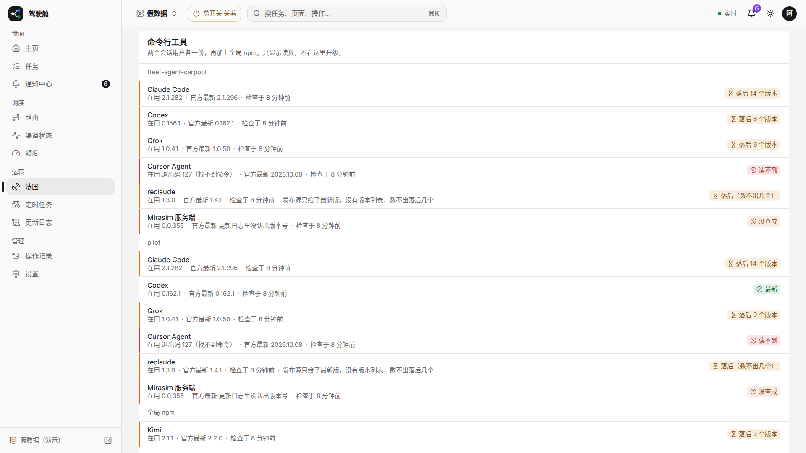
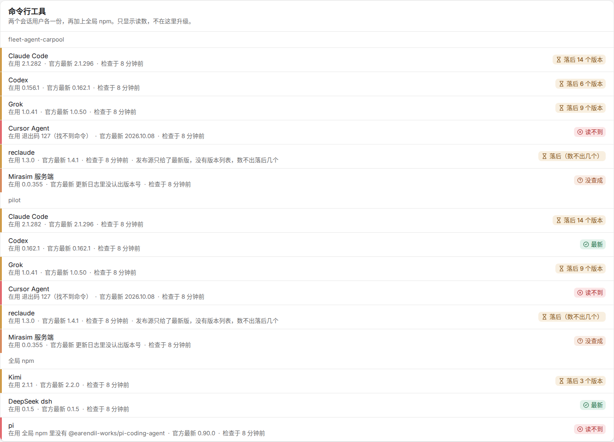
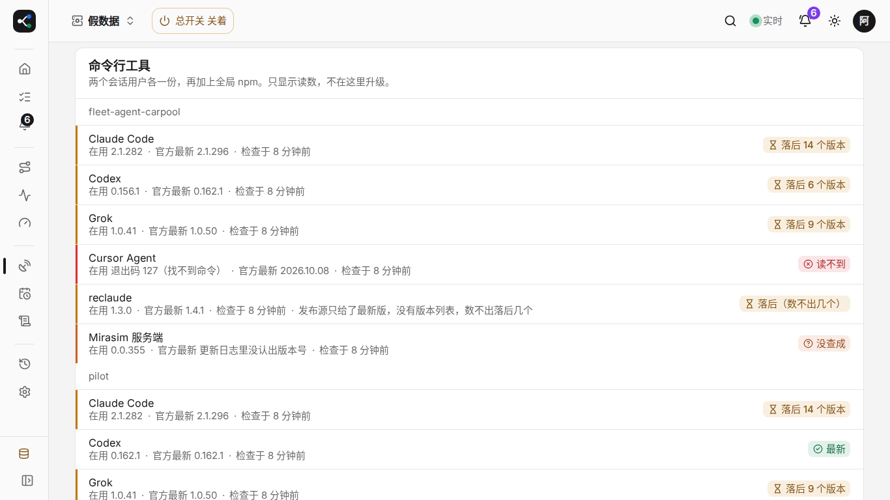
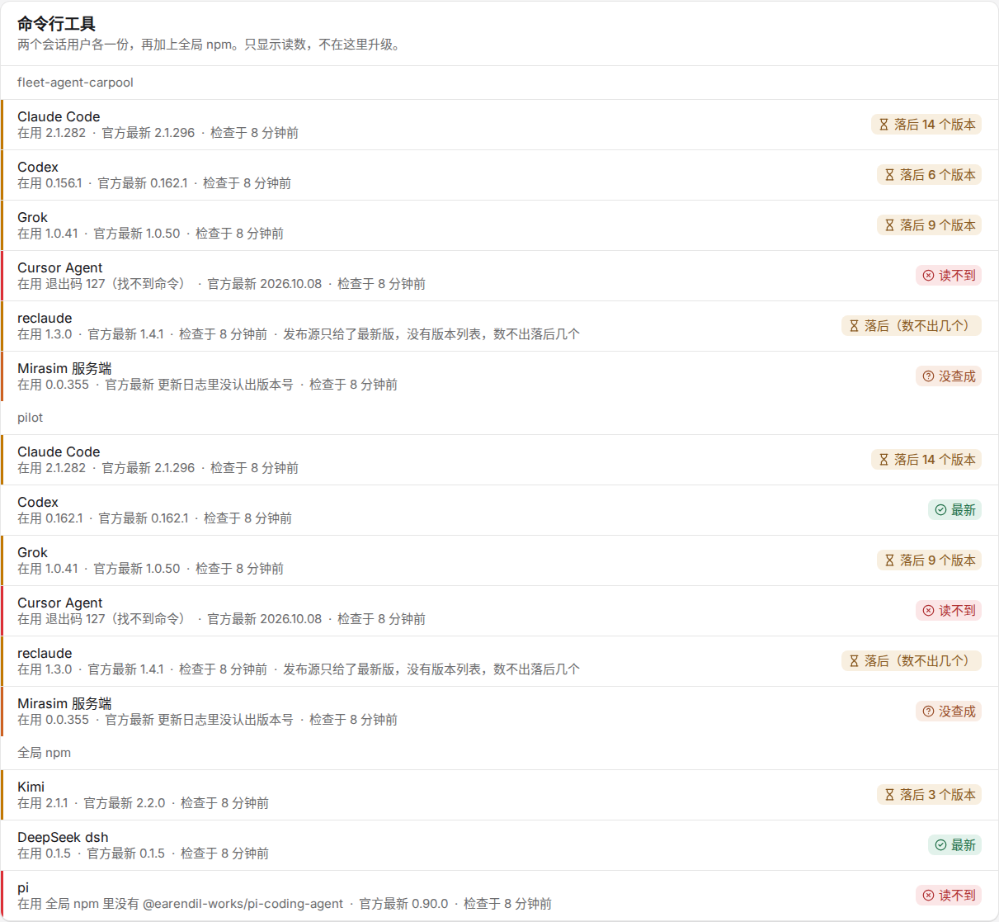

# #1969 法国页「命令行工具」（1366 / 1920）

假数据模式 `/france`。六项事实和定时任务之间加了「命令行工具」：两个会话用户各一份，再加上全局 npm。每行是在用版本、官方最新、状态、检查时间。数字是假的，最新、落后、读不到、没查成都有，不是法国真机读数。这一块没有升级按钮。

视口图是整页滚到这一块。块比 768 高，1366 的视口图裁掉下半，所以另附同一宽度下这一块的整张。

## 1920×1080

## 1366×768

